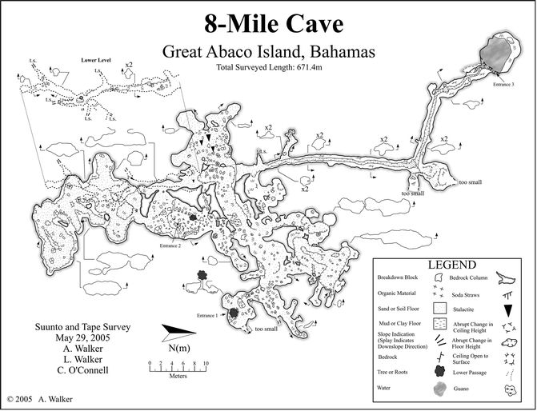

# About

Location estimated from research paper

# Details

## Identification

- **Feature type:** Cave

# References

## Images
- 
- [The_caves_of_Abaco_Island_Bahamas_Keys_to_geologic - 1c91d1eb-8af93162](https://github.com/twosharprocks/Karst-Database/blob/a91711b0be35b53a5de563e070ff13f8b90c3afa/Assets/0fc0e87e855fb7fa5a1f450eace4bdaddddaf8d2a4e697fd8247bfcc1cf9ecb3.pdf)
