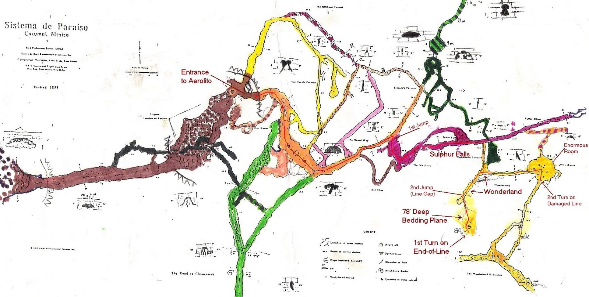
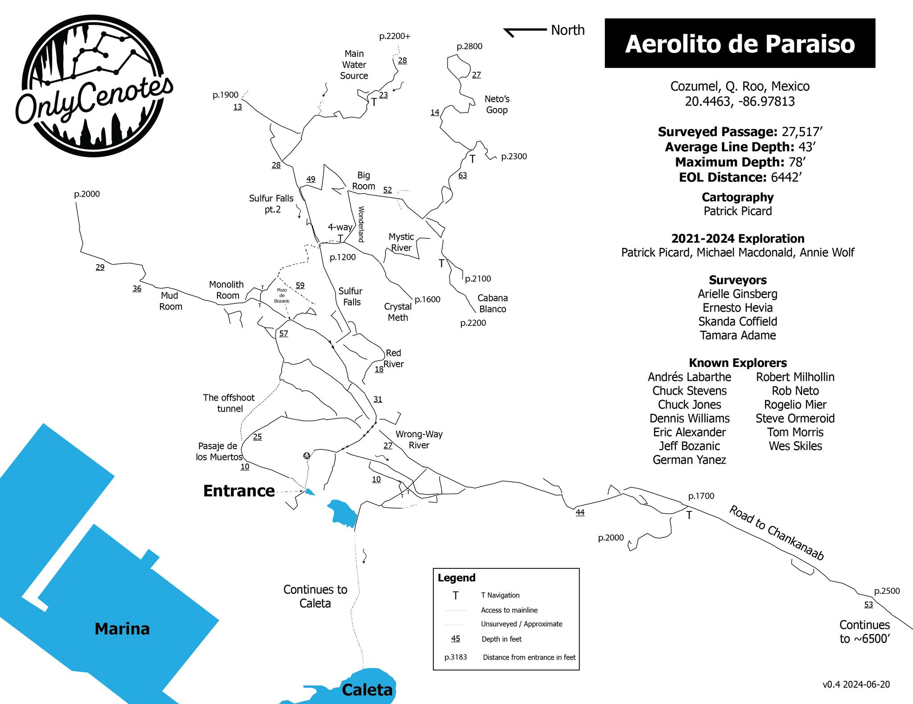
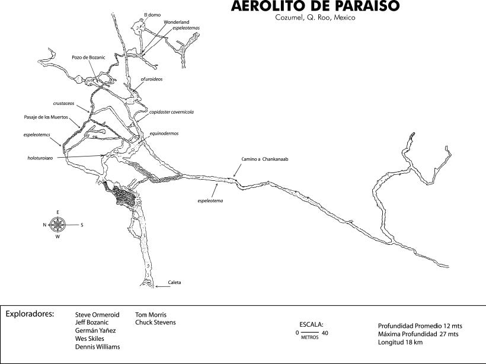

# Details

## Identification

- **Feature type:** Cave

## Cave and exploration data

- **Cave rating:** Cave
- **Highest cave rating:** Advanced
- **Goes to water:** Yes
- **Surveyed length:** 8387 m

## Diving data

- **Maximum depth:** 24 m

# References

## Images
- 
- 
- 
