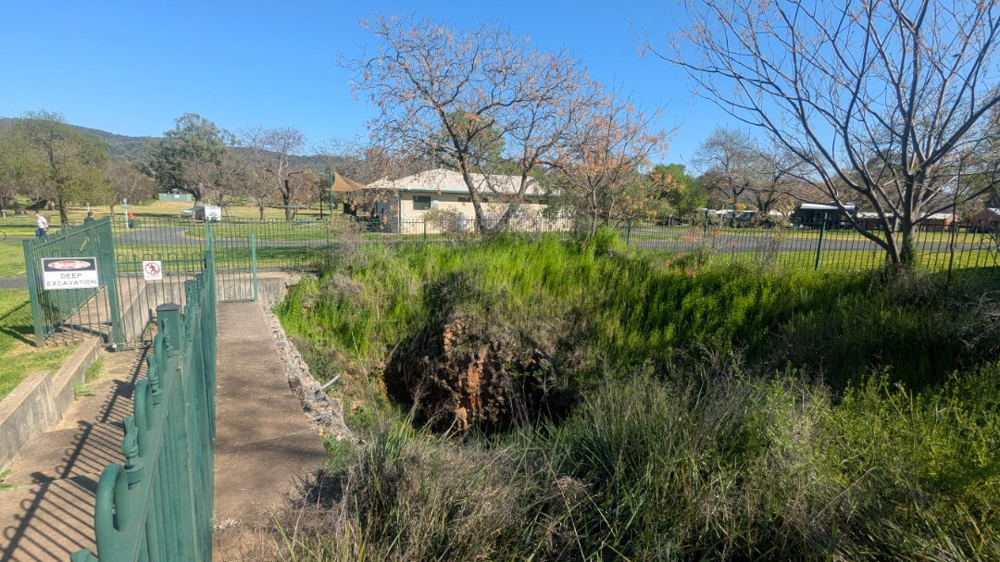
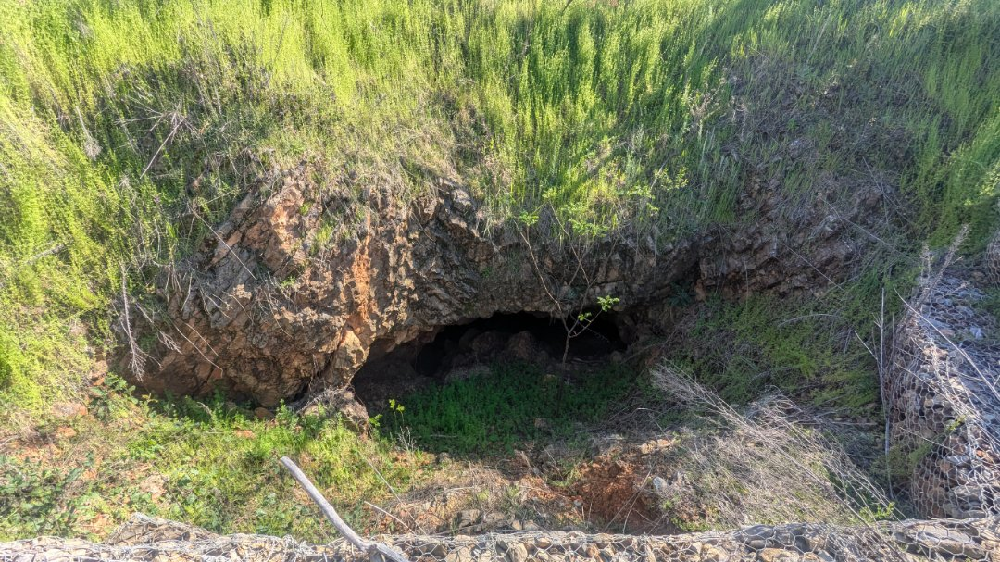
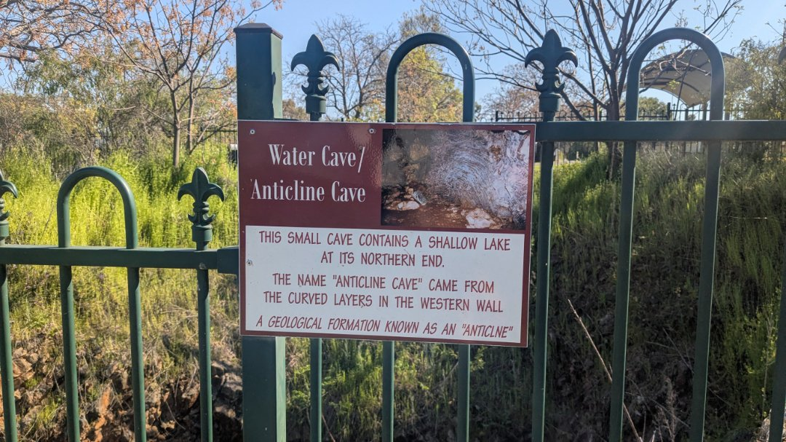

# Details

## Identification

- **Feature type:** Cave

## Cave and exploration data

- **Tourism potential:** Medium
- **Goes to water:** Yes

## Diving data

- **Water type:** Fresh
- **Tidal:** No

## Amenities

- **hasShowers:** Yes
- **hasToilets:** Yes
- **hasPhone:** Yes
- **food:** Ok
- **family:** Ok
- **parking:** Ok

- **Tourism potential:** Medium
- **Disabled access potential:** Low
- **Goes to water:** Yes

# References

## Images
- 
- 
- 

