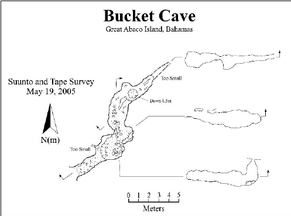

# About

Location estimated from research paper

# Details

## Identification

- **Feature type:** Cave

## Cave and exploration data

- **Exploration potential:** Low

# Maps

- 

# References

## Images
- 
- [The_caves_of_Abaco_Island_Bahamas_Keys_to_geologic - 807e46c8-f2b09c9f](https://github.com/twosharprocks/Karst-Database/blob/a2a4b545b9c4820036e9f530bf202b9f1d5855a5/Assets/0fc0e87e855fb7fa5a1f450eace4bdaddddaf8d2a4e697fd8247bfcc1cf9ecb3.pdf)
