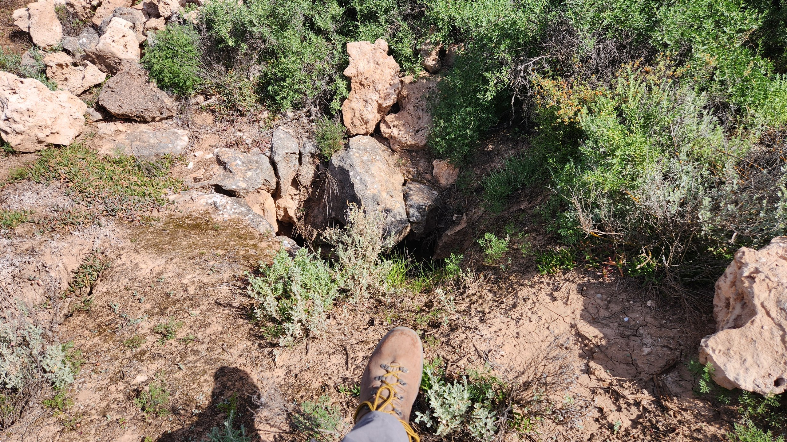
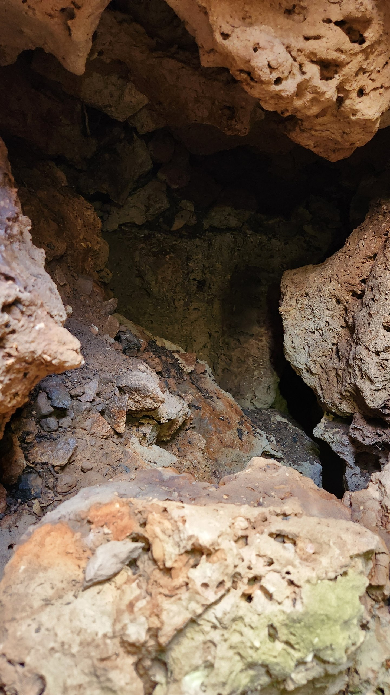
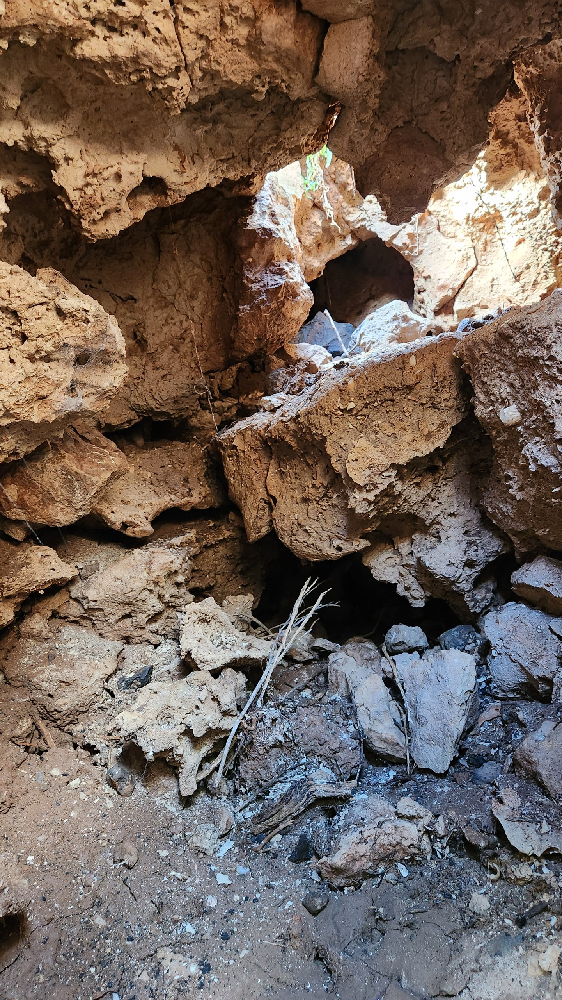
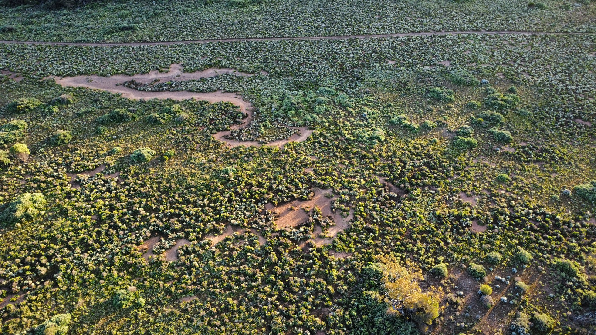
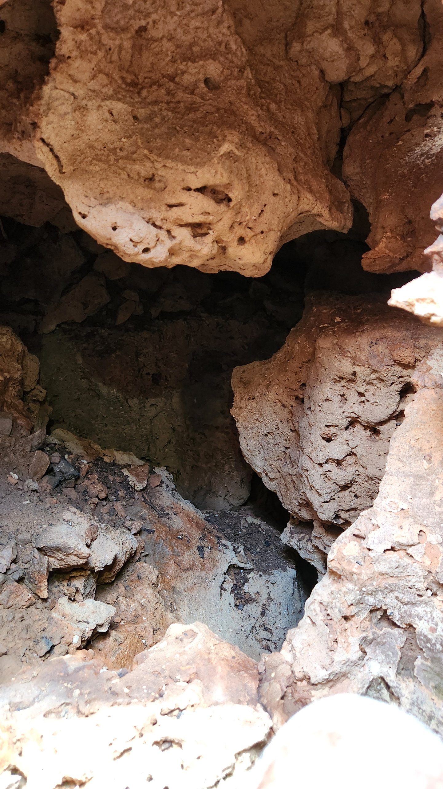
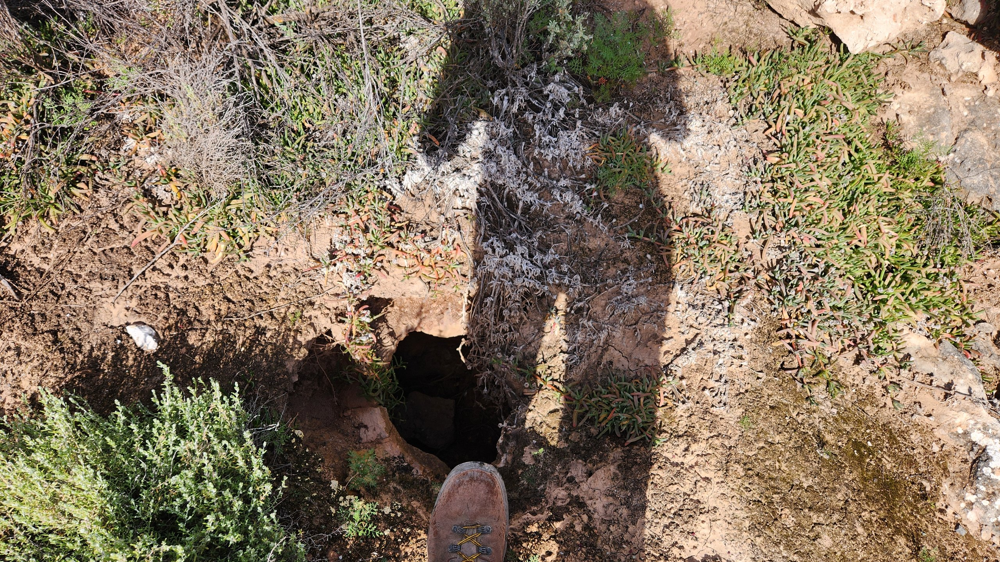
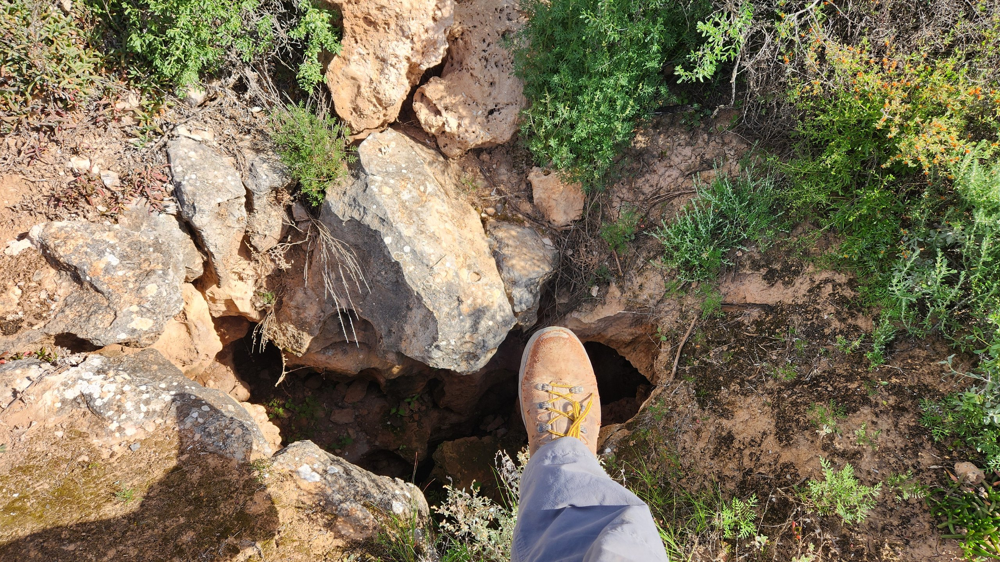

# Details

## Identification

- **Feature type:** RockyOutcrop
- **Reference:** N3959

## Cave and exploration data

- **Vertical access:** No
- **Exploration potential:** Low

# References

- **From RK:** 15mEWx10mNSx1m DEPR with 1m3 drain hole impen

## Images
- 
- 
- 
- 
- 
- 
- 
