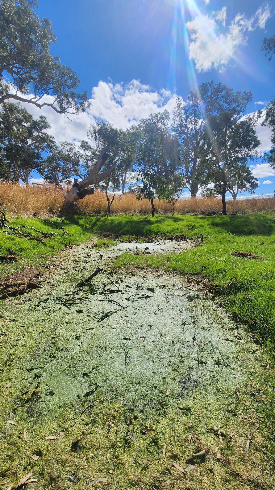
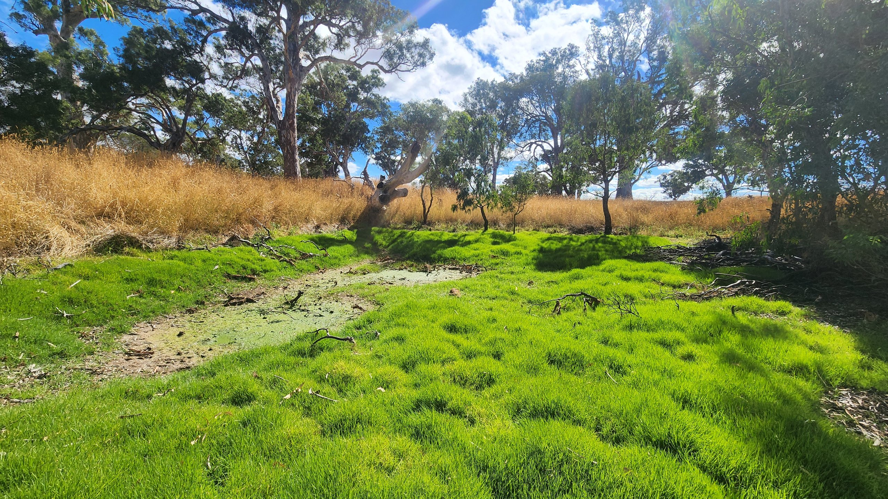
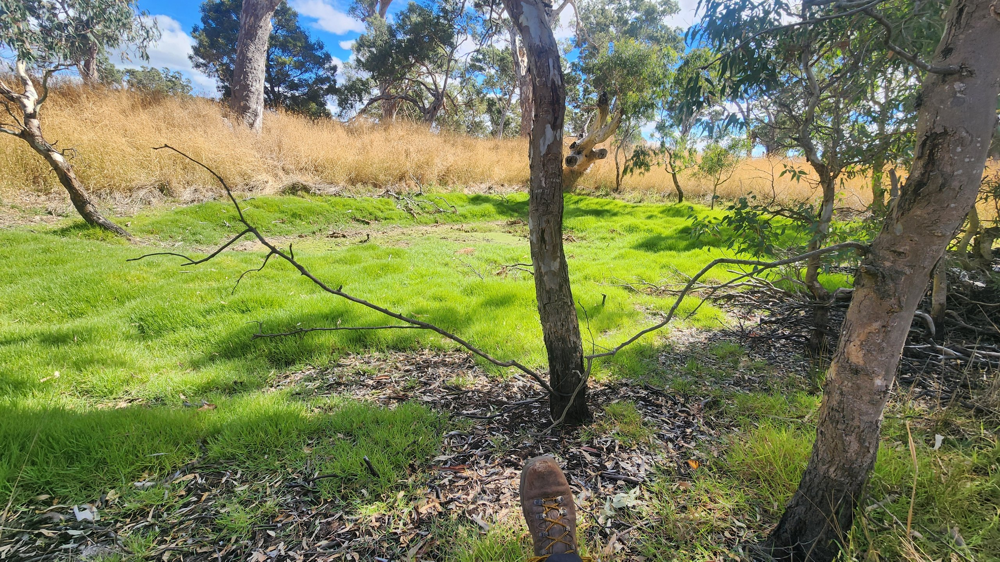

# About

Depression about 30m in diameter with boggy marsh at rhe bottom. No obvious signs of karst or leads.

# Details

## Identification

- **Feature type:** Depression
- **Source:** 7022 - Mt Gambier

## Cave and exploration data

- **Exploration potential:** Low

## Amenities

- **hasShowers:** No
- **hasToilets:** No

# References

## Images
- 
- 
- 
