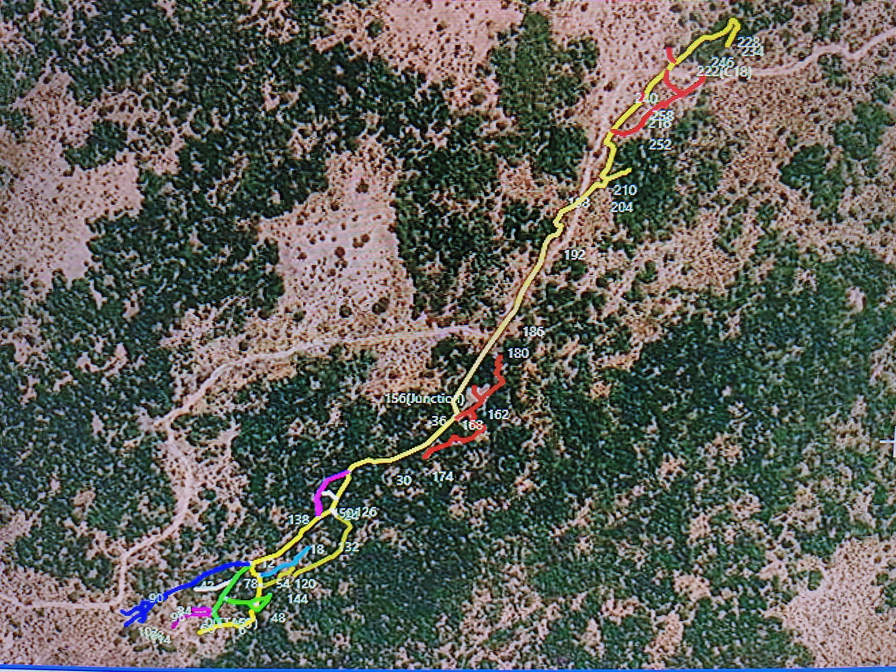
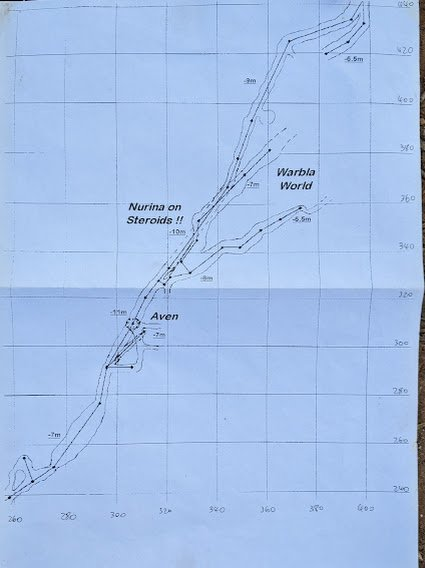
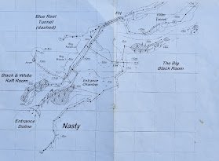
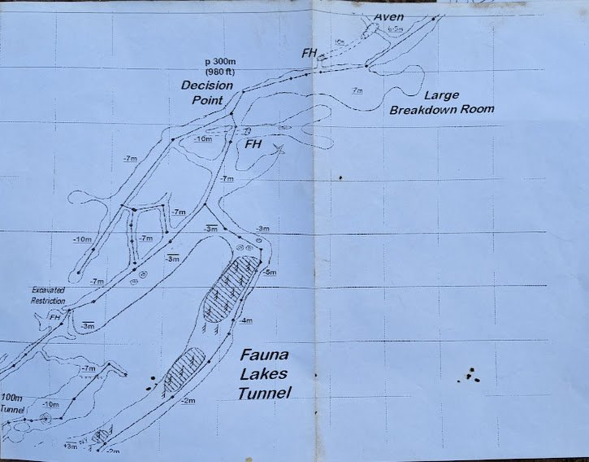
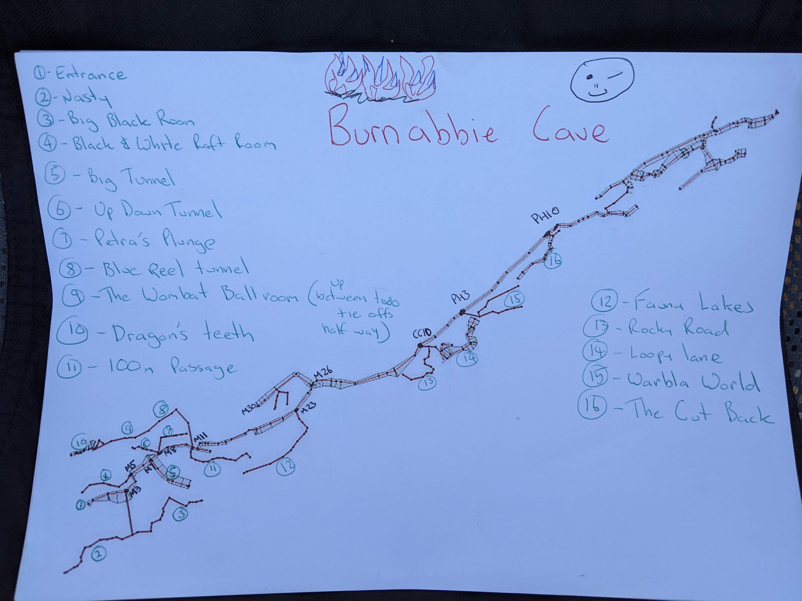
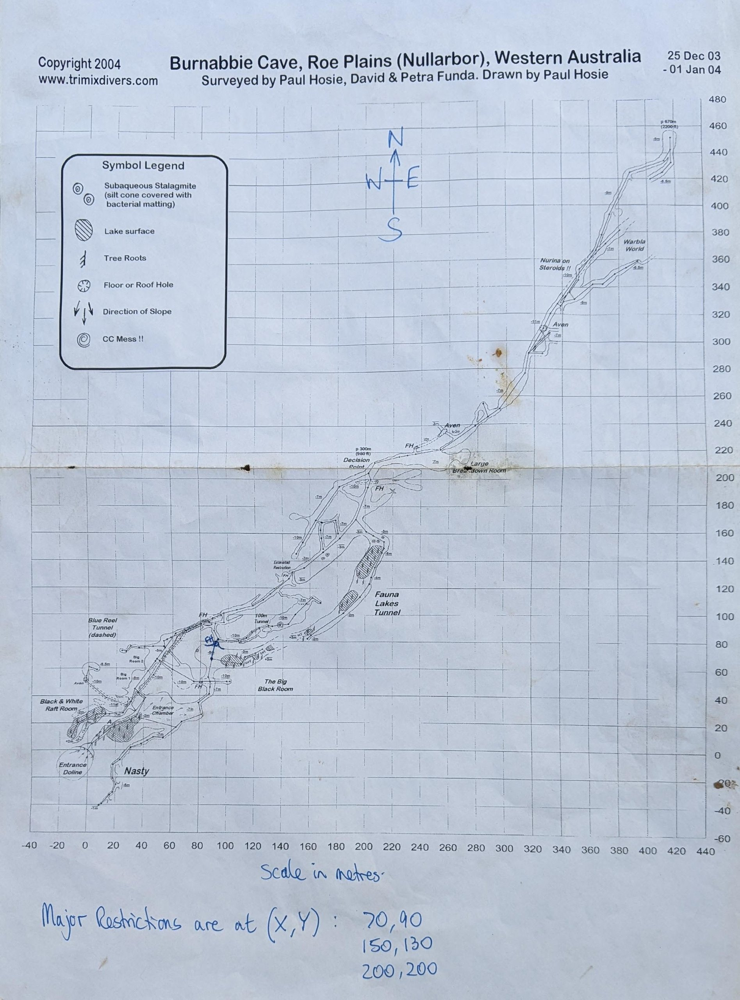
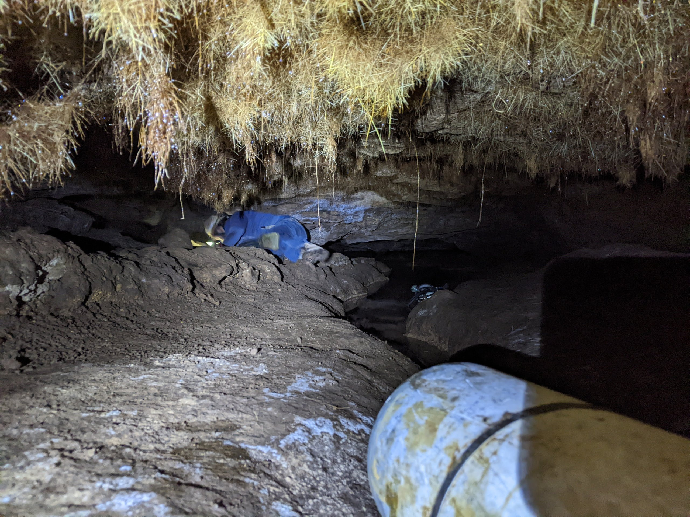

# About

# Details

## Identification

- **Feature type:** Cave

## Cave and exploration data

- **Cave rating:** Advanced
- **Vertical access:** No
- **Exploration potential:** High
- **Goes to water:** Yes

## Diving data

- **Maximum depth:** 14 m
- **Water type:** Salt
- **Tidal:** No

# Maps

- [site - b70bf411-d7500adf](https://github.com/twosharprocks/Karst-Database/blob/d6f539534154fcd23f60d0a25899bf7ef553f1d8/Regions/Oceania/Australia/6N%20-%20Nullabor%20and%20Roe%20Plains/KML_Data/Burnabbie.kml)

# References

## Images
- 
- 
- 
- 
- 
- 
- 
- [bf4d38ab-5488-4c39-866d-d20369375d85](https://www.youtube.com/watch?v=VmfhXZqm2Nc)
- [Burnabbie Map - 996b11bc-d7500adf](https://github.com/twosharprocks/Karst-Database/blob/d6f539534154fcd23f60d0a25899bf7ef553f1d8/Assets/a9aadc76fd6fe38ce07c6574413a3c2fa7b2c30f7010af45e5fe0b55a5138441.pdf)
