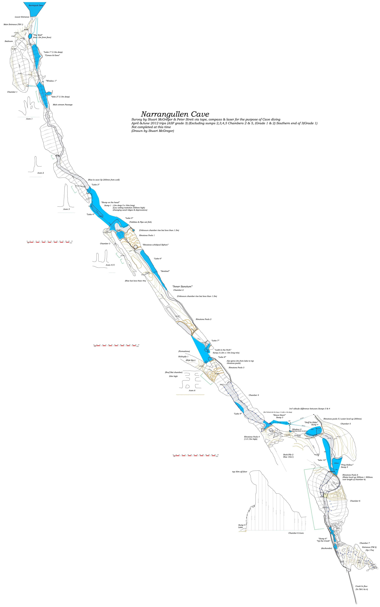
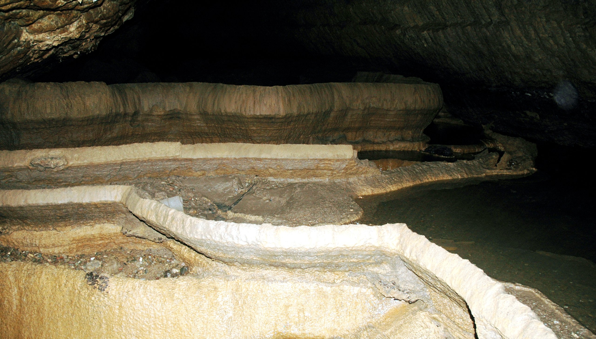
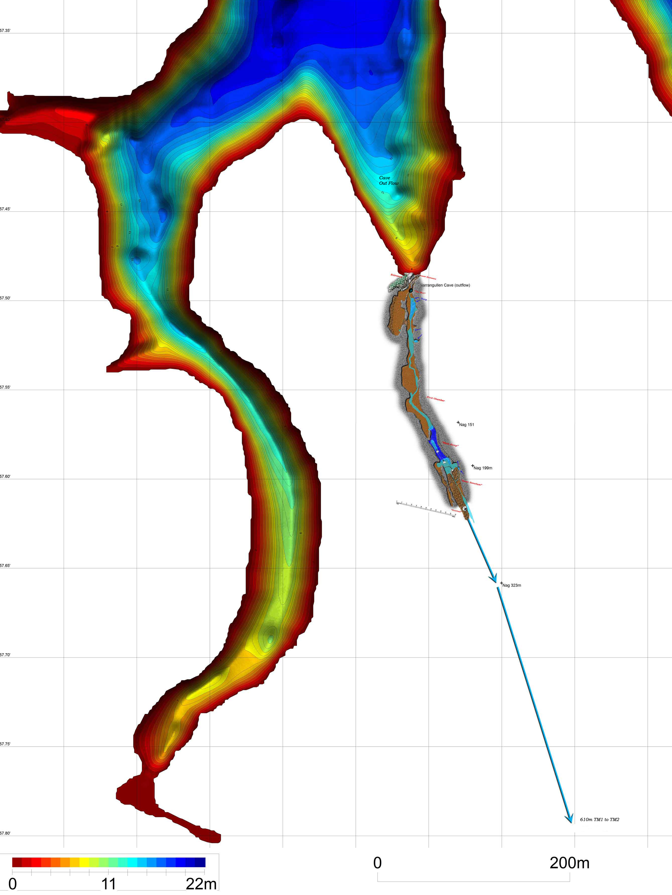
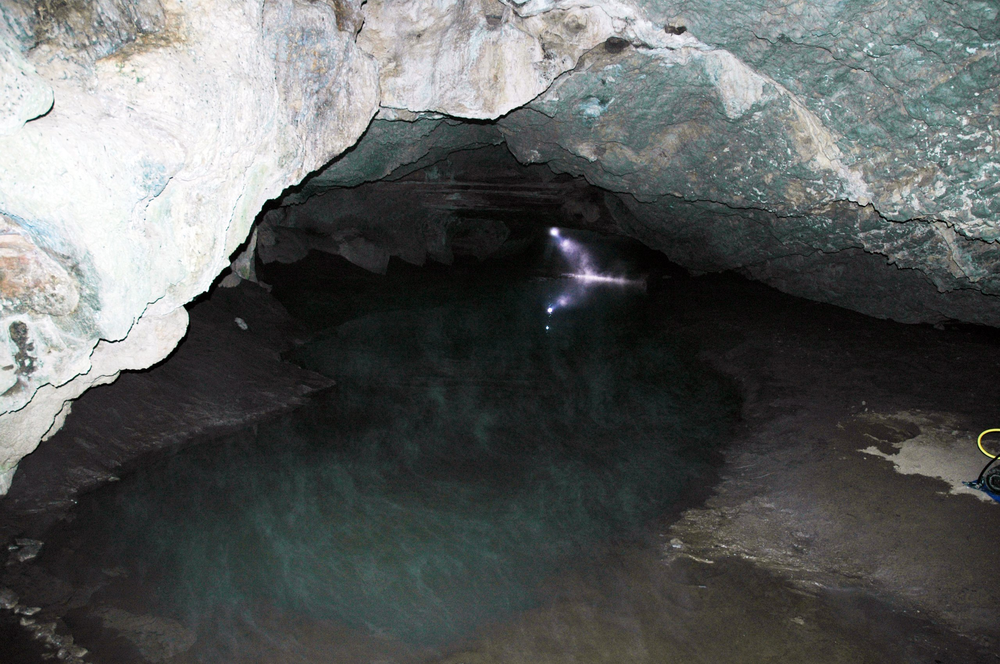
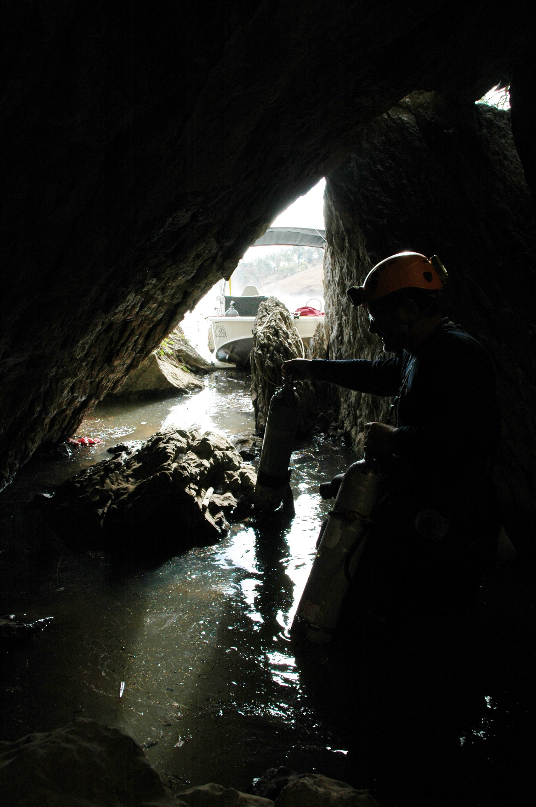
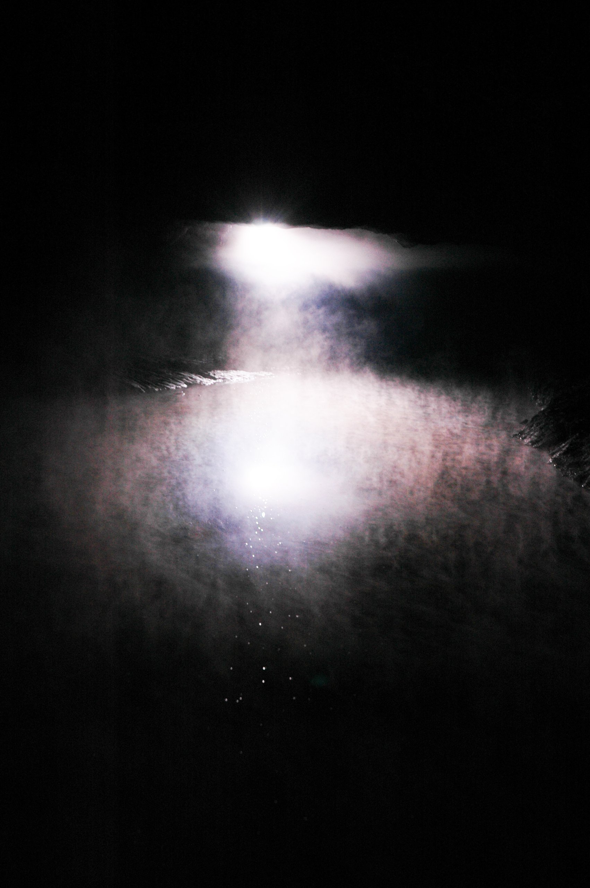

# About

Burrinjuck Dam is a gated, concrete-walled hydro-electric gravity dam at Burrinjuck, in the South West Slopes region of New South Wales, Australia. It has three spillways across the Murrumbidgee River and forms an impounded reservoir called Lake Burrinjuck. In addition to electricity generation, Burrinjuck Dam is used for purposes including flood mitigation, irrigation, water supply and conservation. Also known as Barren Jack Dam and Barrenjack, it was added to the New South Wales State Heritage Register on 2 April 1999.

# Details

## Identification

- **Feature type:** Sinkhole

## Cave and exploration data

- **Cave rating:** Basic
- **Highest cave rating:** Advanced
- **Vertical access:** No
- **Exploration potential:** Low
- **Tourism potential:** Medium
- **Goes to water:** Yes

## Diving data

- **Maximum depth:** 22 m
- **Water type:** Fresh
- **Tidal:** No
- **Temperature:** 12–20 °C
- **Difficulty:** Hard
- **Entry difficulty:** Hard
- **Entry type:** Boat

## Amenities

- **hasShowers:** No
- **hasToilets:** No

# Maps

- 

# References

## Images
- 
- 
- 
- 
- 
- 
- [Burrinjuck 2 - 092c379a-6a69b9c0](https://github.com/twosharprocks/Karst-Database/blob/d6f539534154fcd23f60d0a25899bf7ef553f1d8/Assets/35450c4fc6f00b77f4d3aeccf2e2e36bb8307f2e071b6ab66f109d9be596c3ce.pdf)
