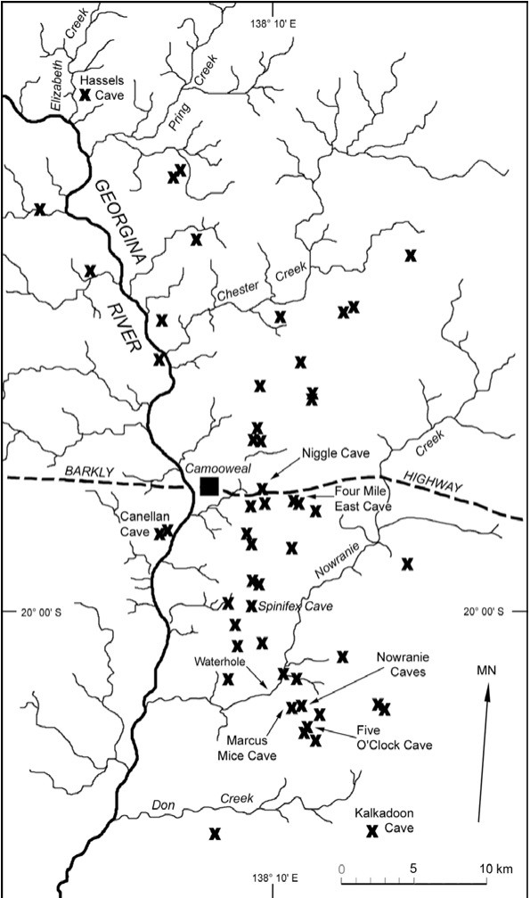
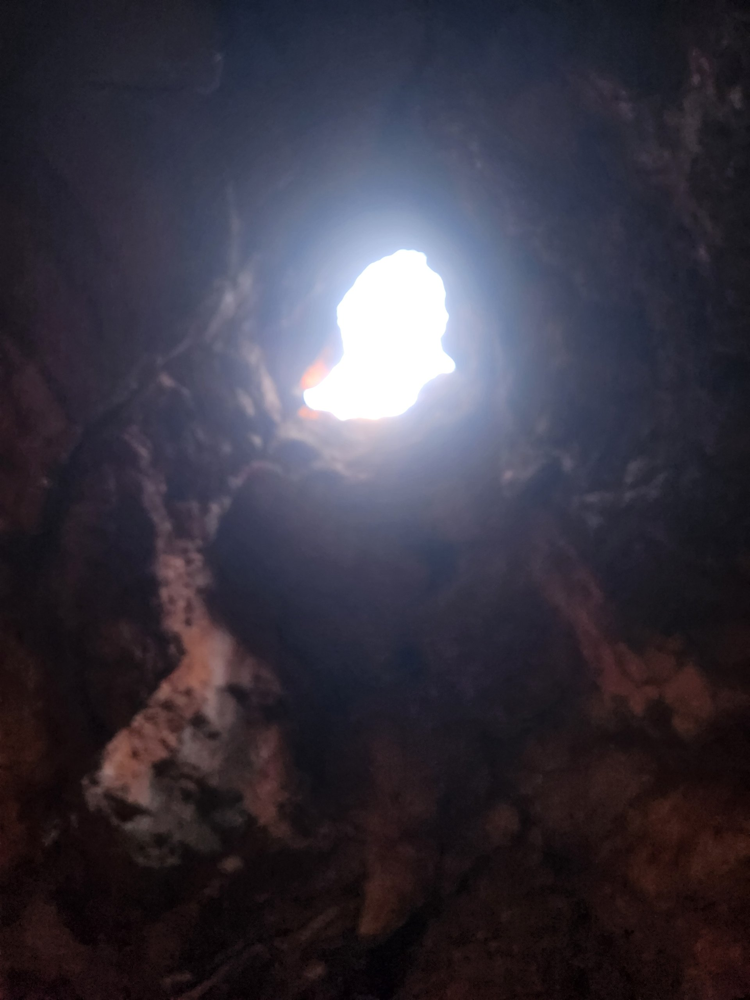

# Details

## Identification

- **Feature type:** Cave

## Cave and exploration data

- **Cave rating:** Advanced
- **Vertical access:** Yes
- **Exploration potential:** High
- **Goes to water:** Yes

# References

## Images
- 
- 
