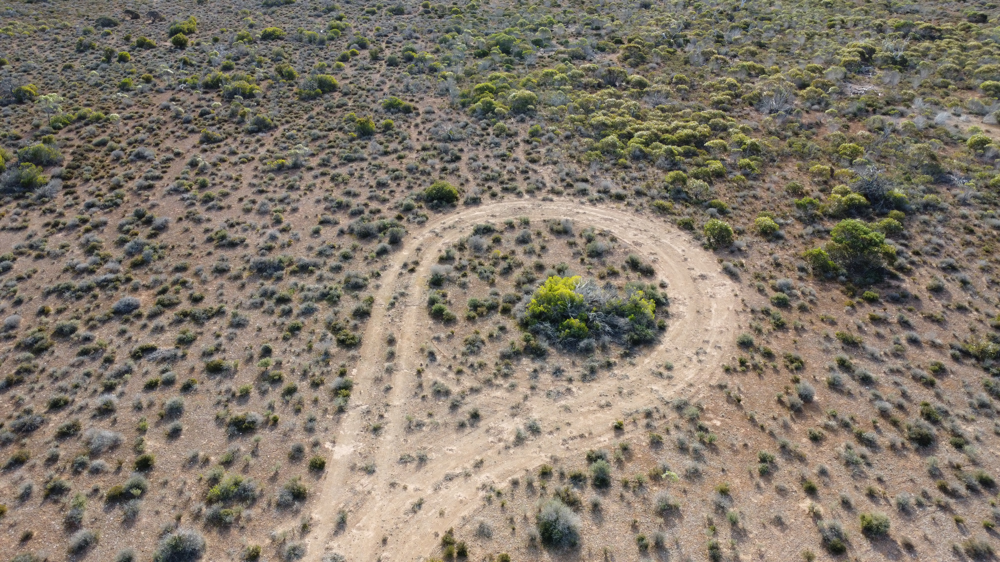
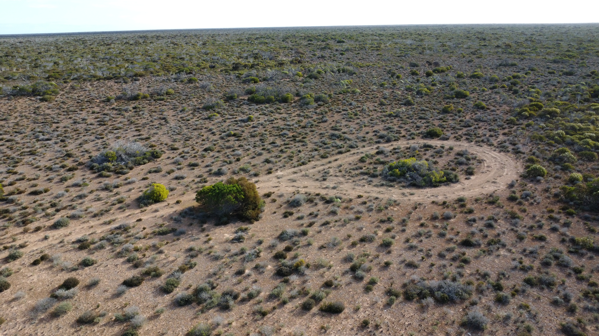
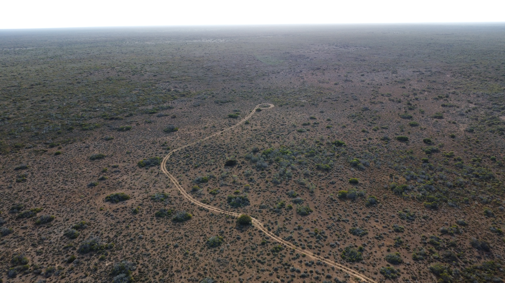
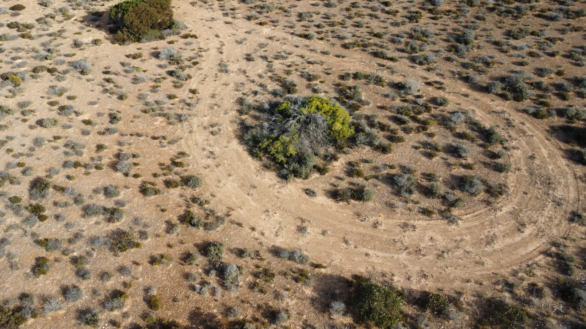

# About

Checked on 2024-07 by MW 
Campsite mismarked as cave

# Details

## Identification

- **Feature type:** Campsite

## Cave and exploration data

- **Vertical access:** No
- **Goes to water:** No

## Amenities

- **hasShowers:** No
- **hasToilets:** No
- **hasPhone:** No
- **family:** Bad
- **parking:** Outstanding

# References

## Images
- 
- 
- 
- 
