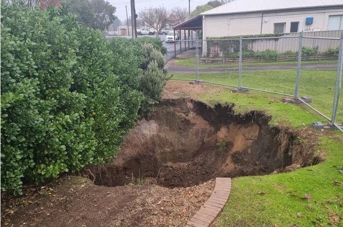

# About
Multiple reports from K. Mott (CEGSA) of regular collapse. The caravan park sinkhole has been backfilled previously, before collapsing again. "There were 5 tonnes of rocks in there before, and they've gone down the hole, and then the council cemented the top and that's gone down the hole as well," Mr Paltridge said.

## Images
- 
# References
- [Mount Gambier Central Caravan Park - Google Maps](https://maps.app.goo.gl/t5ZPY2Y3RRg1EGao7)
- **ABC:** https://www.abc.net.au/news/2023-06-30/mount-gambier-caravan-park-wants-risk-mapping-as-sinkhole-grows/102541238
