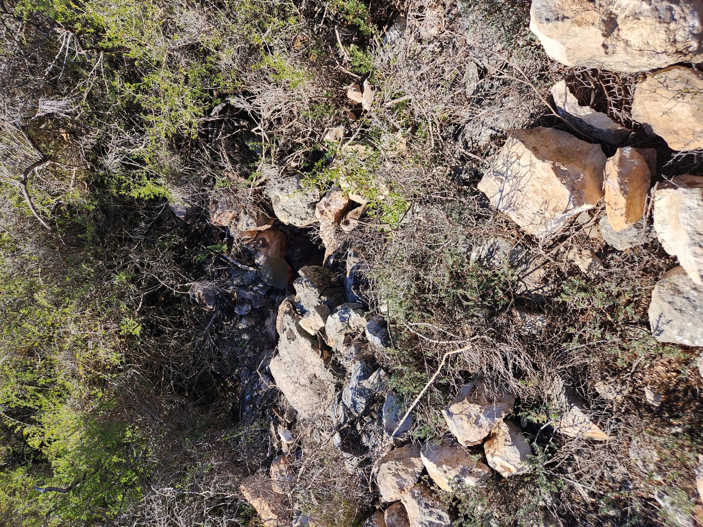
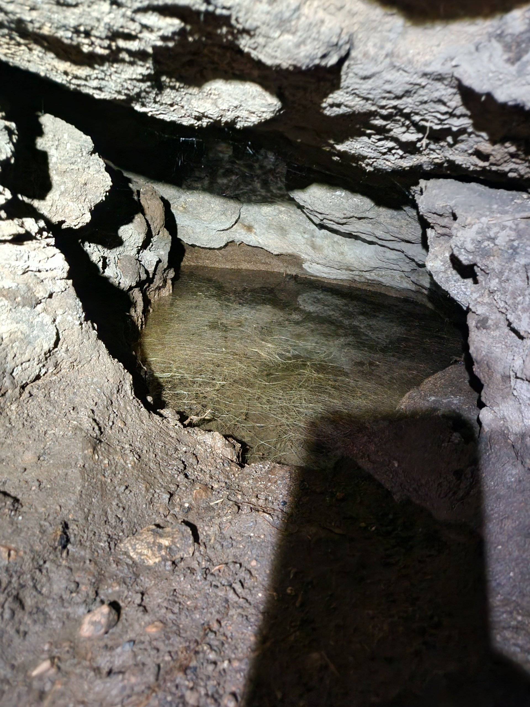
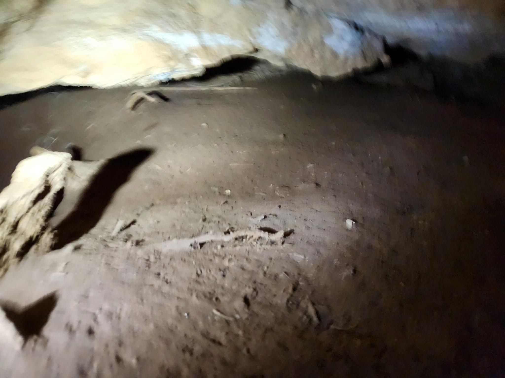
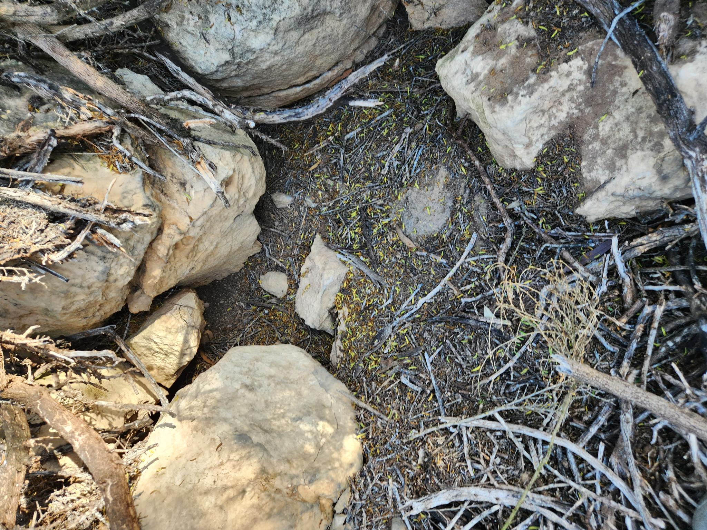
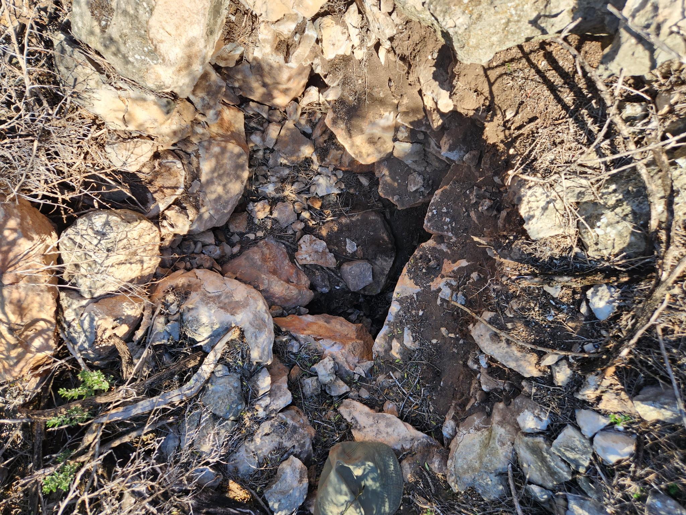

# About

BC and MW (27/5/2023). Goes to water, has a pool at end of moderate hard dry entry. Needs work to open up entry to pool. Very flat multiple flatteners leading to water. Very tight, very hard to get anything to the water. Just no.

# Details

## Identification

- **Feature type:** Cave
- **Reference:** N2785

## Cave and exploration data

- **Vertical access:** No
- **Exploration potential:** High
- **Tourism potential:** Low
- **Goes to water:** Yes

## Diving data

- **Water type:** Salt
- **Tidal:** No

# Maps

- [cave_snorkel_road - 1270675c-f213129a](https://github.com/twosharprocks/Karst-Database/blob/d6f539534154fcd23f60d0a25899bf7ef553f1d8/Assets/8fc5e3f71de478d207032921bb9308d2c79c583a3322702c0880dac5e282fba1.kml)

# References

- **From RK:** 20m diameter x 2m deep DOL with karst wall on STH side with small hole ENT at co-ords. Down 3m under ledge into small LF room with easy potential dig to continue down. Good signs.
was Paul D feature XP1306

## Images
- 
- 
- 
- 
- 
