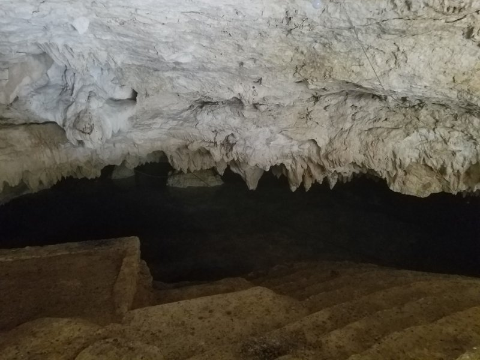
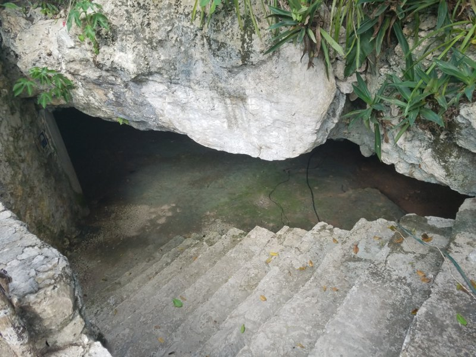
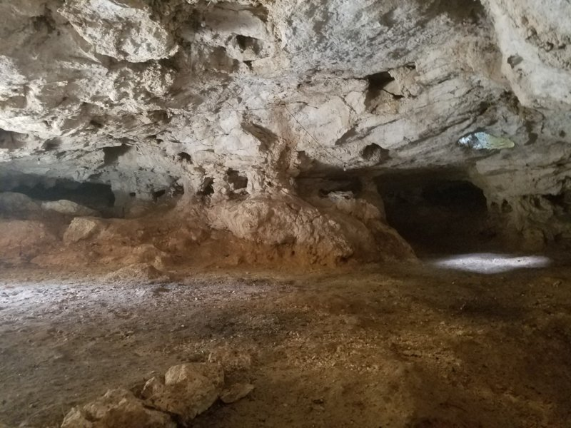

# About

From [https://issuu.com](https://issuu.com/perfectdiver/docs/pd_2_ang/s/67520)

Xulo is one of four cenotes of the Caterpillar Cave System and was discovered about seven years ago. The system is considered small by Mexican standards, although as many as 13,500 meters of its passages have been explored and surveyed so far.

The magic really begins after a few steps down when kneeling in the shallow, pristine water surrounded by pure white stalactites. After going head down, a short way, you enter the first clear, large and delicate room, full of speleothems. It resembles the interior of a cathedral. Continuing, you reach the second section, where the sulphur has left layers of yellow and black marks on the cave formations. Submerged roots have invaded the gas pocket that leads to the first minor restriction. The reward awaits you on the other side, where you will find a gigantic room haunted by what could be named after Giacometti’s sculpture “Walking Men”.

The route then splits into two very contrasting passages. The first deeper one leads to a 27 meters long channel, where we can observe a total change of scenery. Speleothems made of unsteady white limestone seem to be skeletons.

# Details

## Identification

- **Feature type:** Cave
- **System name:** Catapillar Cave System

## Cave and exploration data

- **Cave rating:** Cave
- **Highest cave rating:** Advanced
- **Vertical access:** No
- **Goes to water:** Yes

## Diving data

- **Maximum depth:** 27 m
- **Water type:** Fresh
- **Tidal:** No

# References

## Images
- 
- [Cenote Xulo - Image 05](https://github.com/twosharprocks/Karst-Database/blob/d6f539534154fcd23f60d0a25899bf7ef553f1d8/Assets/3befe44e34bf36507cd8393696e6df27d9a8bb41c3ca1f9678a43b31626efd44.webp)
- 
- [Cenote Xulo - Image 04](https://github.com/twosharprocks/Karst-Database/blob/d6f539534154fcd23f60d0a25899bf7ef553f1d8/Assets/36c62289411e14bbca835b08f1fbb6dc1826c43344c0d509ad8d64c95665cab7.webp)
- [Cenote Xulo - Image 06](https://github.com/twosharprocks/Karst-Database/blob/d6f539534154fcd23f60d0a25899bf7ef553f1d8/Assets/eccf002fc7496cbf8b071f43c48df2792891be83fbf911ce1d288343ee0c78f6.webp)
- 
- [7bcace11-d217-4760-8296-7965f30e5ed4](https://www.youtube.com/watch?v=y5ijxFe25YE)
