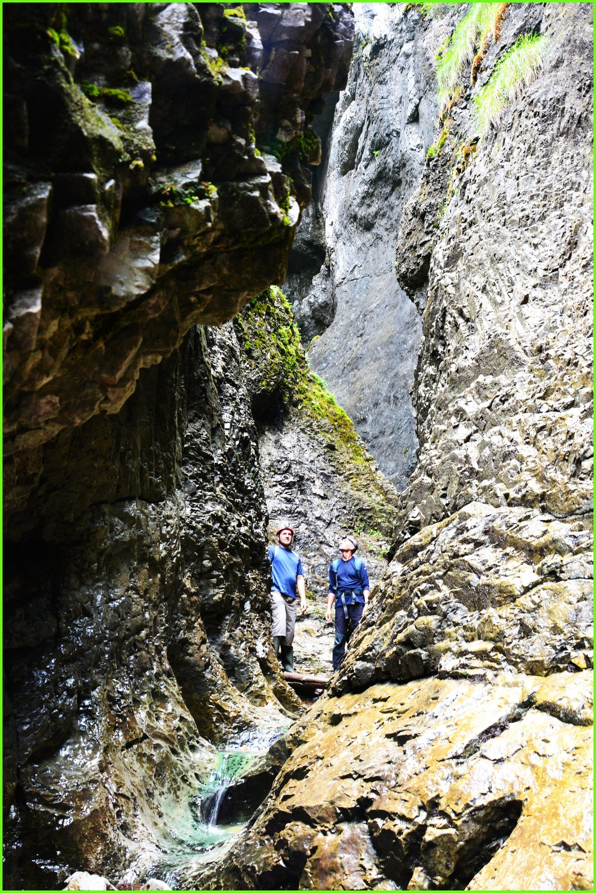
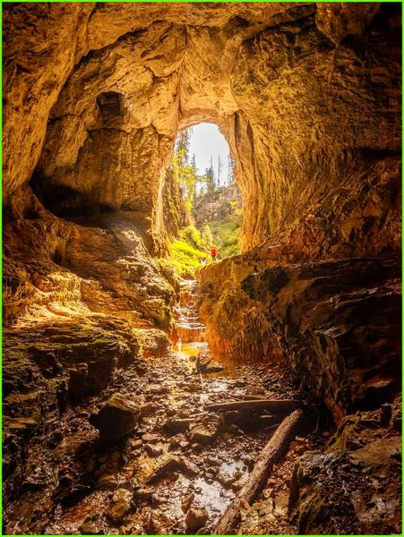

# Details

## Identification

- **Feature type:** Cave
- **Source:** Facebook

## Cave and exploration data

- **Vertical access:** Yes
- **Exploration potential:** Medium
- **Tourism potential:** Low
- **Goes to water:** Yes

## Diving data

- **Water type:** Fresh
- **Tidal:** No

# References

- **Facebook:** https://www.facebook.com/groups/caversgroup/permalink/10160212096053639/
- **Google Maps:** https://maps.app.goo.gl/ArpEeC2uKKVZ4YkaA

## Images
- 
- 
