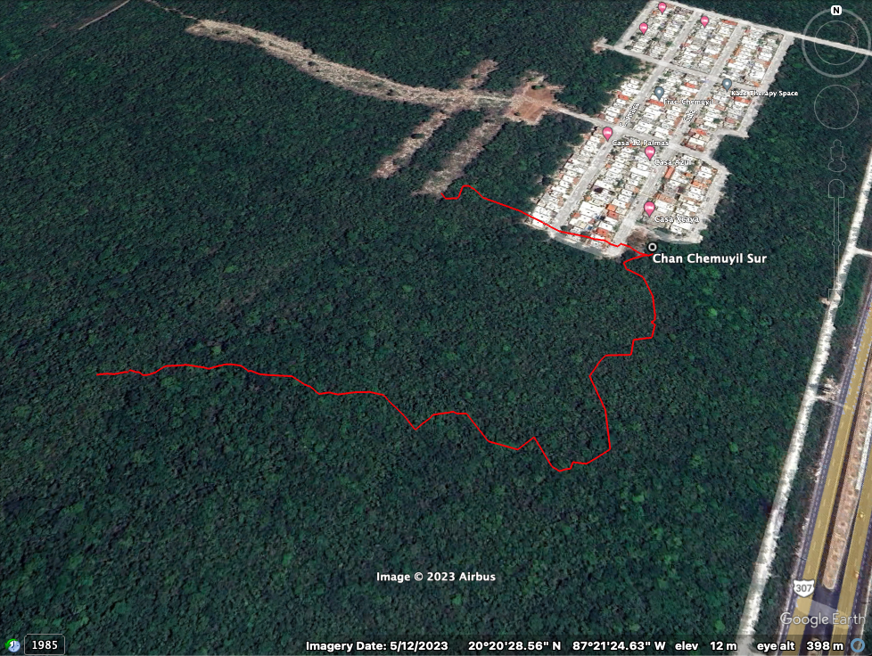

# Details

## Identification

- **Feature type:** Cave

## Cave and exploration data

- **Cave rating:** Cave
- **Vertical access:** No
- **Exploration potential:** Low
- **Tourism potential:** Low
- **Disabled access potential:** Low
- **Goes to water:** Yes

# Maps

- [Chan Chemuyil Sur 2 - 1a5782eb-d3e25240](https://github.com/twosharprocks/Karst-Database/blob/a91711b0be35b53a5de563e070ff13f8b90c3afa/Assets/cdb1e3aa6558e97785e343043b6696046fa5e4a5cb346def0a5eef9f8ffebe2b.kml)

# References

## Images
- 
