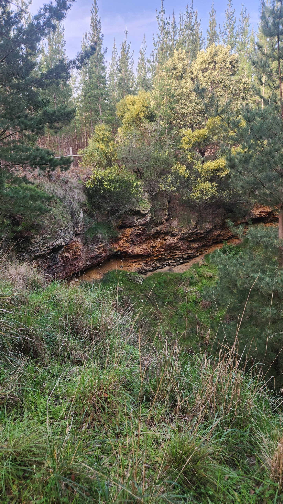
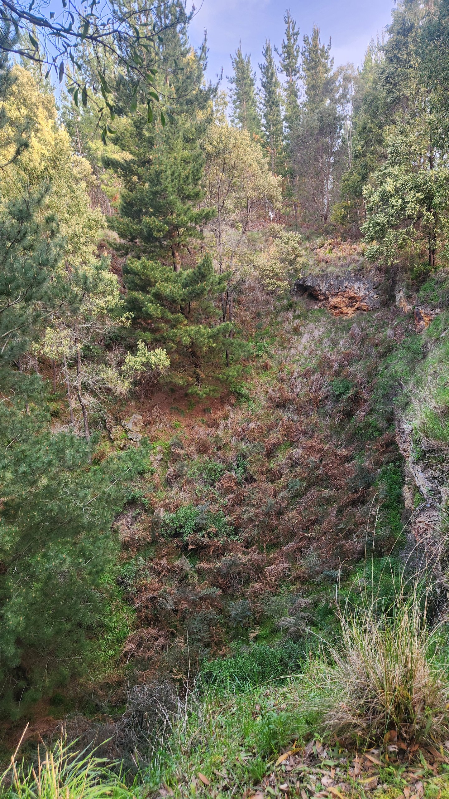
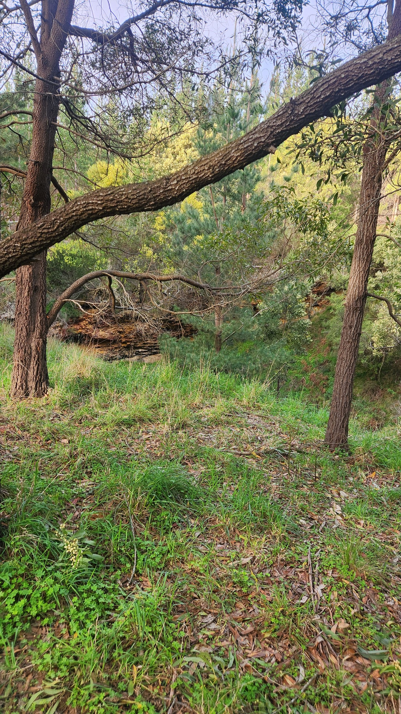
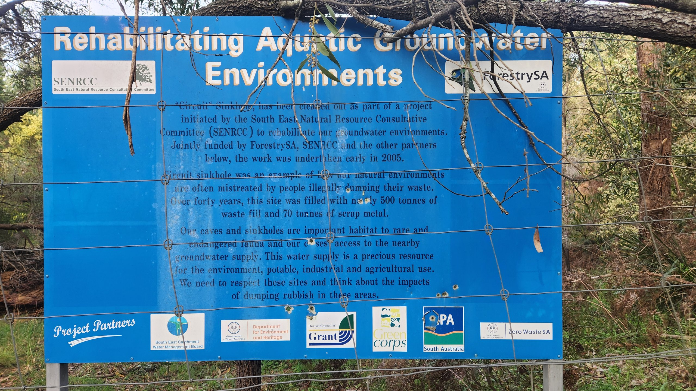
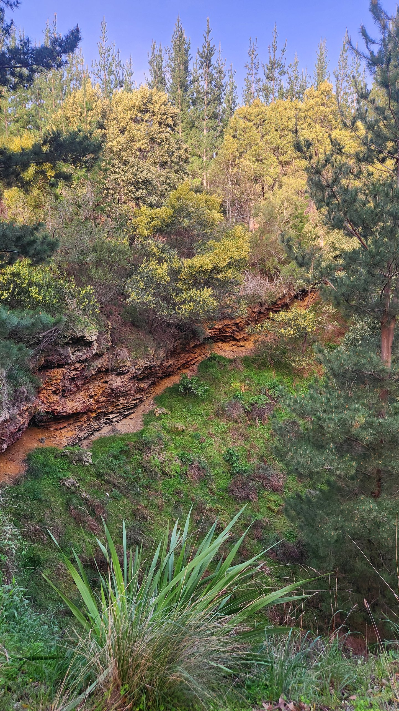
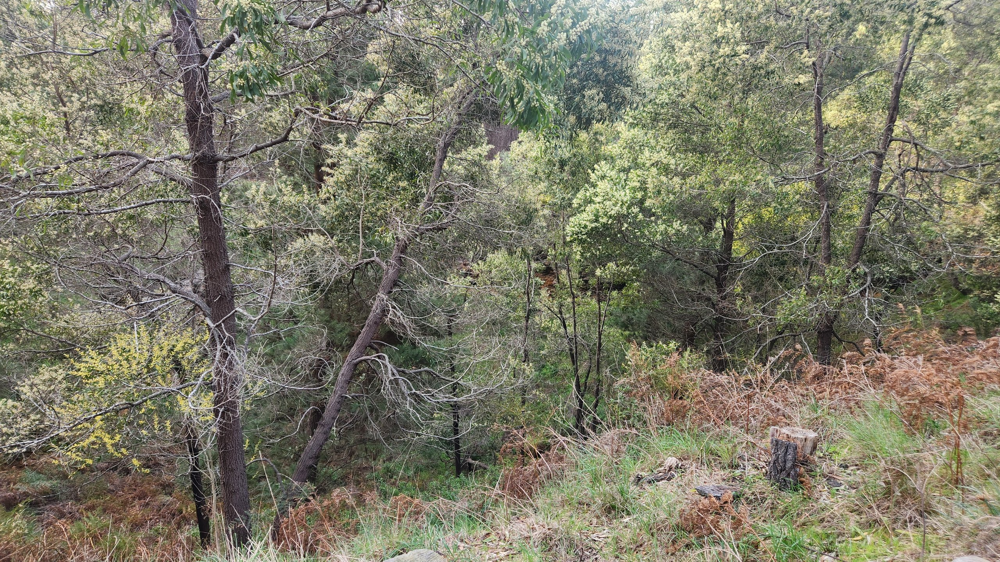

# Details

## Identification

- **Feature type:** Sinkhole
- **Reference:** L0136
- **Source:** Forestry SA

## Cave and exploration data

- **Exploration potential:** Medium

## Access and warnings

Forestry

# References

- **LSECR:** Page 270
- **Forestry SA:** L0136, Thin Roof: N, Fence: R. Dimensions: 45m x 12m deep. Features: Cave formed circuit with others fencing to stop rubbish dumping

## Images
- 
- 
- 
- 
- 
- 
