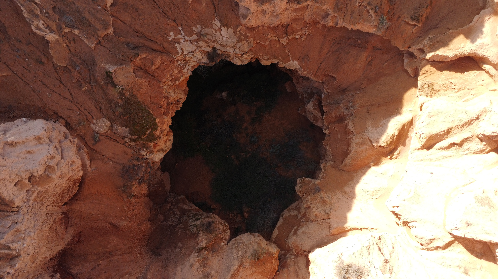
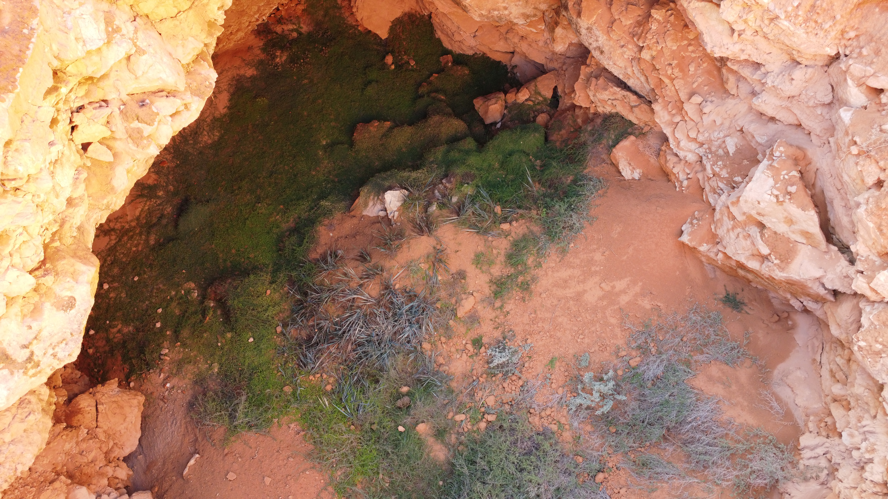
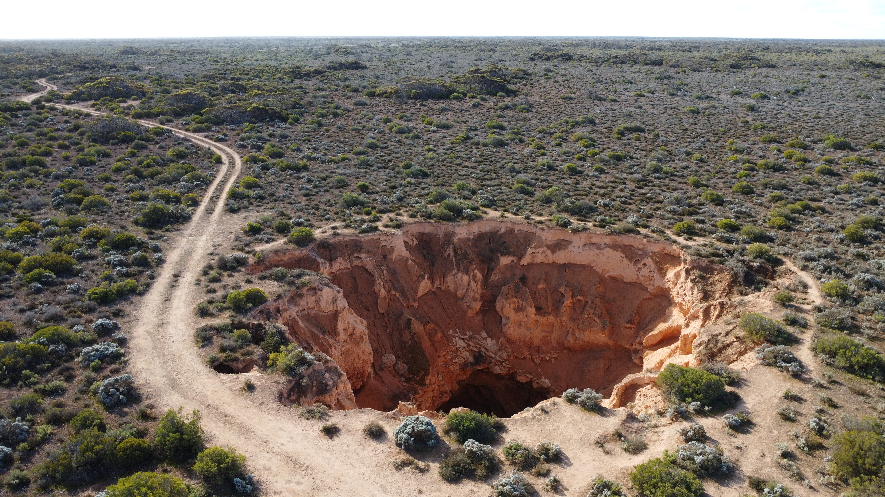

# About

Checked 2024-07 by MW 
Soft walled sinkhole with vegetation in Northern side
DRONE PHOTOS TBA

# Details

## Identification

- **Feature type:** Cave

## Cave and exploration data

- **Vertical access:** Yes
- **Tourism potential:** Low

## Amenities

- **hasShowers:** No
- **hasToilets:** No

# References

## Images
- 
- 
- 
