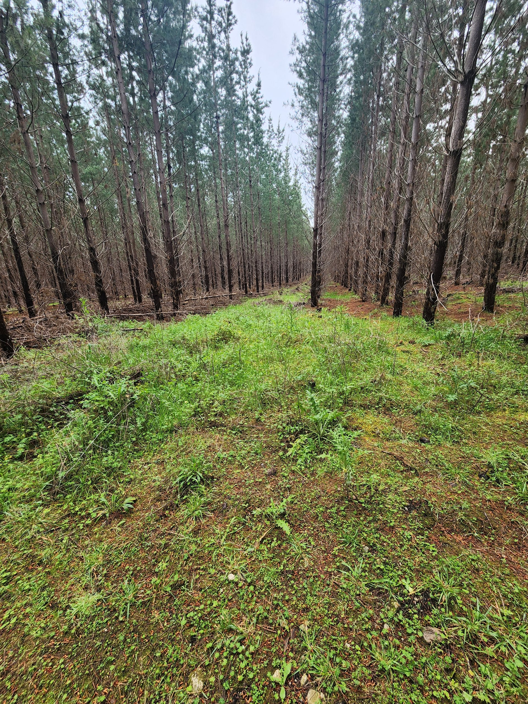

# About

2021-Aug: MW visited on foot, no obvious karst.

# Details

## Identification

- **Feature type:** NotFound

## Cave and exploration data

- **Vertical access:** No
- **Goes to water:** No

# References

## Images
- 
