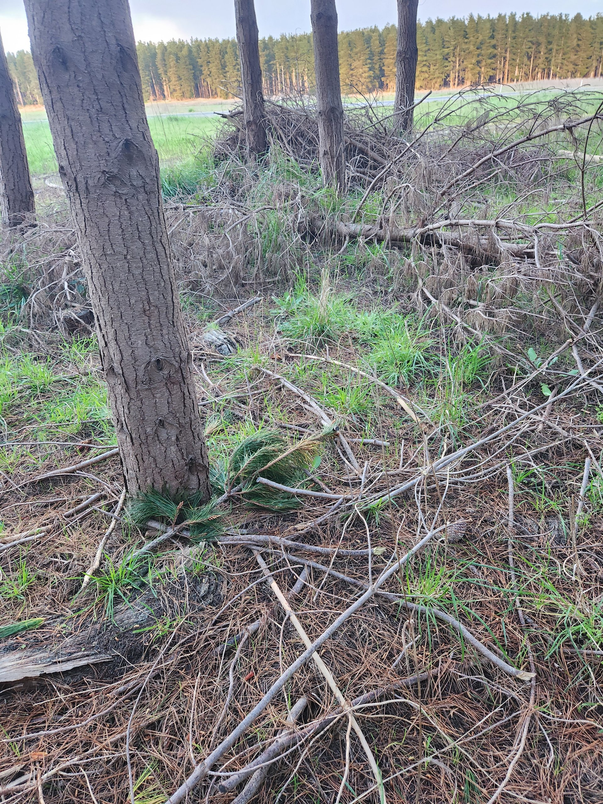
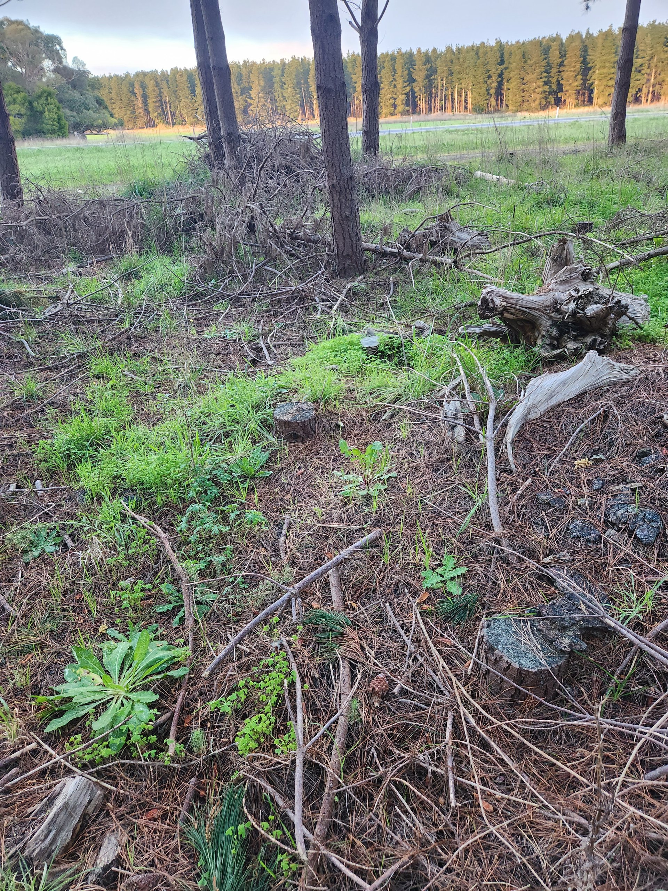

# About

2021-Jan: MW walked around forest checking clear spots identified from satellite imagery. Small depression found (dig?)

# Details

## Identification

- **Feature type:** Depression

## Cave and exploration data

- **Vertical access:** No
- **Exploration potential:** Low
- **Goes to water:** No

# References

## Images
- 
- 
