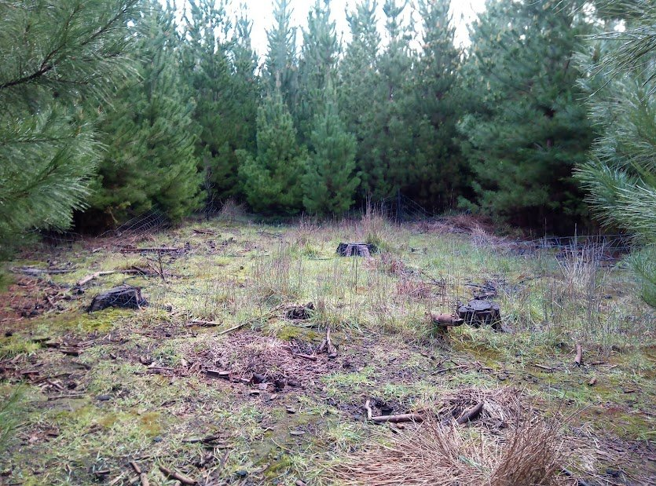
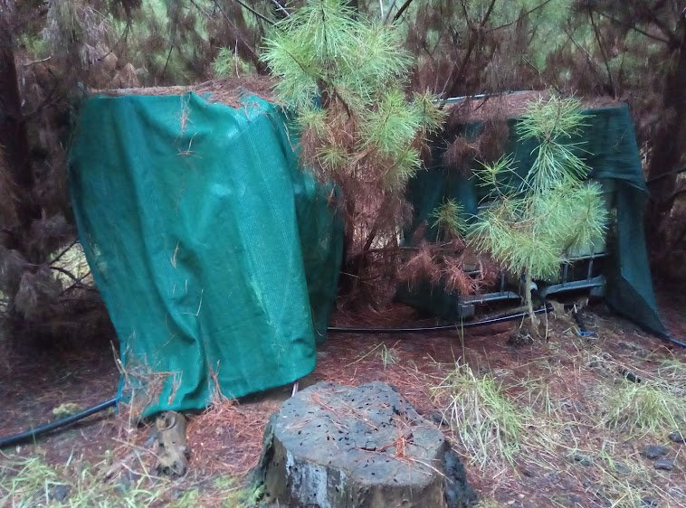

# About

2021-July: MW visited on foot & photographed. Very unusual clearing with a fence around the it in the middle of the forest. Visited in near darkness, return required to figure out what's going on.

2021-Aug: MW revisited on foot & photographed. Highly likely a recently cleared plot for growing weed. No plants, but found irrigation system connected to 2x1000L IBC containers and fetiliser.

# Details

## Identification

- **Feature type:** RockyOutcrop

## Cave and exploration data

- **Vertical access:** No
- **Goes to water:** No

# References

## Images
- 
- 
