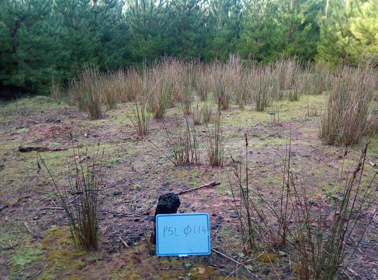

# About

2021-Aug: MW visited on foot. Likely an old weed growing patch - no obvious karst feature, small tree stumps cut with chainsaw, and parts of broken sprinklers.

# Details

## Identification

- **Feature type:** NotFound

## Cave and exploration data

- **Vertical access:** No
- **Goes to water:** No

# References

## Images
- 
