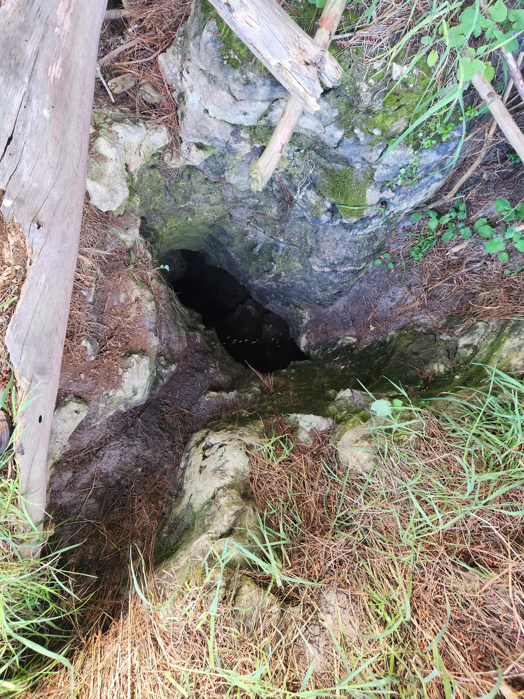
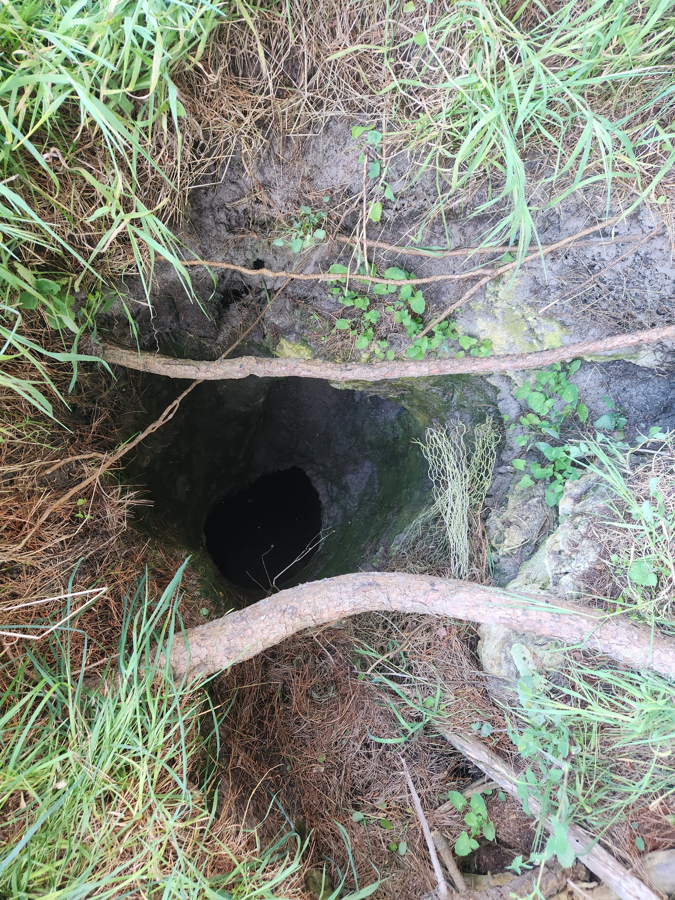
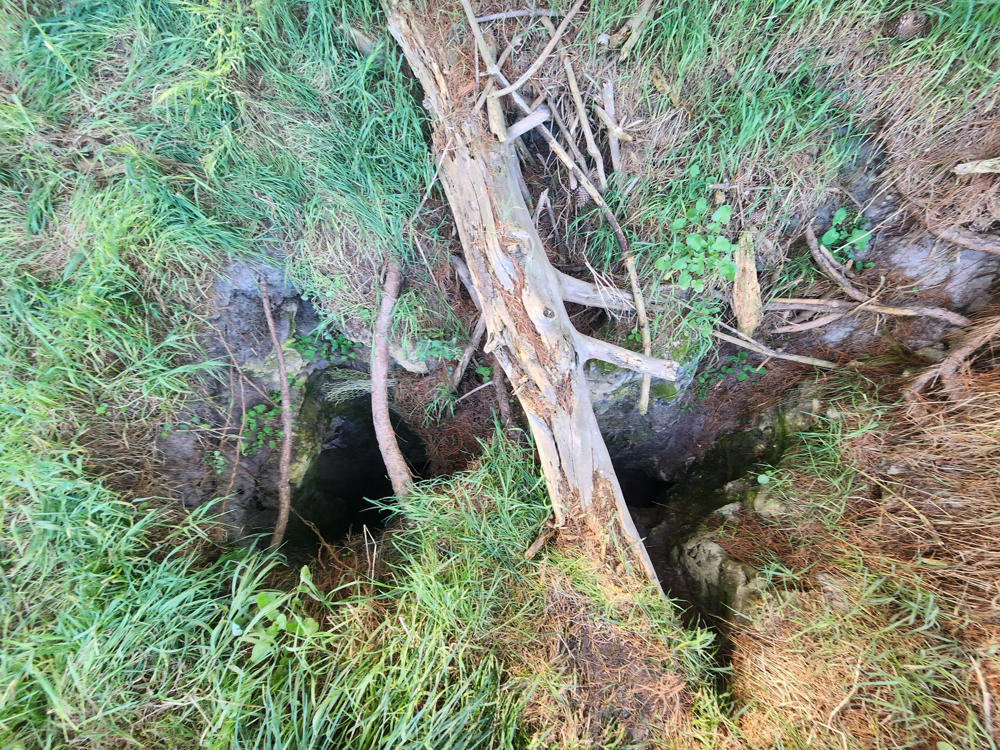

# About

BC + GB 22/09/2023:  Entrance is via one of two surface hole. The larger hole requires VA equipment but the other smaller hole can be used without equipment. Large and complex dry cave area that leads to multiple pools.  There is existing ropes in the cave that look to be placed to haul equipment over to the main wet section that leads to a 30m dive at around 5m depth. Where you see the chain linking to the rope you either traverse the crevice or above it there is a crawl that leads to the same area. The crawl is the safest route as without cowtails attached to the rope you risk slipping and getting stuck in the crevice. This leads to a low room with water which has line leading to the dive (the dive was not attempted yet though).   An alternative area runs north west from the the entrance hole into a system of tunnels and rooms with ornate features that lead to another pool

# Details

## Identification

- **Feature type:** Cave
- **Reference:** L0086
- **Source:** Forestry SA

## Cave and exploration data

- **Vertical access:** No
- **Exploration potential:** VeryHigh
- **Tourism potential:** Medium
- **Goes to water:** Yes

## Diving data

- **Maximum depth:** 5 m
- **Water type:** Fresh
- **Tidal:** No

## Access and warnings

Private

# References

- **LSECR:** Page 172

## Images
- 
- 
- 
