# Details

## Identification

- **Feature type:** Cave
- **Reference:** 5Y1
- **System name:** Corra-Lynn
- **Source:** ASF

## Cave and exploration data

- **Vertical access:** No
- **Exploration potential:** Medium
- **Tourism potential:** High
- **Goes to water:** No

# References

## Images
- 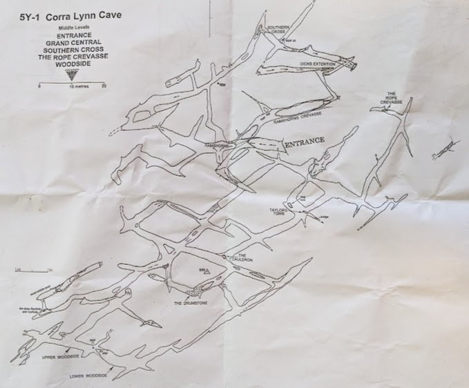
- 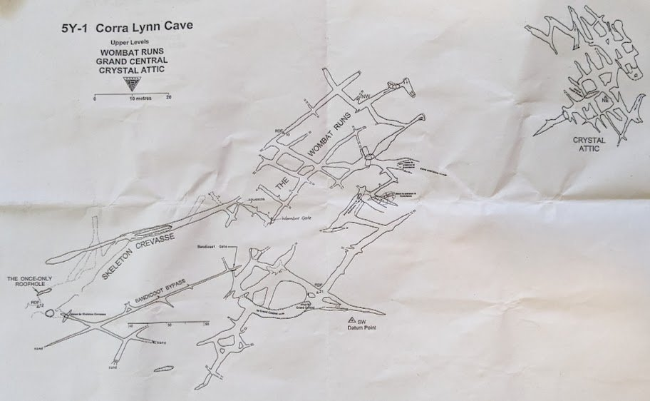
- 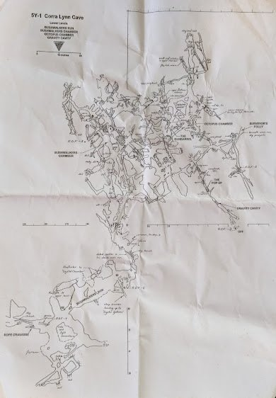
- 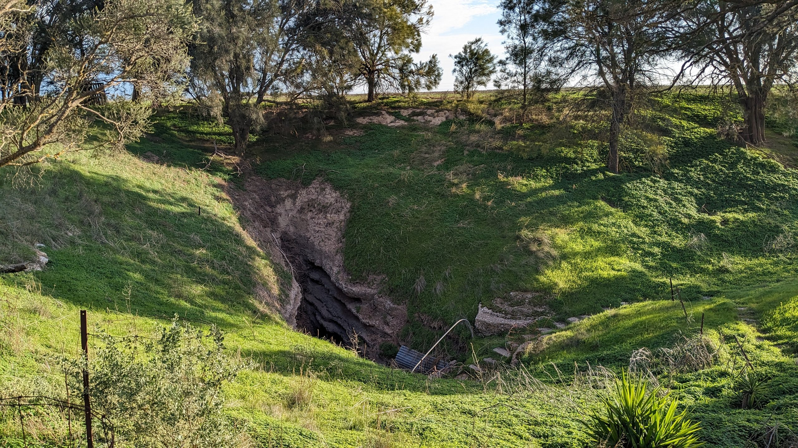
- 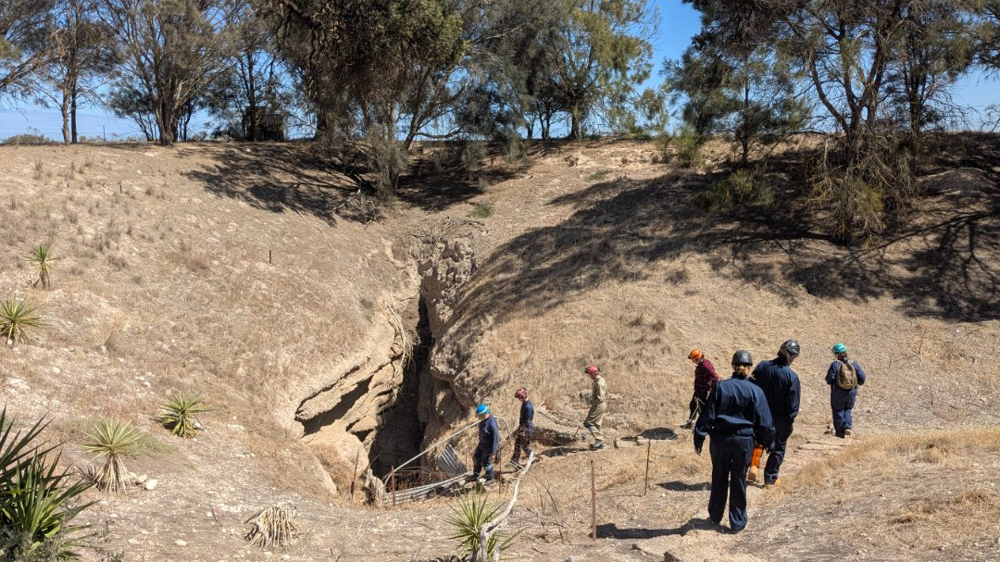
- 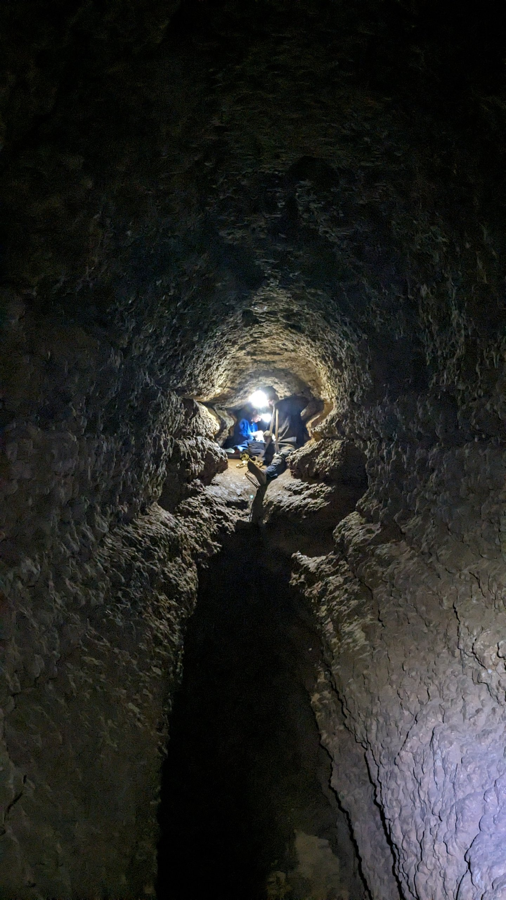
- 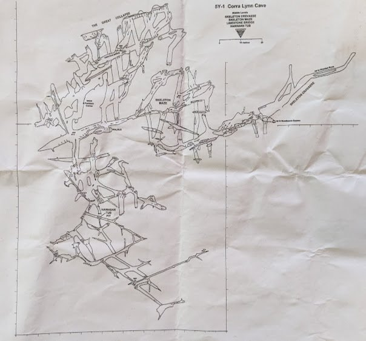
- 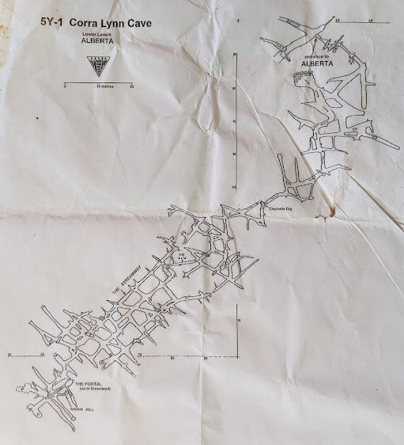
- 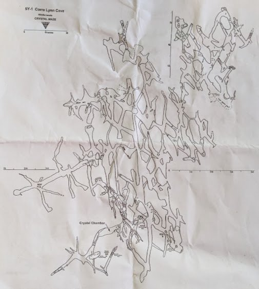
- 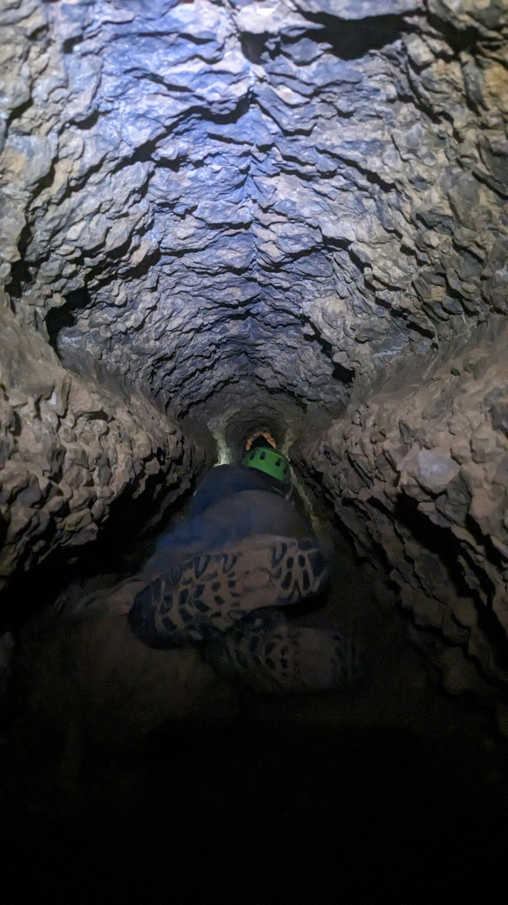
- 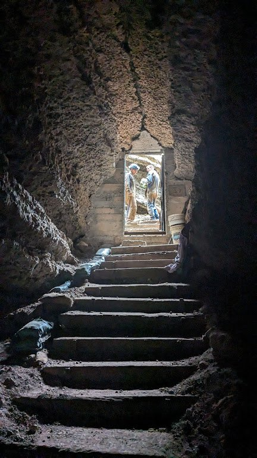
- 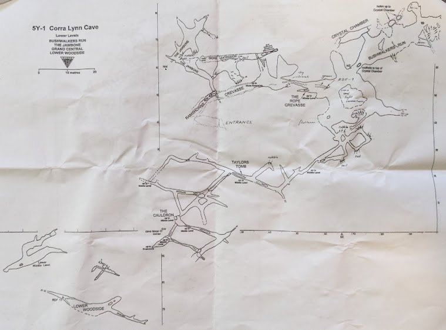
