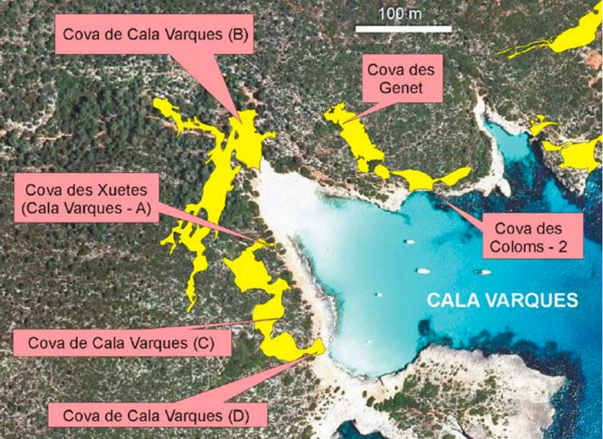
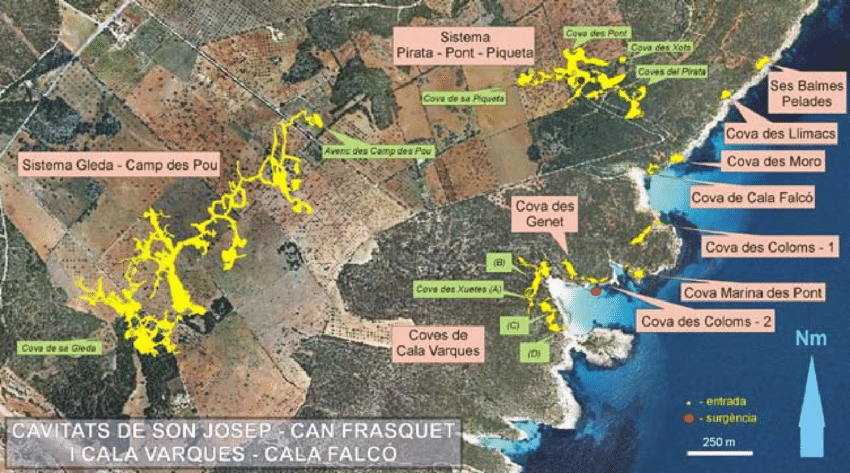

# Details

## Identification

- **Feature type:** Cave
- **System name:** Coves de Cala Varques
- **Source:** MapCarta

# References

- **MapCarta:** https://mapcarta.com/N6368677432

## Images
- 
- 
