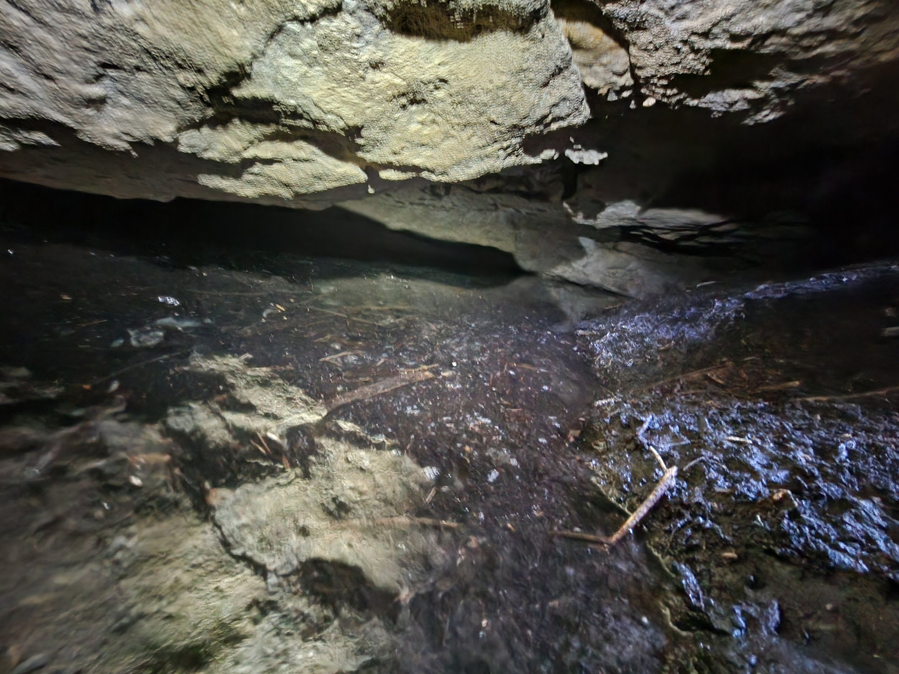
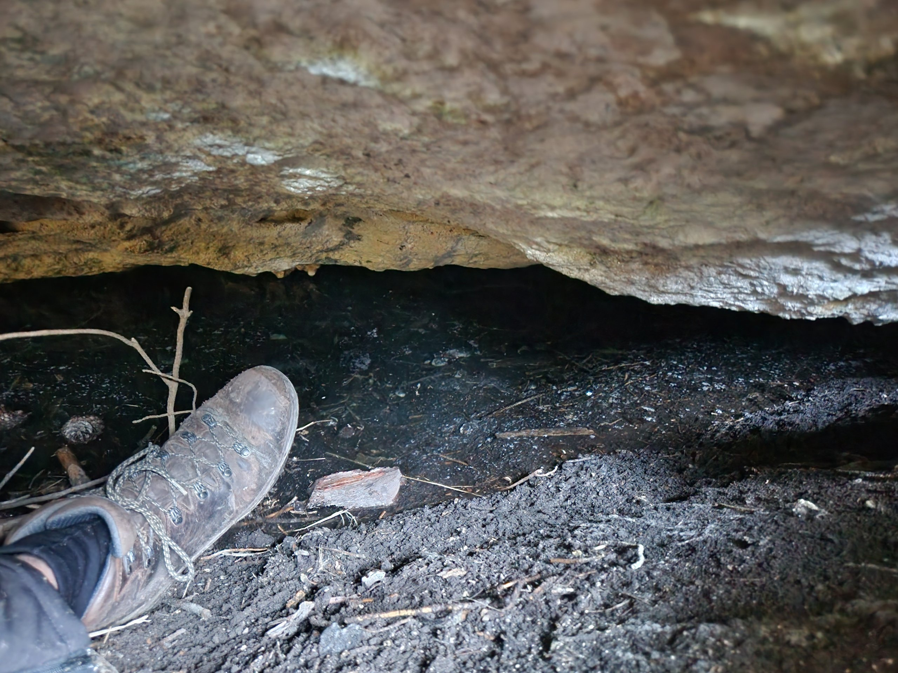
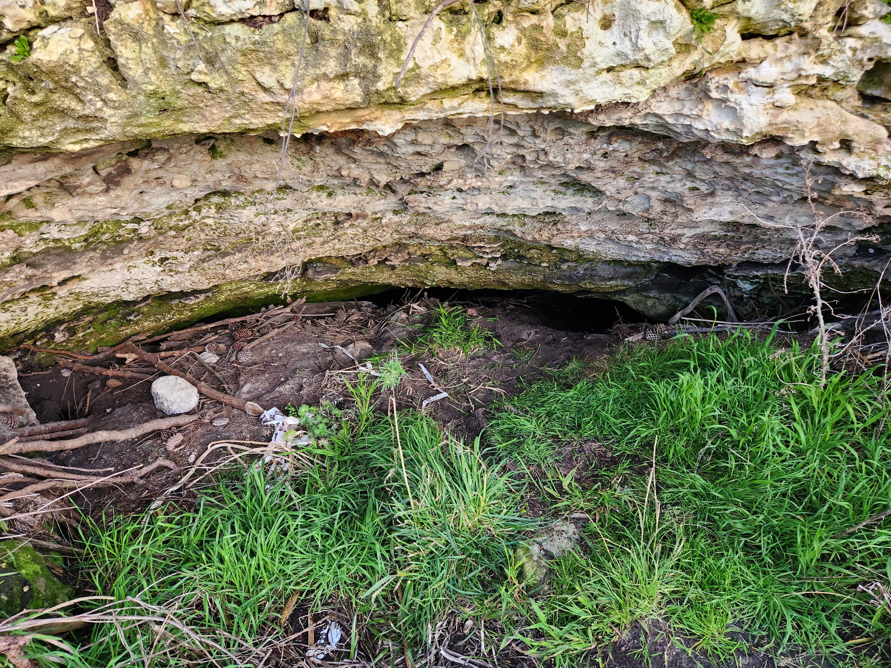
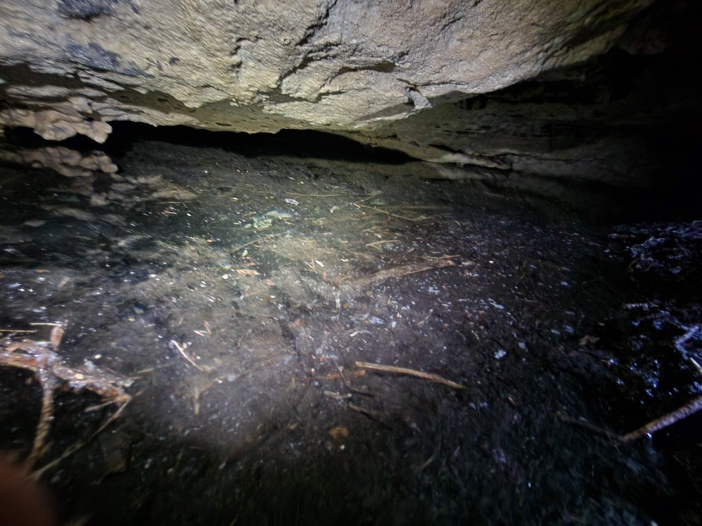
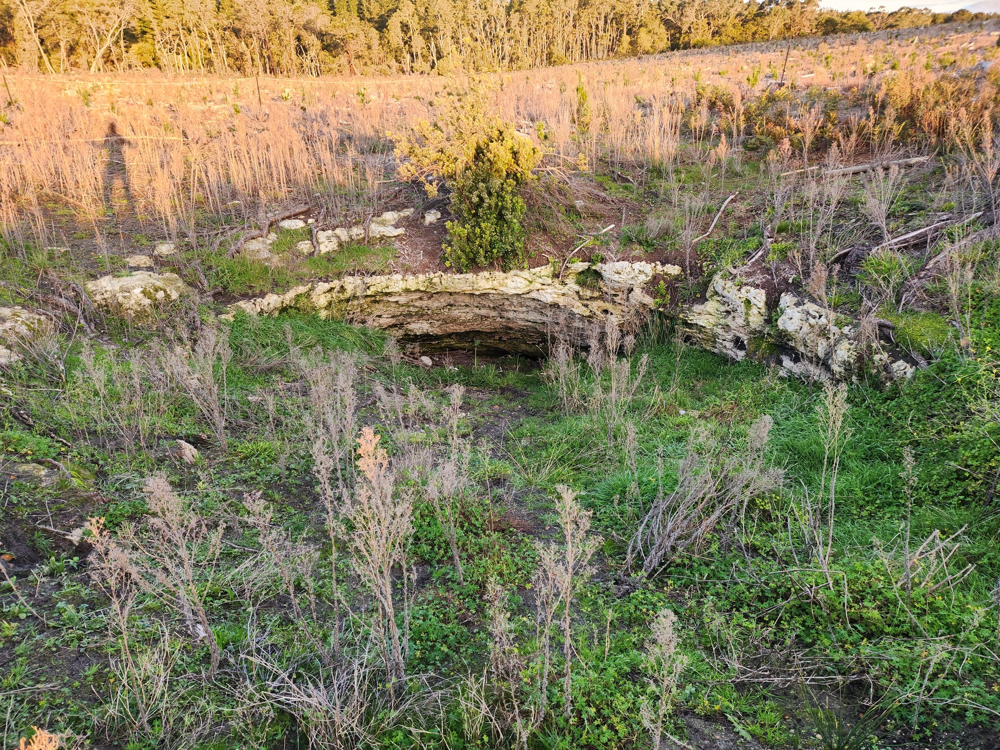
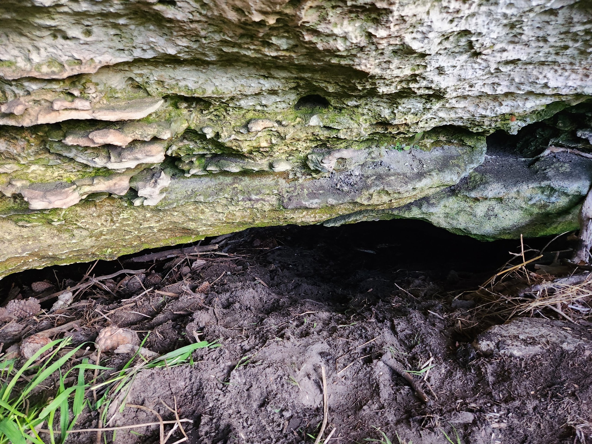
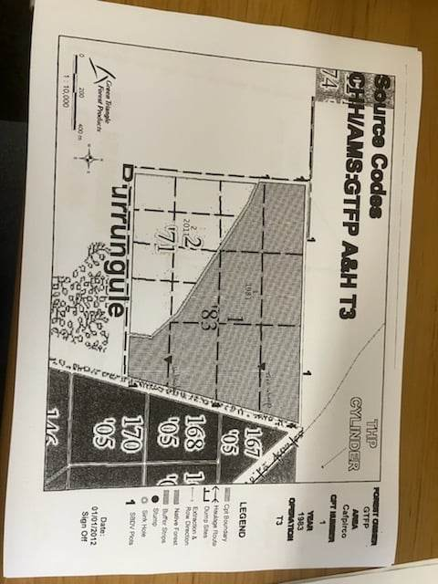

# About

From Col's List
2023-Aug: BC checked and photographed - small cave goes to water, well worth return with cave snorkel or 7s.

# Details

## Identification

- **Feature type:** Cave
- **Source:** GTFP

## Cave and exploration data

- **Vertical access:** No
- **Exploration potential:** VeryHigh
- **Tourism potential:** Low
- **Disabled access potential:** Low
- **Goes to water:** Yes

## Diving data

- **Water type:** Fresh
- **Tidal:** No

# References

## Images
- 
- 
- 
- 
- 
- 
- 
