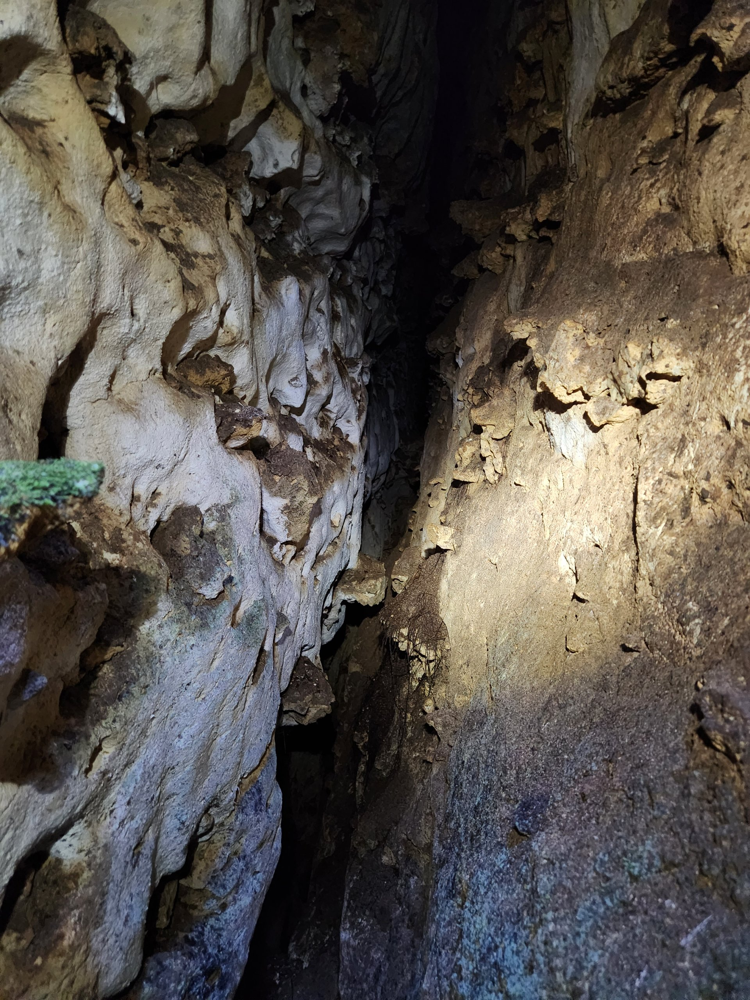
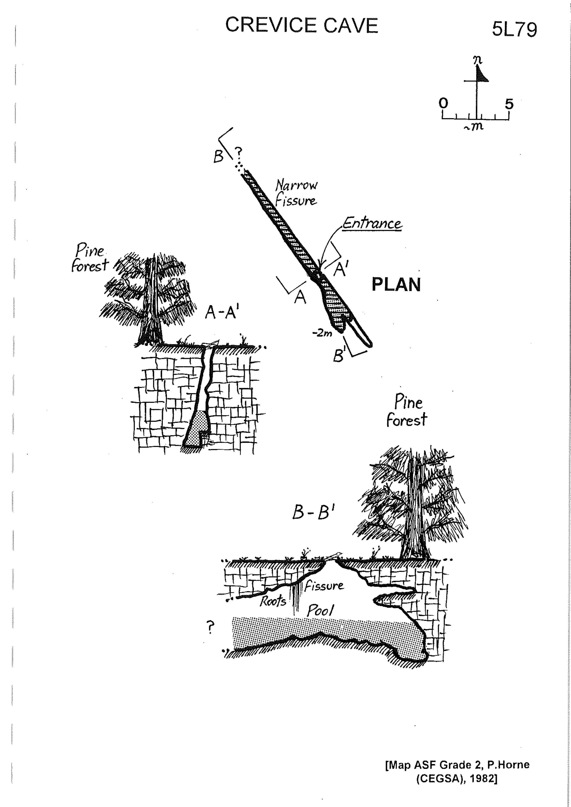
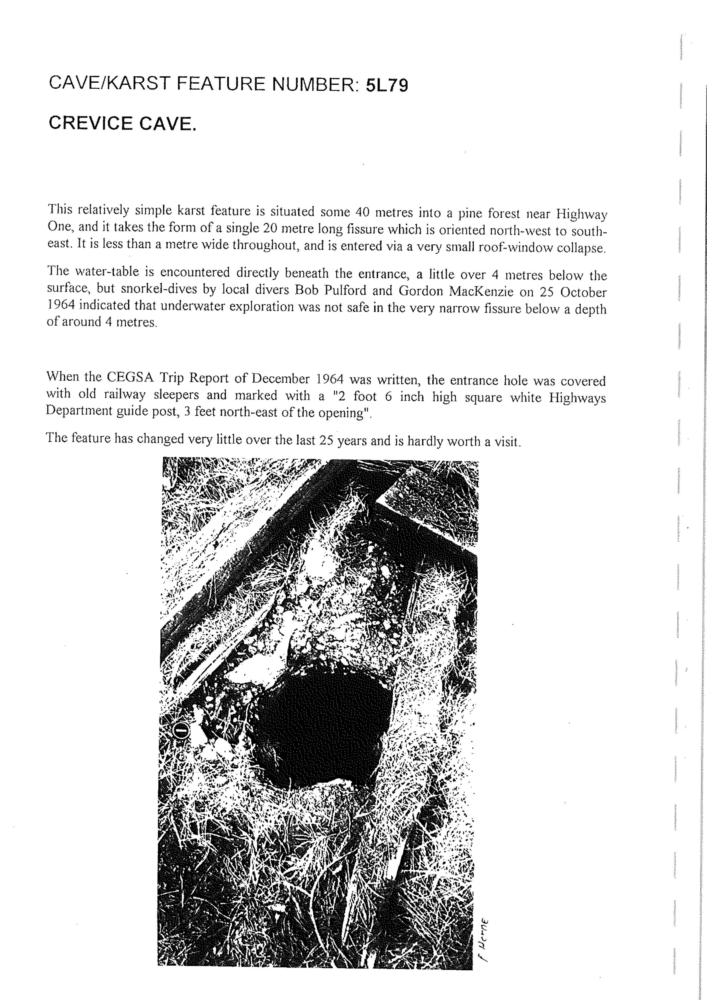
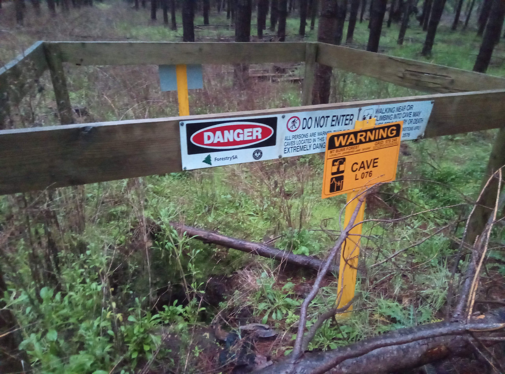
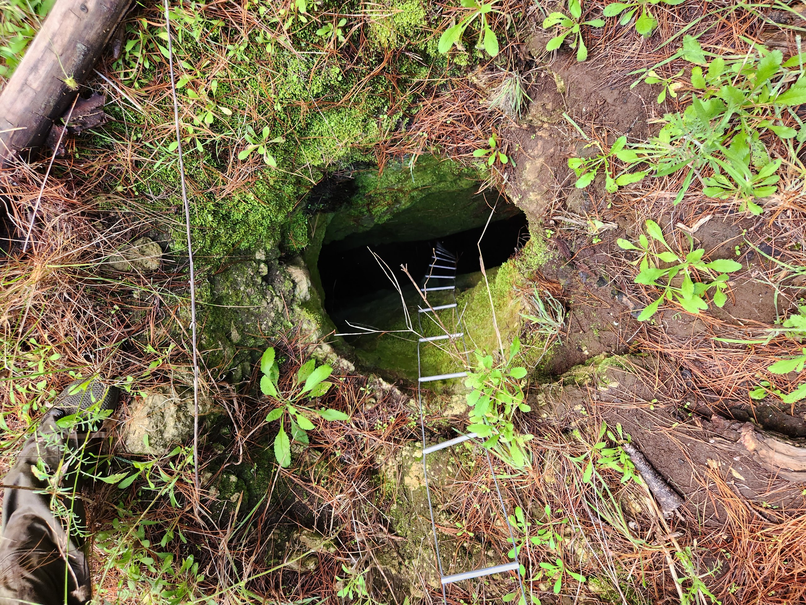
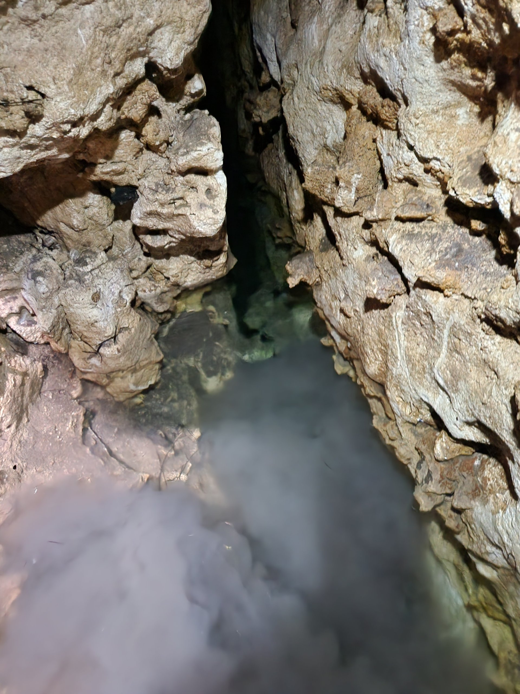
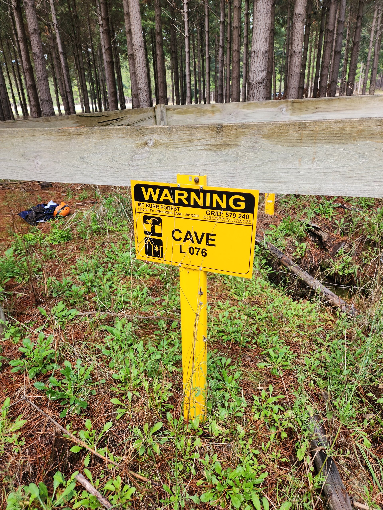

# About

Visited on foot and photographed surface entrance. Cave mis-labelled with yellow "L076" Forestry sign and surrounded by chest-high timber fence. Need to return with wire ladde, wetsuit & 7's.

# Details

## Identification

- **Feature type:** Cave
- **Reference:** L0079
- **Source:** Forestry SA

## Cave and exploration data

- **Vertical access:** Yes
- **Exploration potential:** VeryHigh
- **Goes to water:** Yes

## Access and warnings

Forestry

# References

- **LSECR:** Page 160
- **Forestry SA:** L0079, Thin Roof: N, Fence: Y. Dimensions: 0.7m diam tube x 4+m deep. Features: Water table at 4m below surface, 20m long fissue orientated NW-SE <1m wide

## Images
- 
- 
- 
- 
- 
- 
- 
- 
