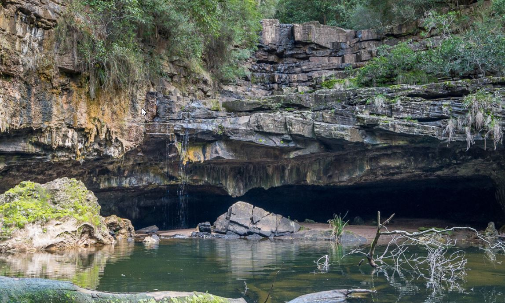
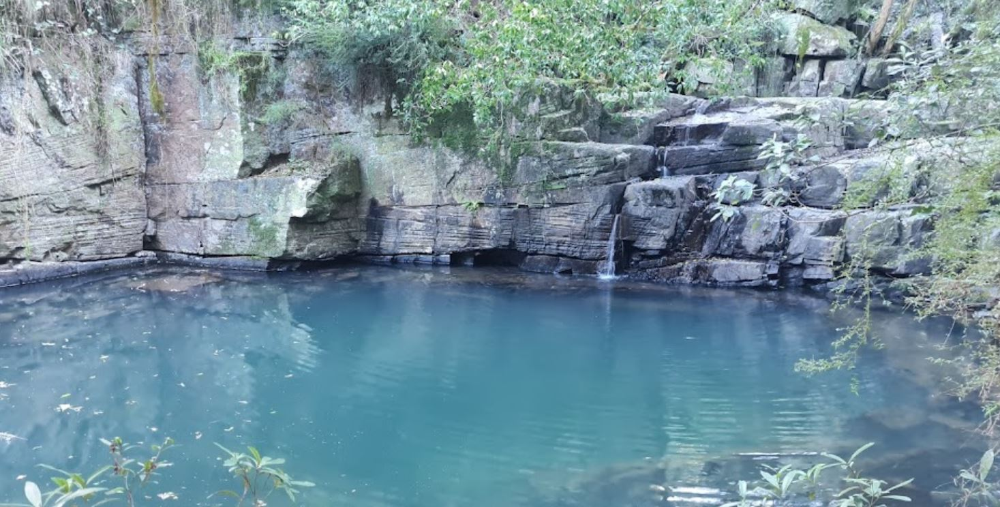

# Details

## Identification

- **Feature type:** Cave

## Cave and exploration data

- **Vertical access:** No
- **Tourism potential:** Medium
- **Disabled access potential:** Low
- **Goes to water:** Yes

## Diving data

- **Water type:** Fresh
- **Tidal:** No

## Amenities

- **hasShowers:** No
- **hasToilets:** No

# References

- **Google Maps:** https://maps.app.goo.gl/P8kQYzxhSFLTz54q7

## Images
- 
- 
