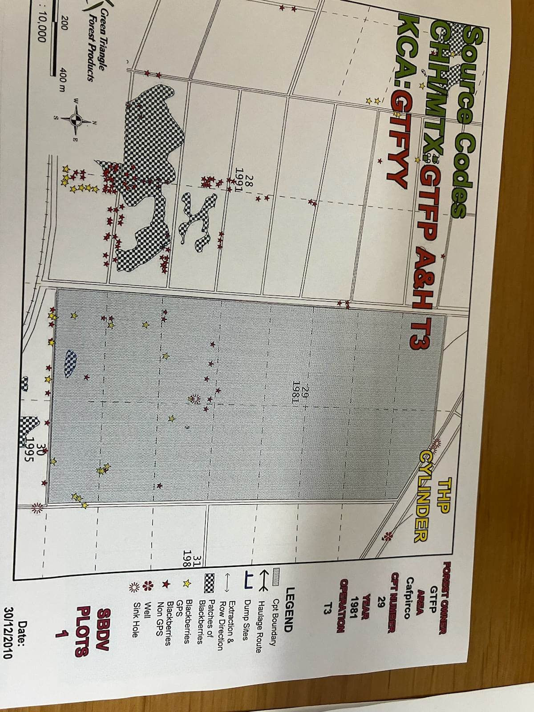
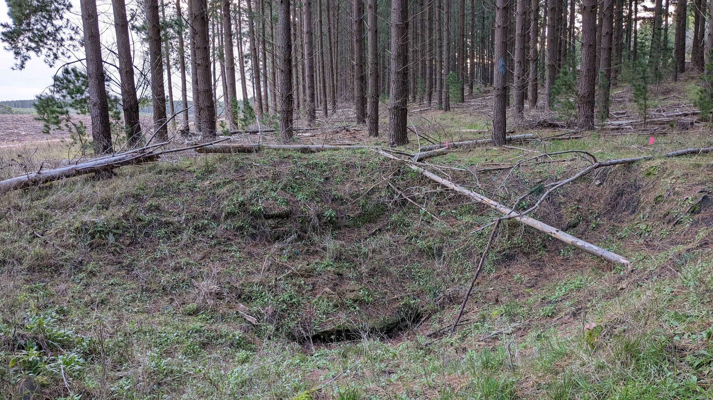
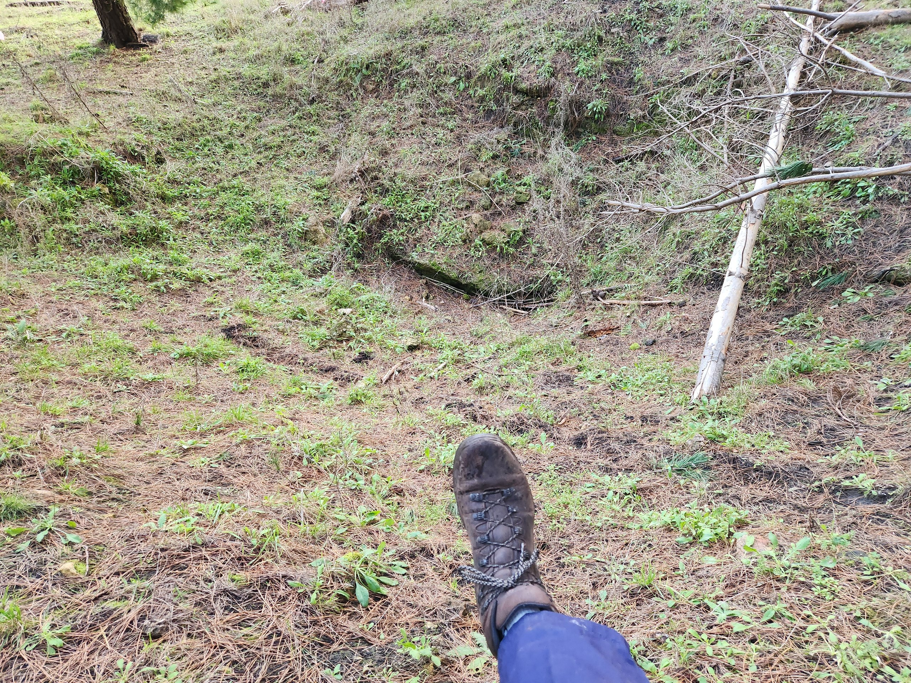

# About

From Col's List
MW / BC 15/7/2023 : Depression wirh rock, not exciting

# Details

## Identification

- **Feature type:** Depression

## Cave and exploration data

- **Vertical access:** No
- **Goes to water:** No

# References

## Images
- 
- 
- 
