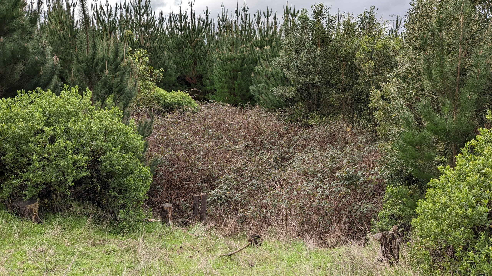

# About

Checked 23-06-2023 by MW: Spotted from satellite imagery, visited on foot. Simple blind doline filled with trees and bushes, any possible cave leads buried under foliage.

# Details

## Identification

- **Feature type:** Depression
- **Source:** Discovered - Drone

## Cave and exploration data

- **Exploration potential:** Medium

# References

## Images
- 
