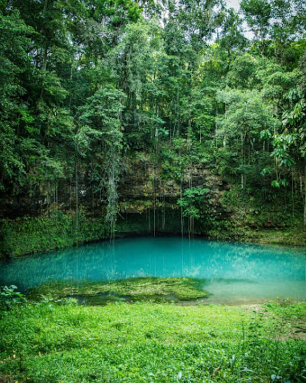
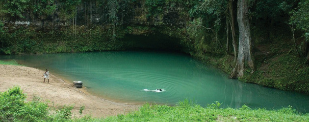
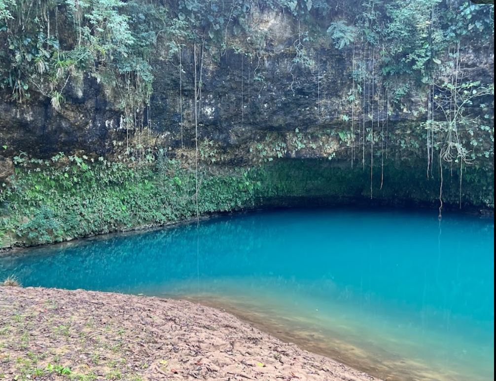

# Details

## Identification

- **Feature type:** Cave
- **System name:** Dornoch River

## Cave and exploration data

- **Vertical access:** No
- **Exploration potential:** High
- **Tourism potential:** Medium
- **Goes to water:** Yes

## Diving data

- **Tidal:** No

# References

- **Jamaican to the world:** https://jamaicantotheworld.com/the-great-dornoch-river-head-expedition/

## Images
- 
- 
- 
- 
