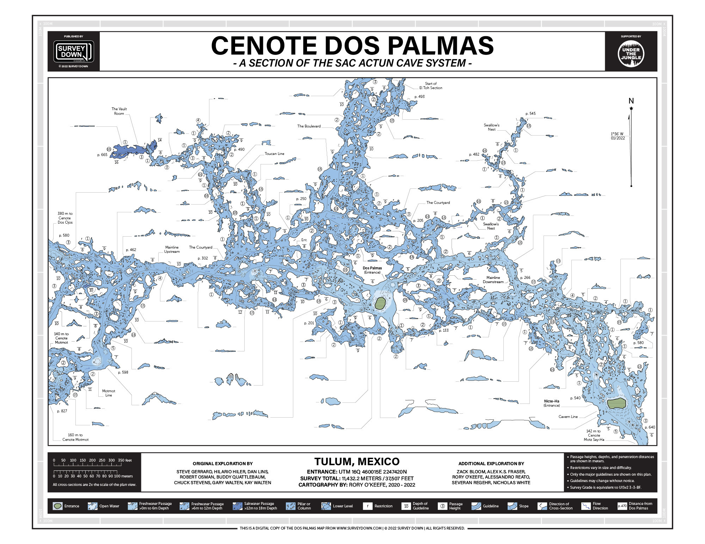
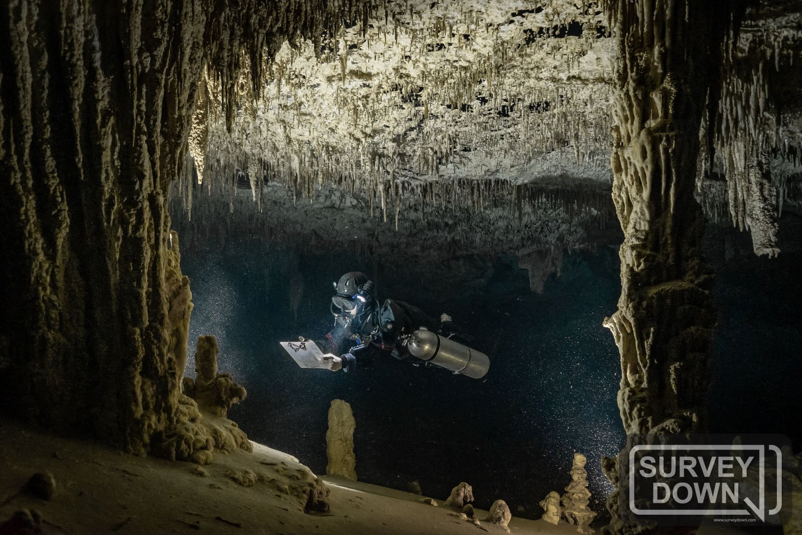
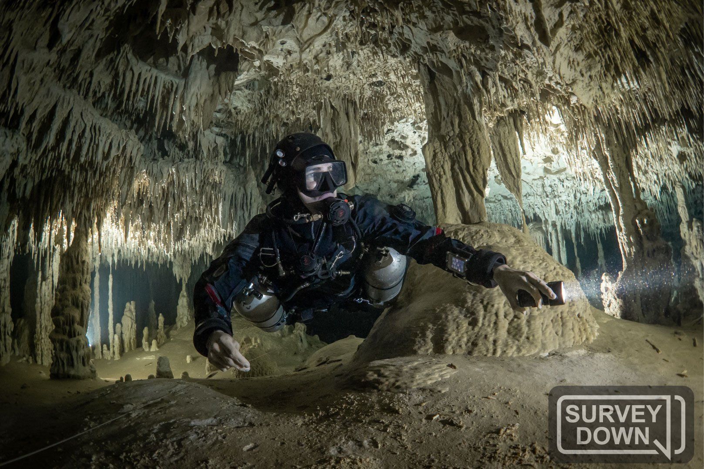
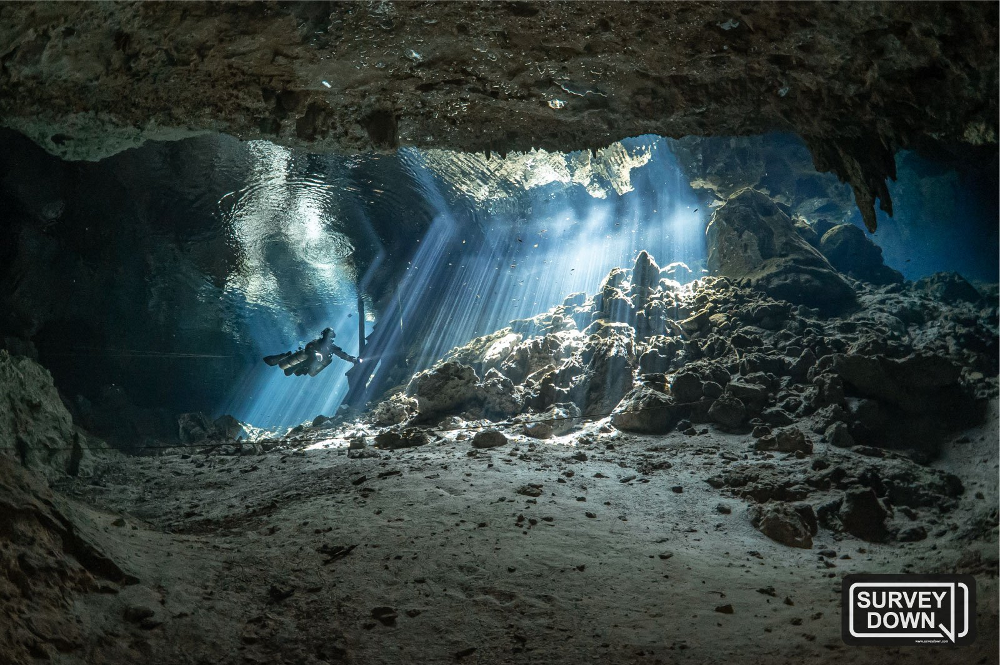

# About

Complete survey to [Nicte Ha]() (downstream/east) and approximately 3/4 of the way towards [Dos Ojos]() (upstream/west).

# Details

## Identification

- **Feature type:** Cave
- **System name:** Sac Actun

## Cave and exploration data

- **Cave rating:** Cave
- **Vertical access:** No
- **Exploration potential:** Low
- **Tourism potential:** Medium
- **Disabled access potential:** Low
- **Goes to water:** Yes

## Access and warnings

Open to the public. Entrance fee is required and is paid at the booth in the parking lot.

# Maps

- [Dos Palmas - 8d01d665-cde7b827](https://github.com/twosharprocks/Karst-Database/blob/d6f539534154fcd23f60d0a25899bf7ef553f1d8/Assets/58cbf60e046ac743502f08f3d39fc8ff53de8657d9858d539279896d978573df.kml)

# References

## Images
- 
- 
- 
- 
