# Details

## Identification

- **Feature type:** Cave

## Cave and exploration data

- **Goes to water:** Yes
- **Surveyed length:** 180 m

## Diving data

- **Maximum depth:** 17 m
- **Water type:** Fresh
- **Tidal:** No
- **Temperature:** 11–11 °C
- **Difficulty:** VeryHard
- **Entry difficulty:** Easy

# References

## Images
- 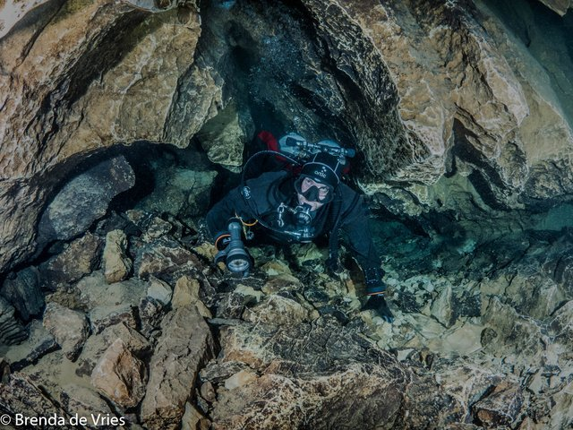
- 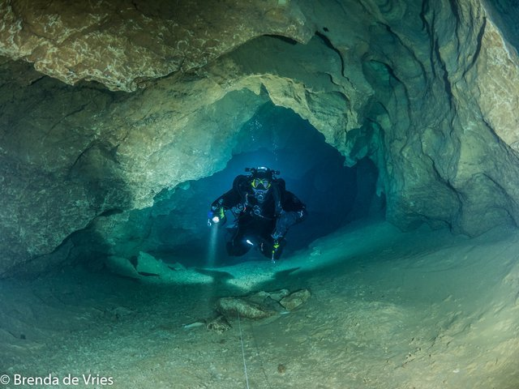
- 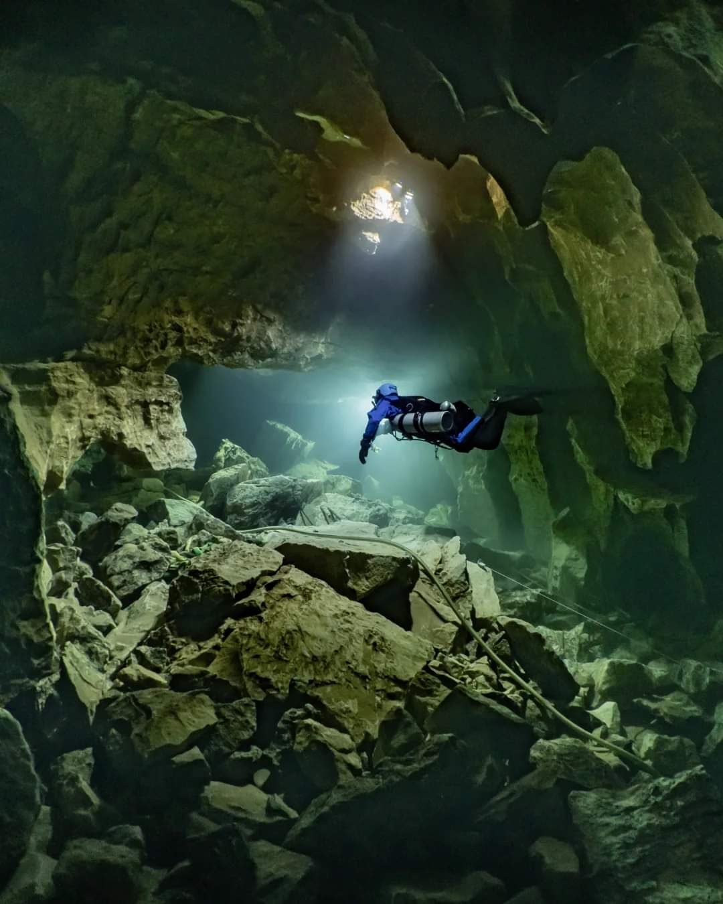
- 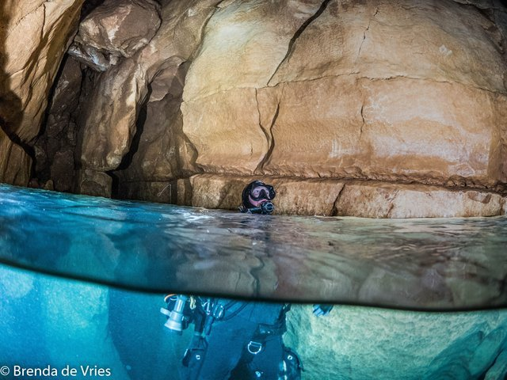
- 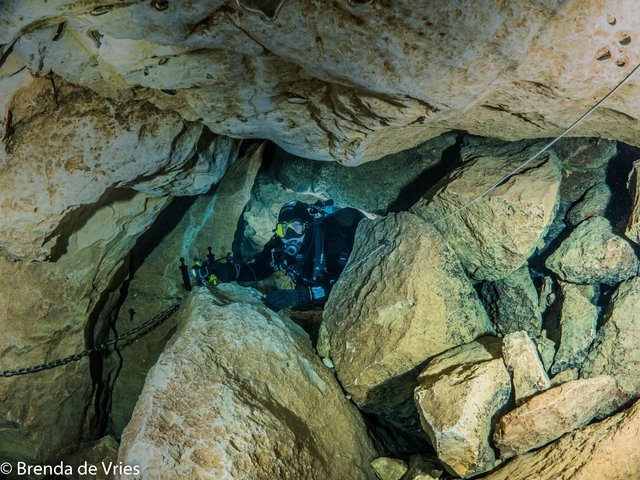
- 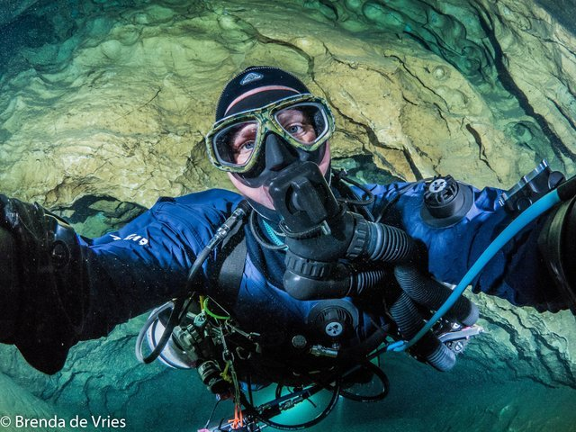
- 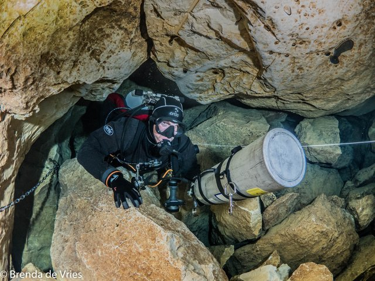
- 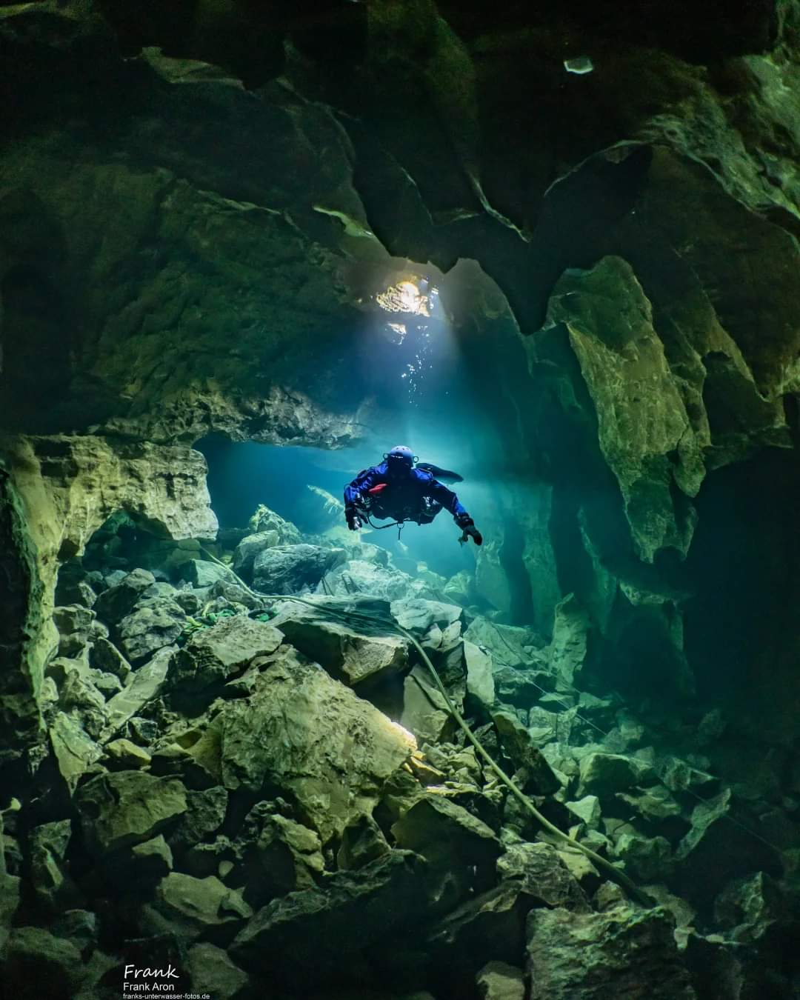
- 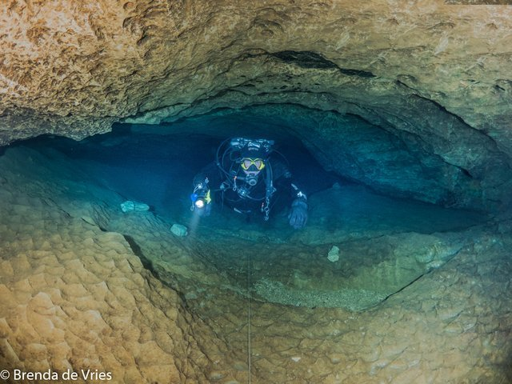
- 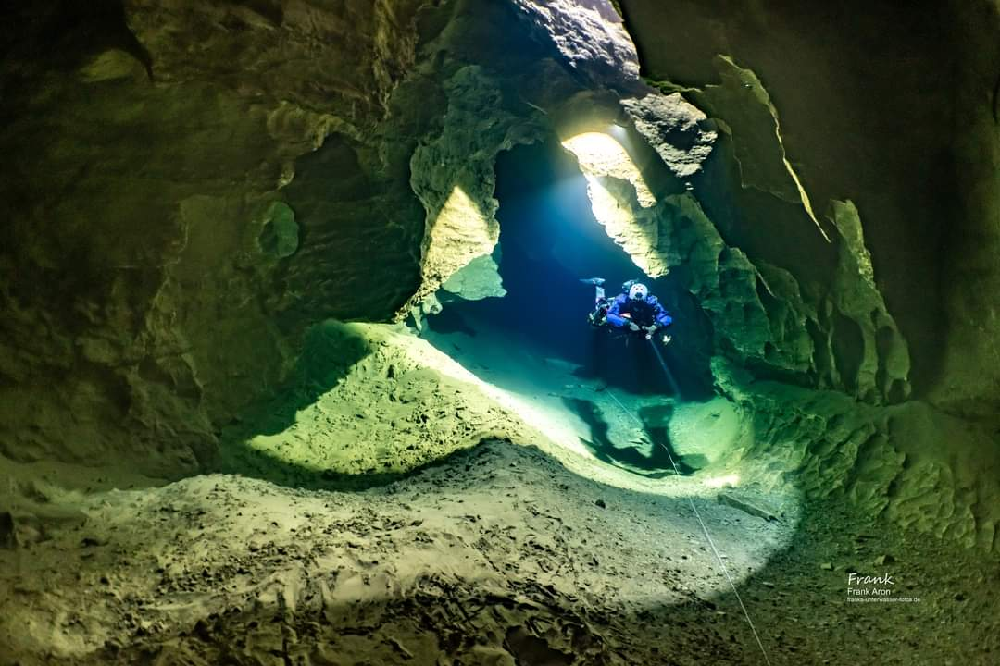
- 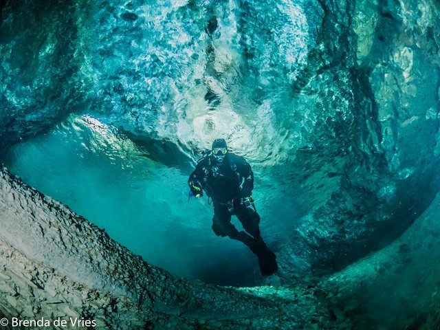
- 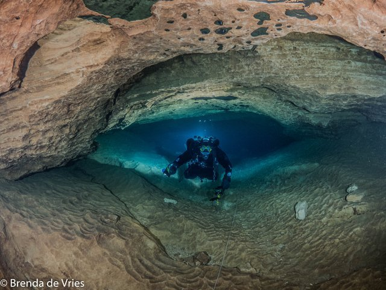
- 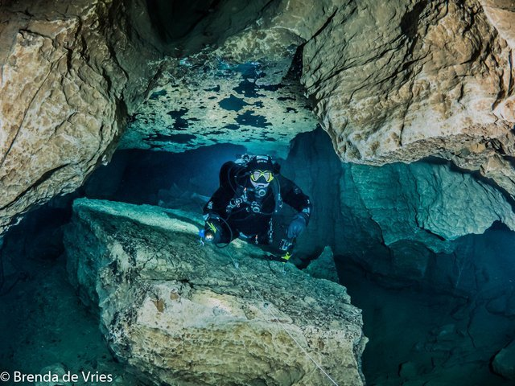
- 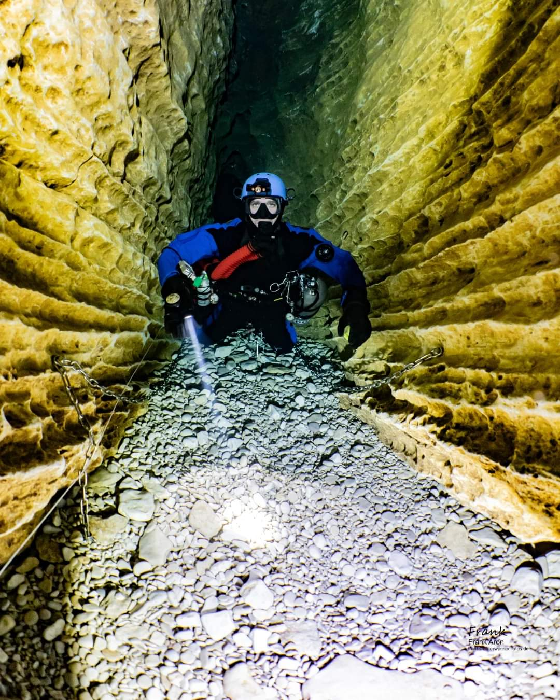
- 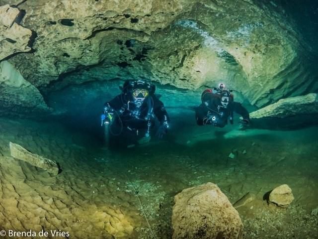
- 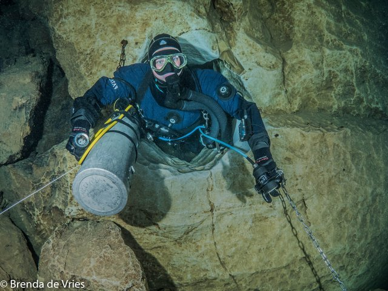
