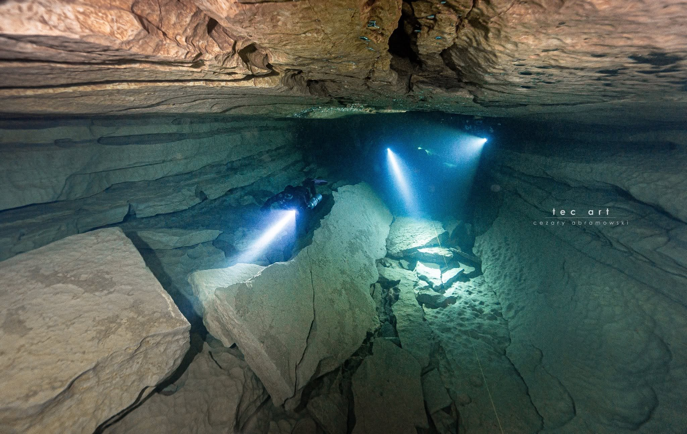
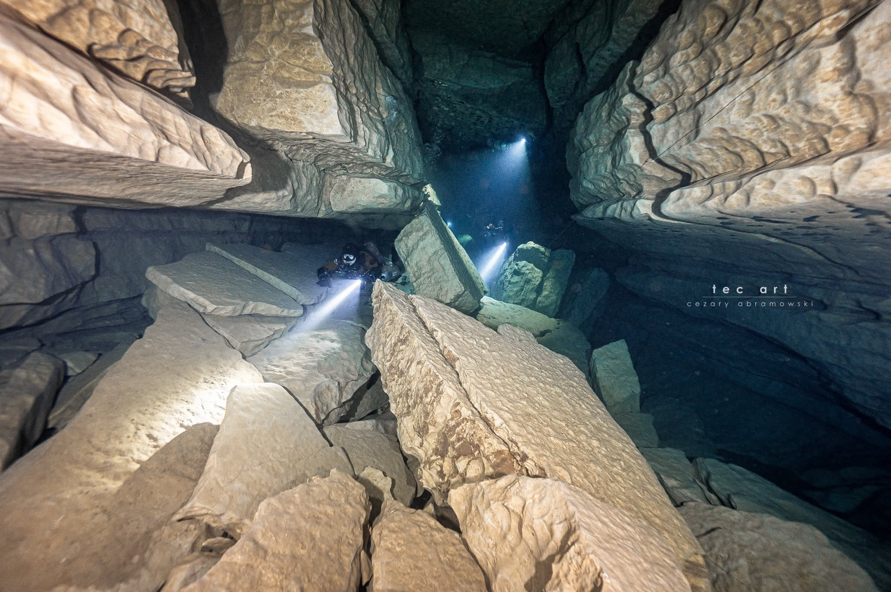
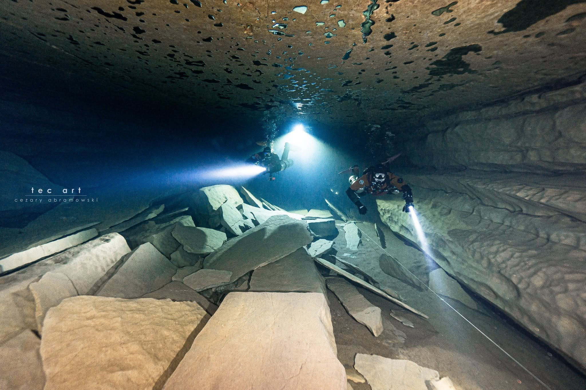

# Details

## Identification

- **Feature type:** Cave

## Cave and exploration data

- **Exploration potential:** High
- **Goes to water:** Yes

## Diving data

- **Maximum depth:** 80 m
- **Water type:** Fresh
- **Tidal:** No

# References

## Images
- 
- 
- 
- [38f502ee-90e6-4522-afb8-808877719129](https://www.youtube.com/watch?v=anD_40H9Lw0)
