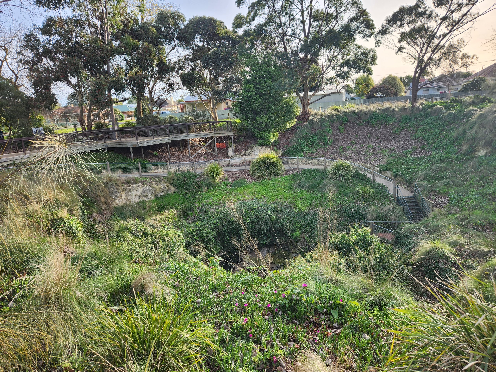
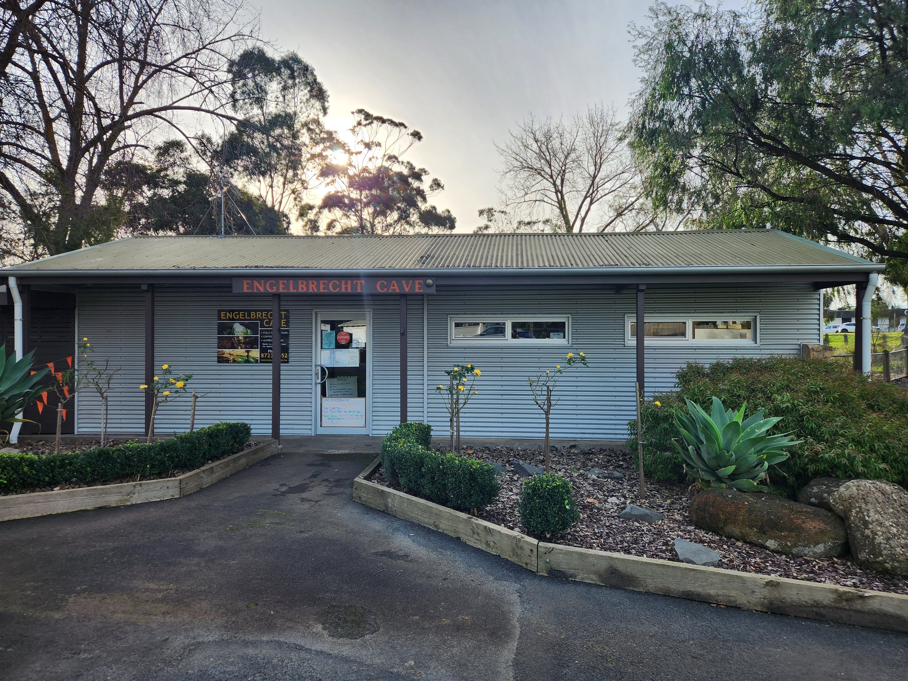
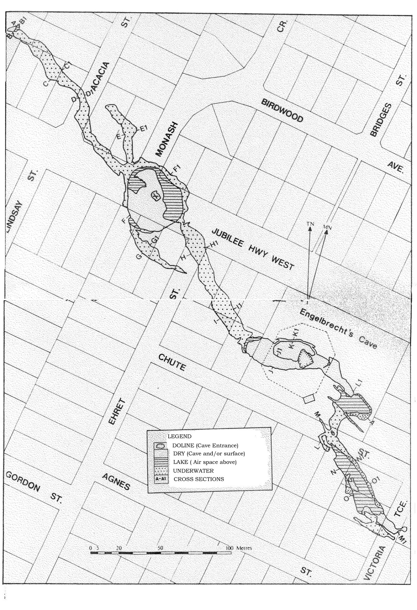
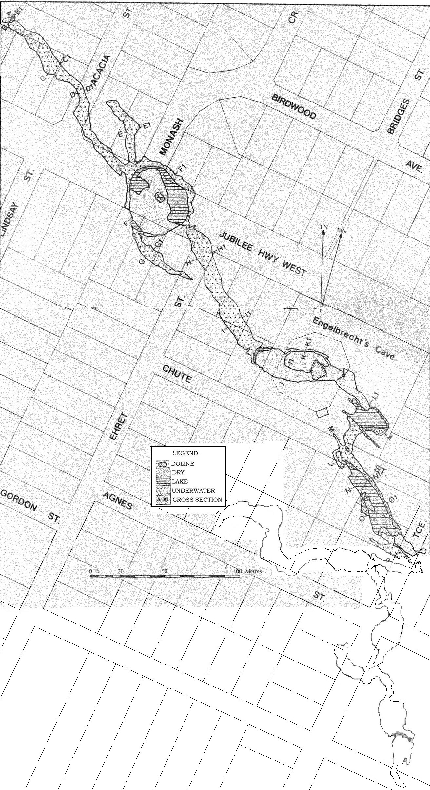
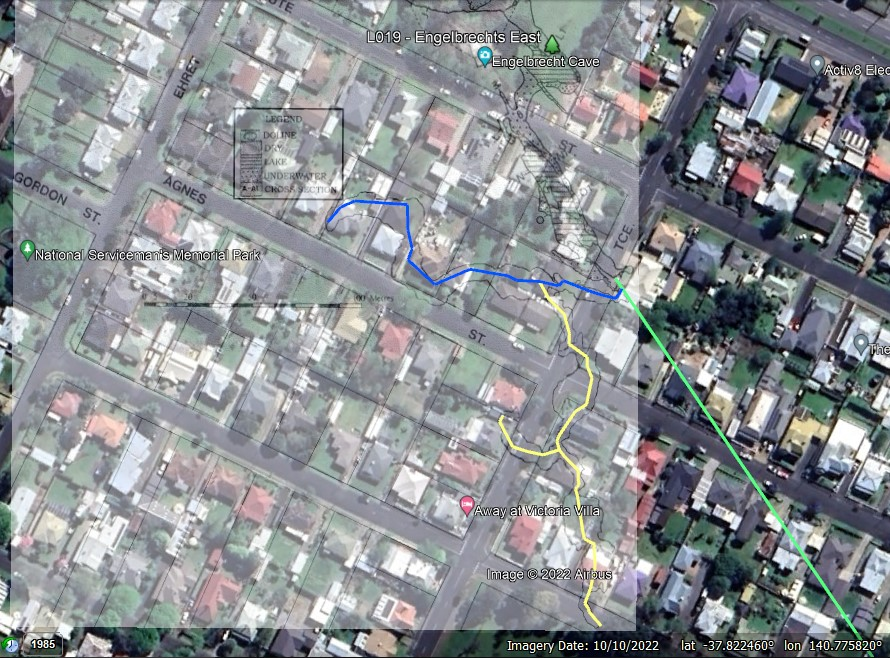
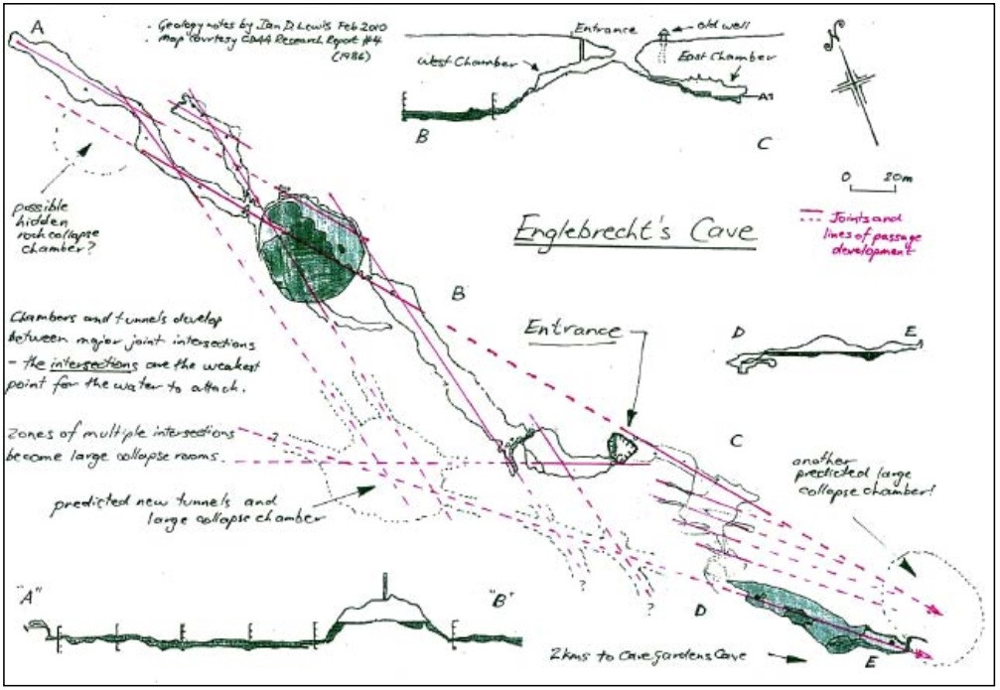

# Maps

5L19/20 Fault Lines (Lewis)
 - MAP.jpg>)

5L19/20 (Horne) 

5L019 Englebrecht's East (Richards, 2022)

## Survey
KML Survey: Englebrecht's E Extension - KML.kml

[Englebrecht's East Extension]() (Richards)
 - MAP.jpg>)

Englebrecht's West Survey (Richards)

# References

[ABC Australia - Instagram](https://www.instagram.com/p/Ck5FcAAgw9O/)

## Images
- 
- 
- 
- 
- 
- 
