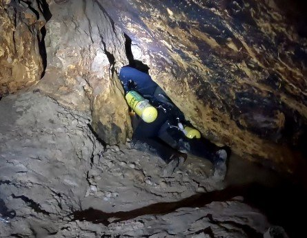
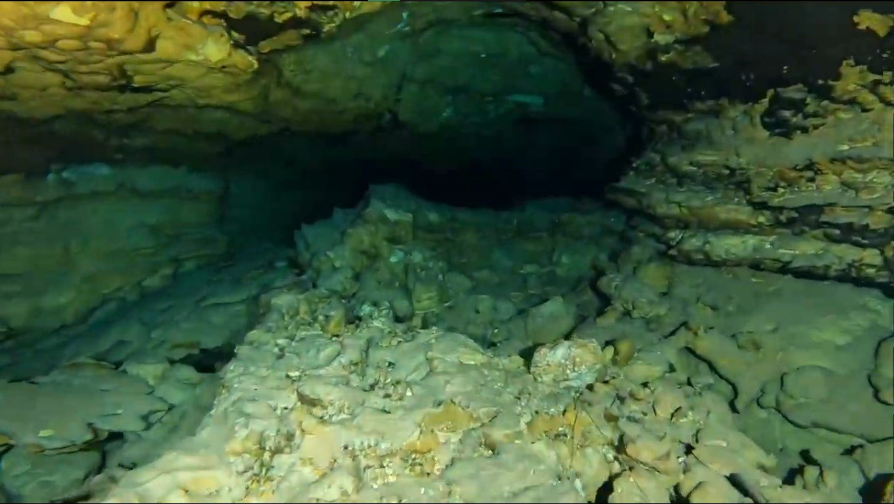
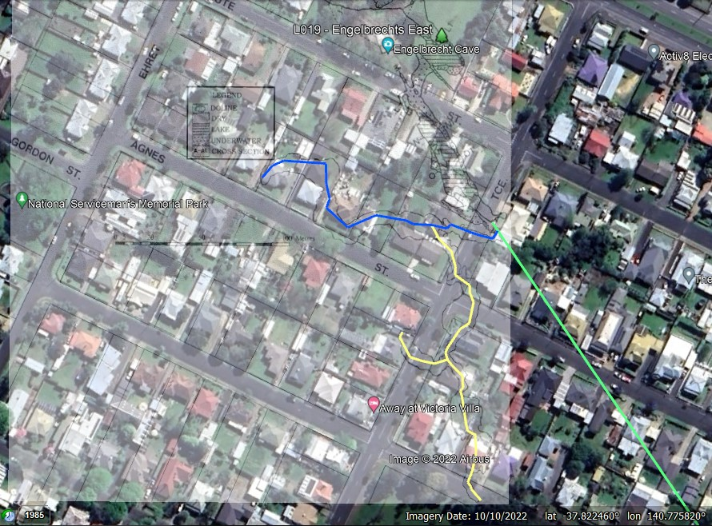
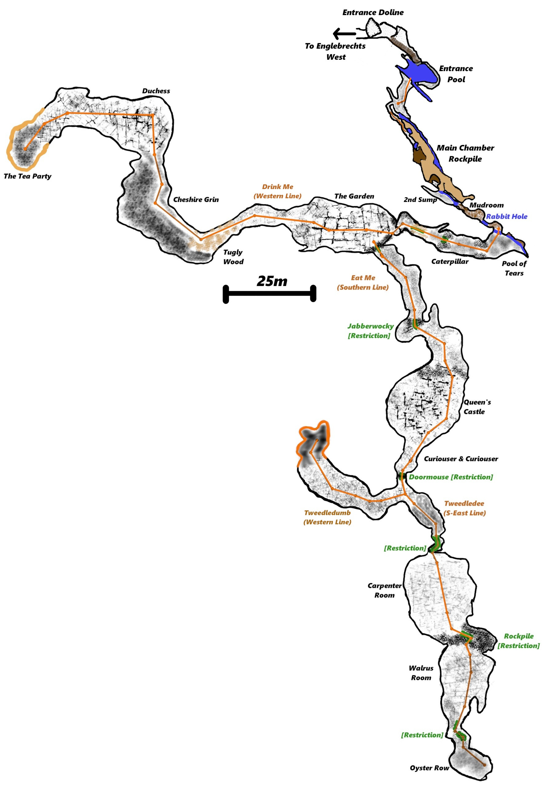

# Passage and exploration history

Engelbrechts East Extension (EEX) names both a section of passage within [5L019 - Englebrecht's East]() and the project established to map and survey that passage after its discovery in 2020. East is part of [Englebrecht's Cave - 5L19-20](). EEX is not a separate entrance or an independent cave system.

The 2020 discovery year and these relationships were confirmed by the discoverer on 15 November 2026. Exact discovery dates and the later survey chronology remain to be documented from the original records.

# Details

## Identification

- **Feature type:** Cave
- **Reference:** L019E
- **System name:** Englebrechts

## Cave and exploration data

- **Cave rating:** Advanced
- **Vertical access:** No
- **Exploration potential:** Medium
- **Goes to water:** Yes

## Diving data

- **Maximum depth:** 22 m
- **Water type:** Fresh
- **Tidal:** No

# Additional Notes

Site Description:

Located in the heart of the Mount Gambier township, the site is named after Carl Engelbrecht, a German immigrant who settled in Mount Gambier during the 19th century. A private tour operator manages the site on behalf of the City of Mount Gambier, and runs regular tours of the sinkhole and dry caves for members of the public. The facility includes a café, a tour desk, viewing platforms, toilets and range of open spaces with varying degrees of shelter for picnics and associated activities.

For divers, Engelbrechts Cave consists has two main submerged cave passages - one running in an easterly direction and one running in a westerly direction.

The East passage is Cave rated and extends about 70 meters from the doline's opening, with a maximum depth of 8m. To access the water, there is a short, steep stairway inside the eastern tourist cave which leads down to the lake, where divers can enter the first sump. From here divers can navigate a low, flat, silty passage to an inner air chamber and lake, or explore several side passages.

Englebrecht’s East Extension (EEX)
From the inner air chamber, divers can exit the water and climb over the main chamber rock pile to access Englebrecht’s East Extension (EEX). The Extension is Advanced Cave rated and currently features more than 400m of submerged tunnel with a maximum depth of 22m.

Divers are warned that EEX is an advanced sidemount-only site, and Cave-rated divers must not venture beyond the main chamber rockpile.

To access the extension, divers need to climb down an opening in the far end of the rockpile, enter a second sump and remerge onto a rocky beach, then squeeze through a dry restriction into the “Mudroom” before attempting the “Rabbit Hole” and reaching the start of the established line.

Divers are advised that water levels in the Rabbit Hole fluctuate seasonally from nearly dry to completely submerged, and that it poses a drowning hazard if attempted without preparation and proper gear configuration. The Rabbit Hole should not be attempted with steel cylinders larger than 7L, and it's recommended that all cylinders be fully removed and passed through individually. Divers are also asked to exercise caution in the “Caterpillar” tunnel as even minimal silting will reduce visibility to zero, and practice careful finning technique through the “Tugly Wood” area to avoid damaging the low roof and pristine clay blocks.

The Southern “Eat Me” branch of EEX is accessed via a jump from the main line in the “Garden” room, however divers are warned that this area features numerous advanced sidemount-only restrictions and are encouraged to practice extreme caution.

Site Access Requirements:
Collect key from Lady Nelson Visitor Centre - 35 Jubilee Hwy East, Mount Gambier. Key can be collected during business hours.
Key to be returned to Lady Nelson Visitor Centre at conclusion of diving - can be returned after hours.
Timeslots and the number of divers have been allocated as below:
Maximum of 4 divers per timeslot – 8am to 2pm, 2pm to 8pm.
For each timeslot there must be a minimum of two divers, diving together, per booking.
All divers must sign in at the site on arrival, and sign out on departure and notify staff on arrival (if present).
Gates to be shut and locked behind you at all times.
Please note there are only two keys for this site - please be considerate in the amount of time you hold them.

Due to the pristine characteristics of the site and entry/exit challenges, training of any kind is NOT permitted in this site.

# Images
- 
- 
- 
- 
- [da3426c2-7da9-429f-84bb-1f3eb86ca955](https://www.youtube.com/watch?v=M1c0uyAFW9o)

# References
- **CaveDivers.com.au:** https://www.cavedivers.com.au/index.cfm?leca=1831&module=BUSINESSDIRECTORY&pageMode=indiv&action=details&page_id=1964632&stattype=default
