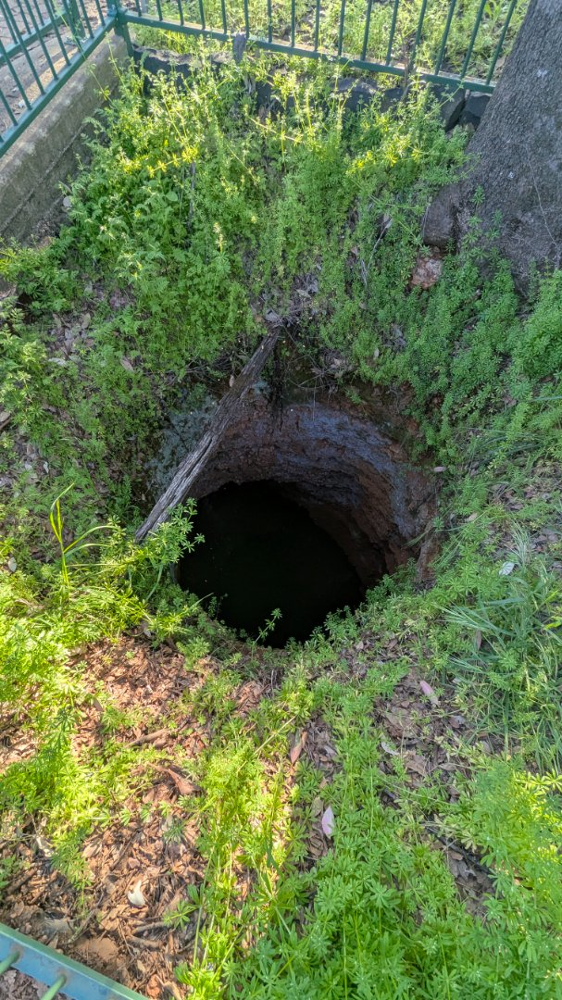
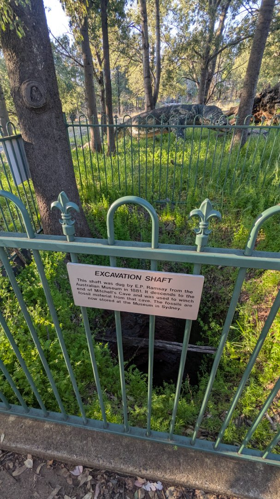

# Details

## Identification

- **Feature type:** SolutionTube

## Cave and exploration data

- **Vertical access:** Yes

## Amenities

- **hasShowers:** No
- **hasToilets:** No
- **hasPhone:** Yes

# References

## Images
- 
- 
