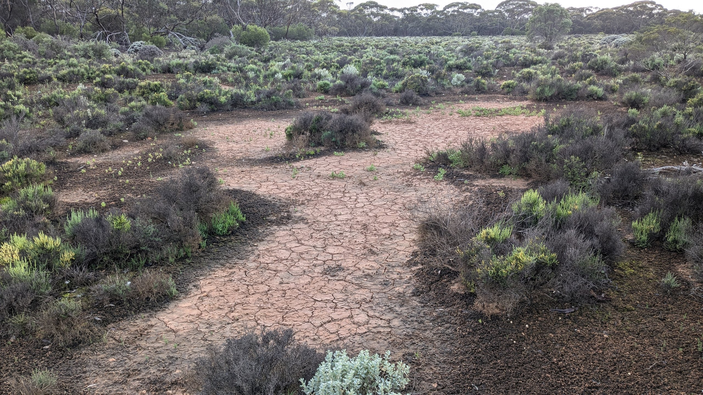

# Details

## Identification

- **Feature type:** Depression

## Cave and exploration data

- **Vertical access:** No
- **Goes to water:** No

## Amenities

- **hasShowers:** No
- **hasToilets:** No

# References

## Images
- 
