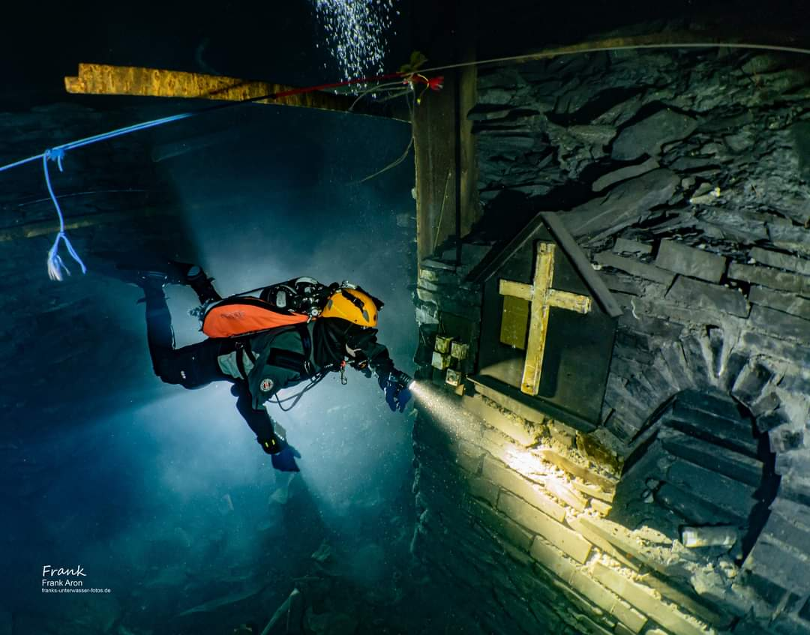
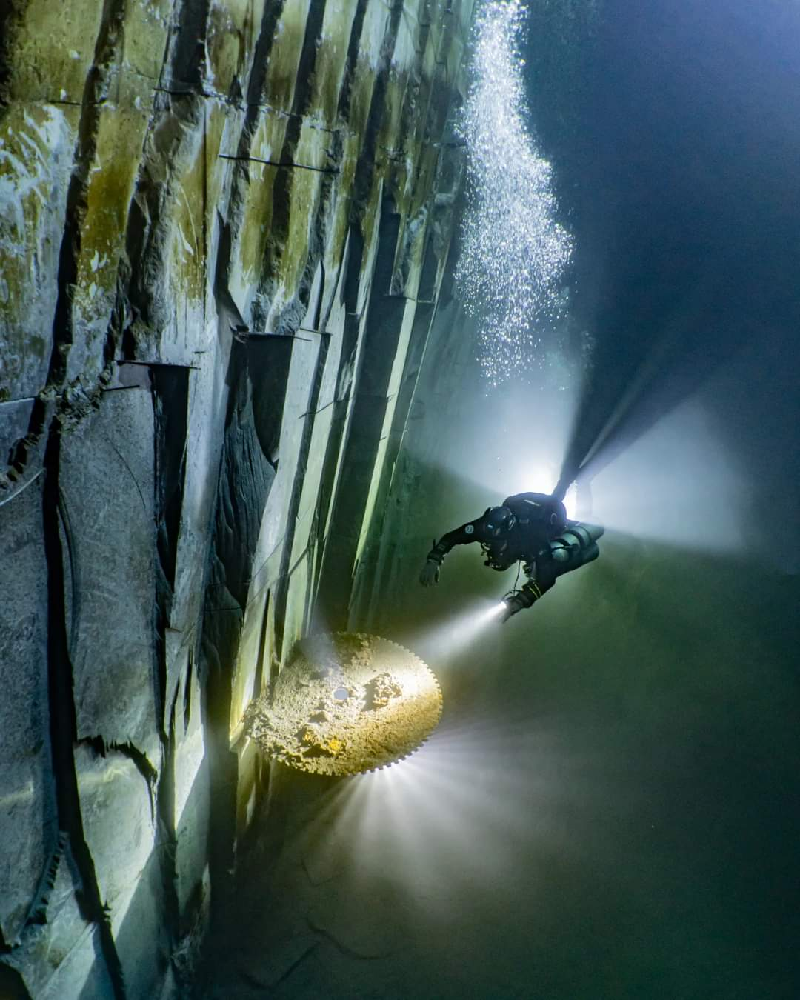
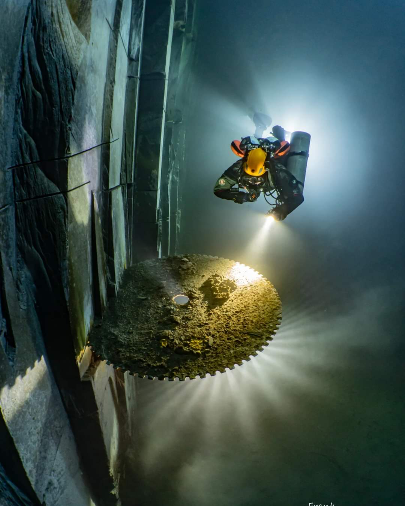
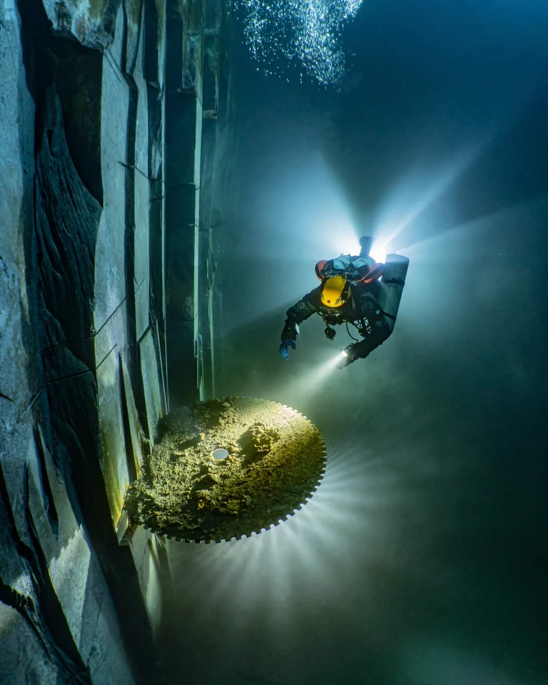
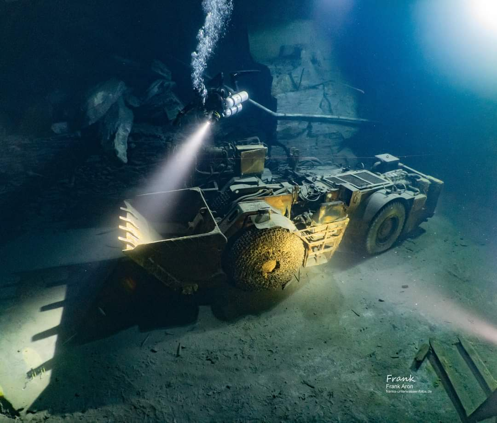
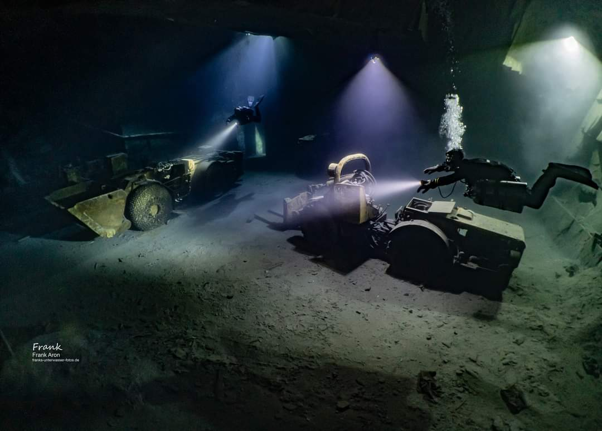

# About

https://www.bergwerktauchen-felicitas.de/

# Details

## Identification

- **Feature type:** Mine

## Cave and exploration data

- **Cave rating:** Cave
- **Highest cave rating:** Advanced
- **Vertical access:** No
- **Goes to water:** Yes

## Diving data

- **Water type:** Fresh
- **Tidal:** No

# References

## Images
- 
- 
- 
- 
- 
- 
