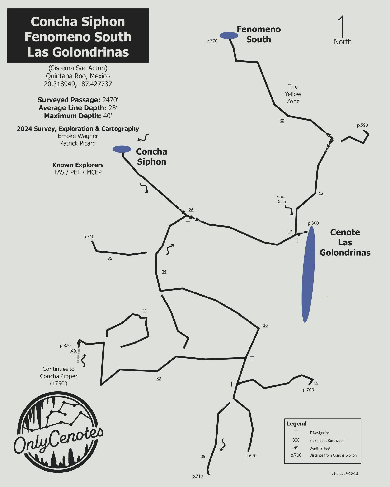

# Details

## Identification

- **Feature type:** Cave
- **System name:** Concha Siphon

## Cave and exploration data

- **Cave rating:** Cave
- **Highest cave rating:** Advanced
- **Goes to water:** Yes
- **Surveyed length:** 760 m

## Diving data

- **Maximum depth:** 13 m

# References

## Images
- 
