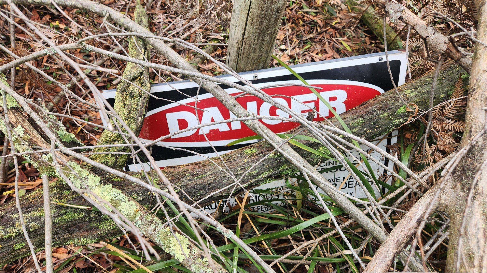
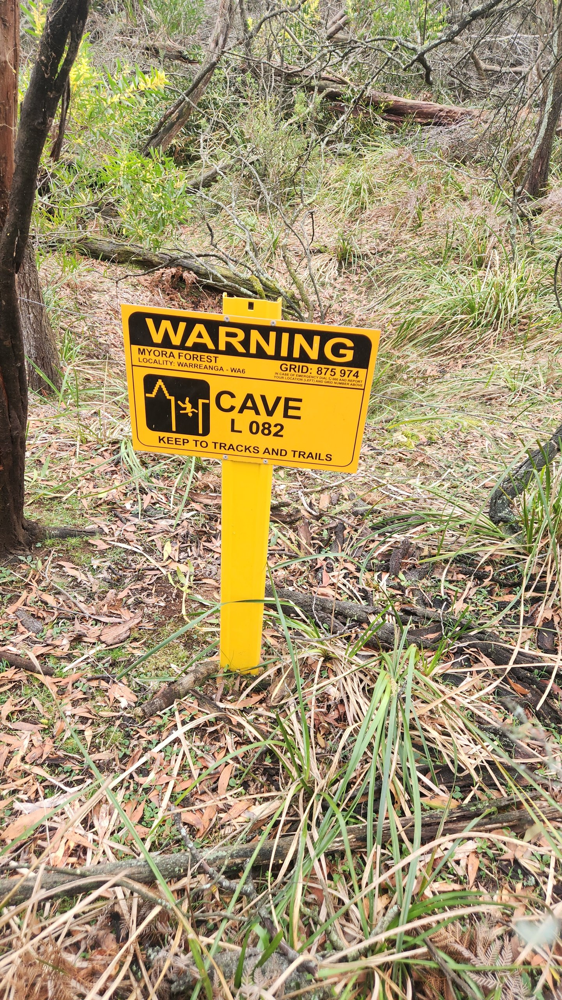
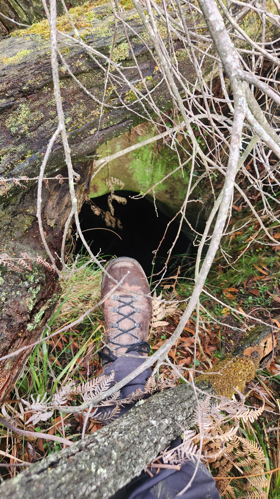
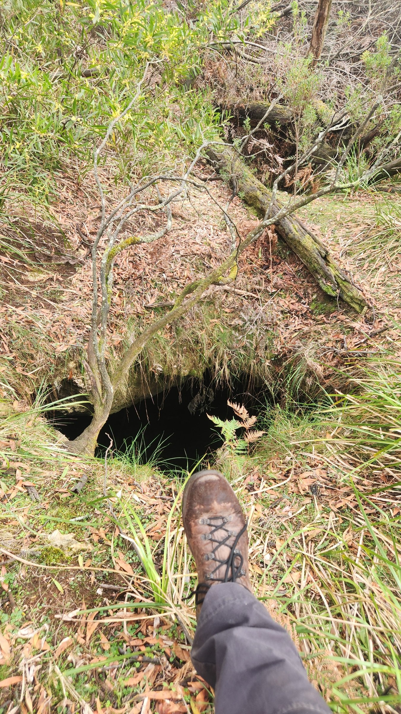
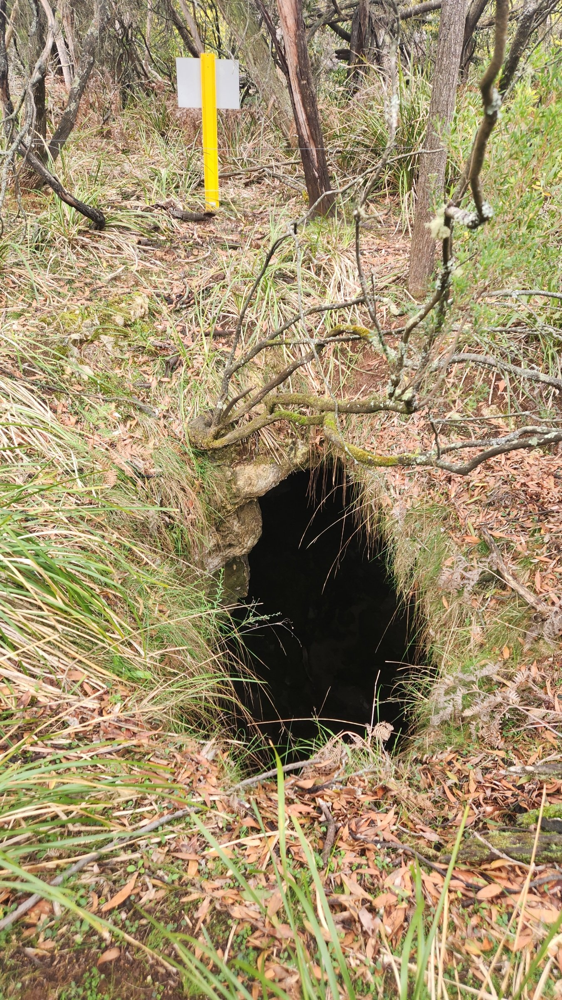

# Details

## Identification

- **Feature type:** Cave
- **Reference:** L0082
- **Source:** Forestry SA

## Cave and exploration data

- **Exploration potential:** High

## Access and warnings

Forestry

# References

- **LSECR:** Page 166
- **Forestry SA:** L0082, Thin Roof: N, Fence: R. Dimensions: 1m x 8m deep. Features: 2 small entrances near L64

## Images
- 
- 
- 
- 
- 
- 
- 
