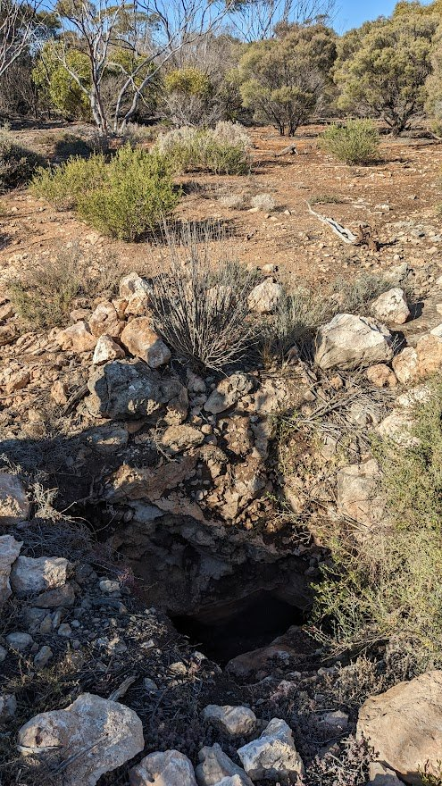
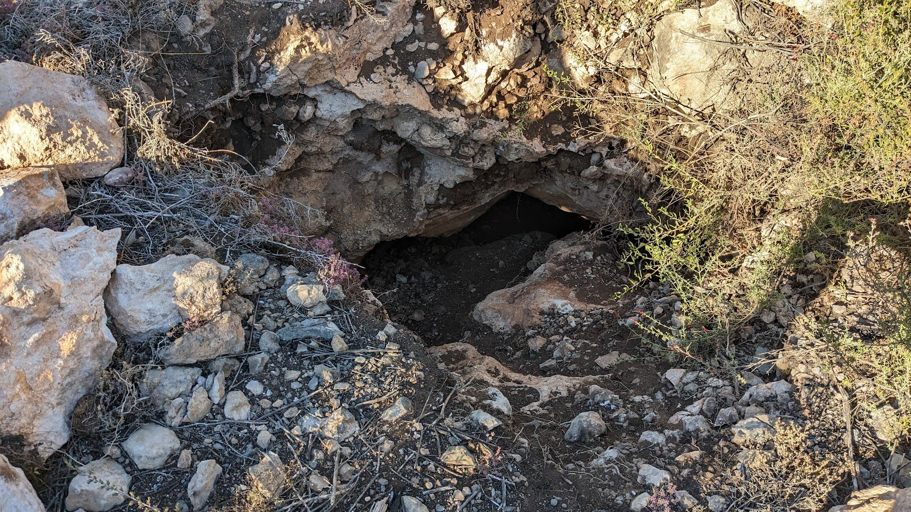

# About

BC and MW (27/5/2023). Goes to very shallow pool at end of hard dry entry. Needs considerable work to open up entry and path to pool, low probability of success.

# Details

## Identification

- **Feature type:** Cave
- **Source:** RK

## Cave and exploration data

- **Vertical access:** No
- **Exploration potential:** Medium
- **Goes to water:** Yes

# References

- **From RK:** Found and dug to cave 2022 by Ryan Kaczkowski. Large drain leads to water. Currently undoved. Needs some digging to slide into dive.

## Images
- 
- 
