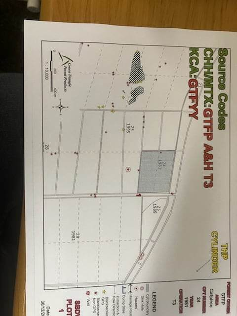
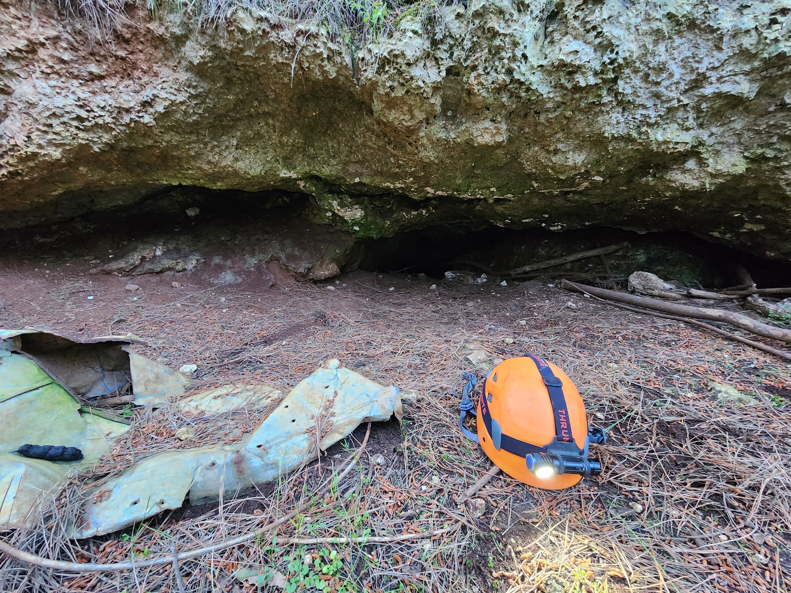
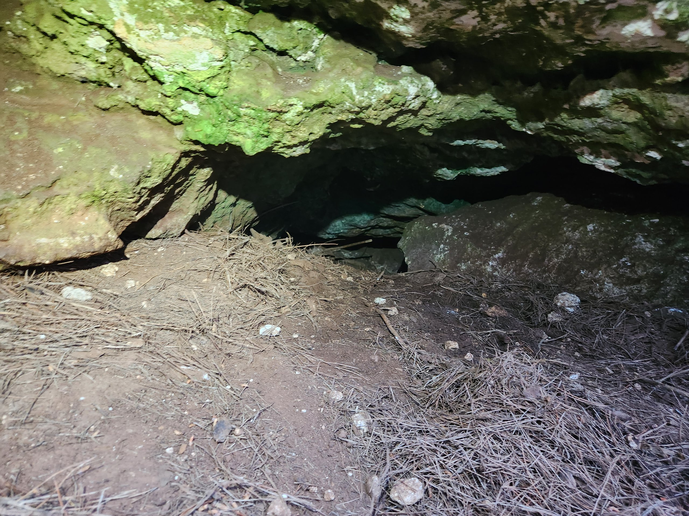
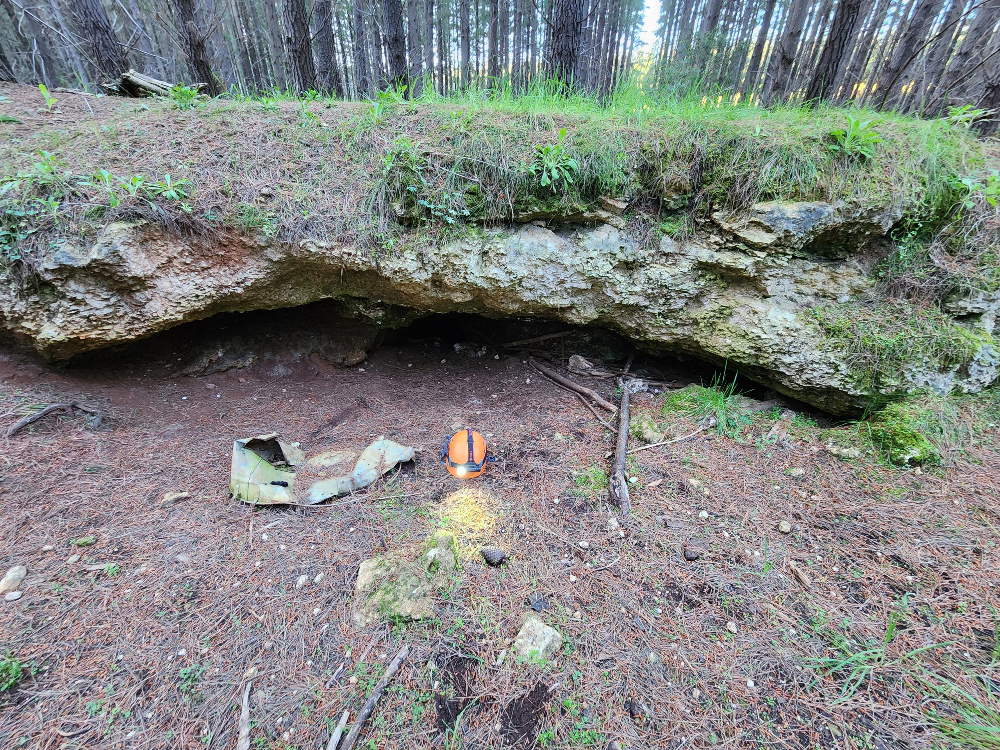

# About

From Col's List

BC 23/8/2023: Small crevice that had a hole just big enough to crawl through. Inside is 50cm high and 5m diameter cave with one potential lead that closes off.

# Details

## Identification

- **Feature type:** Cave

## Cave and exploration data

- **Vertical access:** No
- **Exploration potential:** Low

# References

## Images
- 
- 
- 
- 
