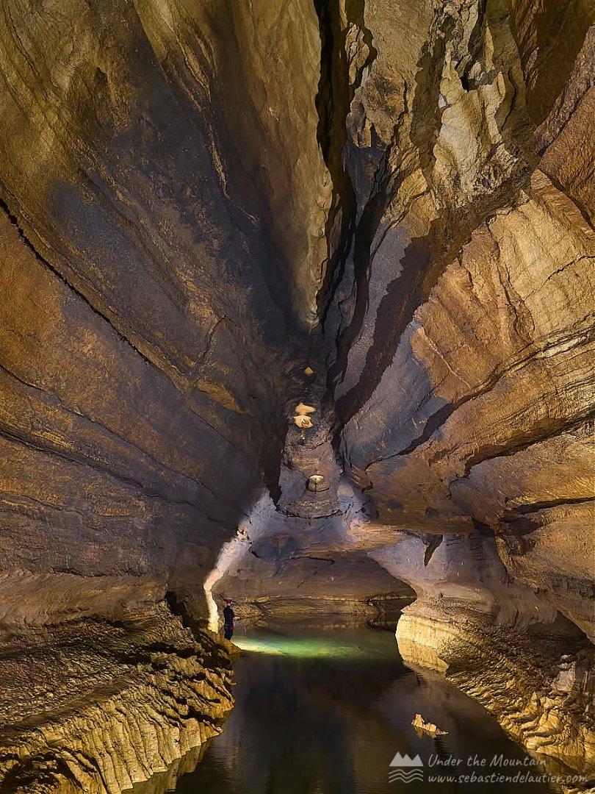
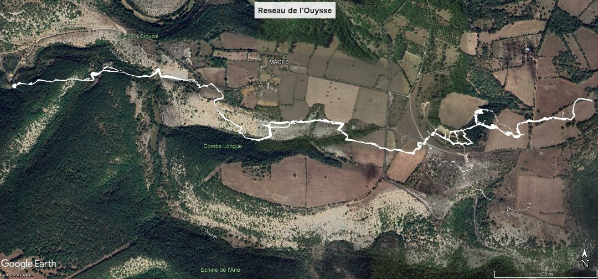
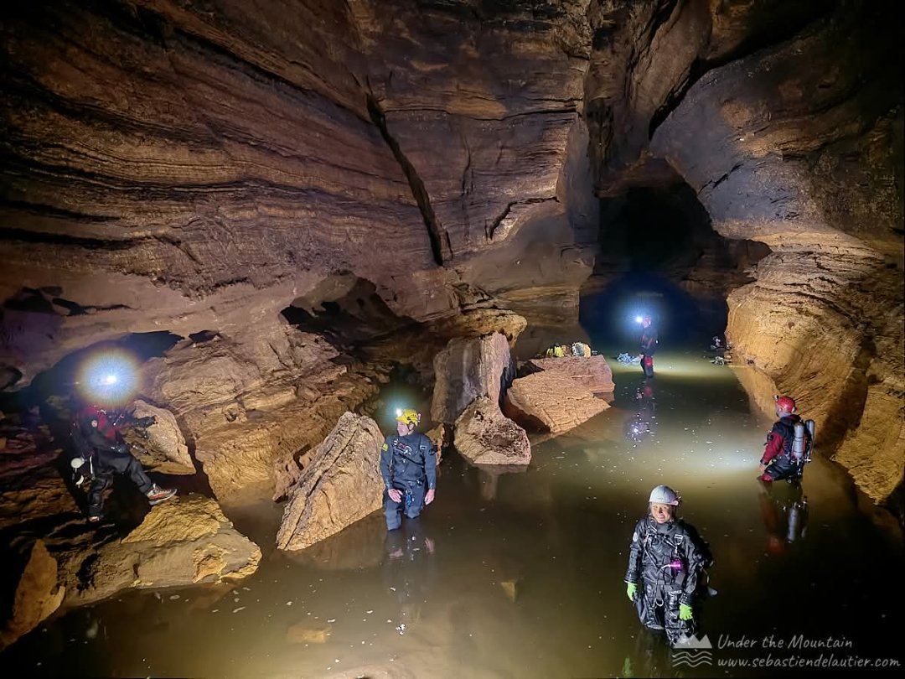
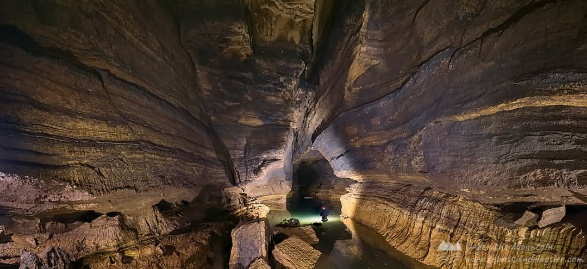

# Details

## Identification

- **Feature type:** Cave
- **System name:** Reseau de l’Ouysse

## Cave and exploration data

- **Goes to water:** Yes

## Diving data

- **Water type:** Fresh
- **Tidal:** No

# Maps

- [Reseau_de_lOuysse_plan - 93ff622f-b795a806](https://github.com/twosharprocks/Karst-Database/blob/d6f539534154fcd23f60d0a25899bf7ef553f1d8/Assets/20c70521653979f0e86d3ebf74b477bc9c0d2a31cc77eca278b6a2d2ea39c528.kml)

# References

- **Facebook Reel:** https://www.facebook.com/watch?v=1137171934990124
- **Hidden River Project:** https://thehiddenriverproject.org/
- **Facebook Reel:** https://www.facebook.com/watch?v=1793671011259527

## Images
- 
- 
- 
- 
- [Reseau_de_lOuysse - 80505cba-b795a806](https://github.com/twosharprocks/Karst-Database/blob/d6f539534154fcd23f60d0a25899bf7ef553f1d8/Assets/91819263c36d692ee78d2e83072432343619a59cf83fed46811e63262123b0fb.pdf)
- [DiveSAGA](https://www.youtube.com/watch?v=eEvmgP7Q5HM)
