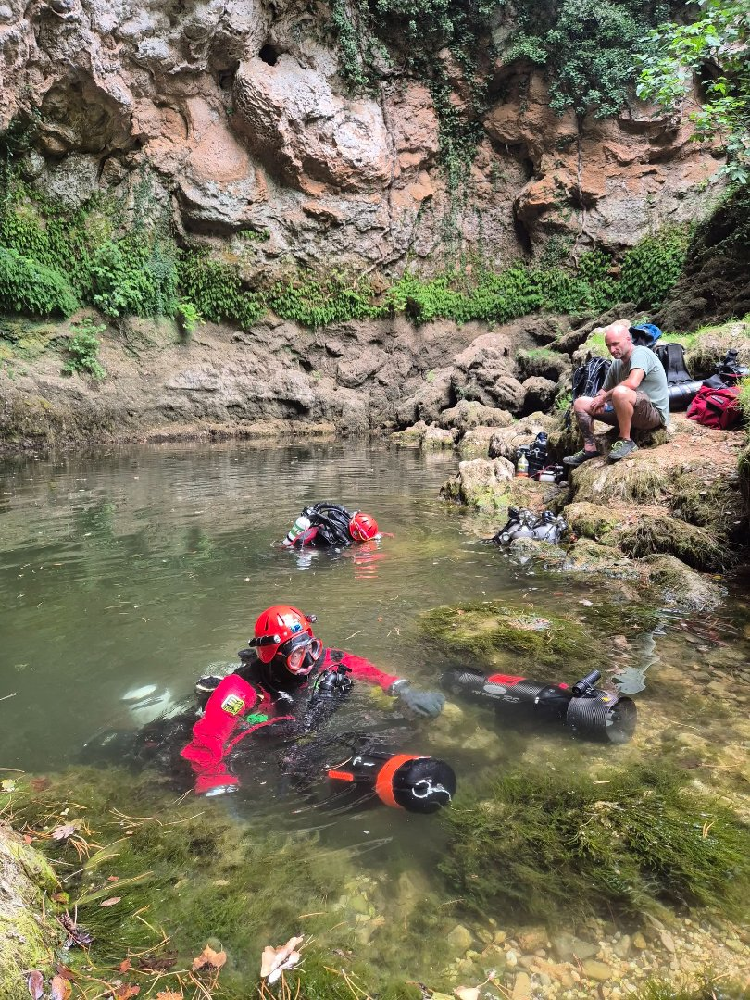
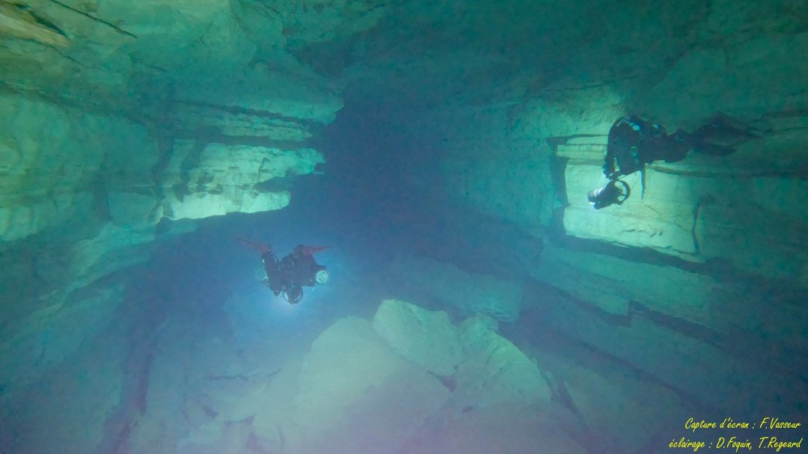

# Details

## Identification

- **Feature type:** Cave

## Cave and exploration data

- **Goes to water:** Yes

## Diving data

- **Water type:** Fresh
- **Tidal:** No

# References

## Images
- 
- 
