# References

## Images
- 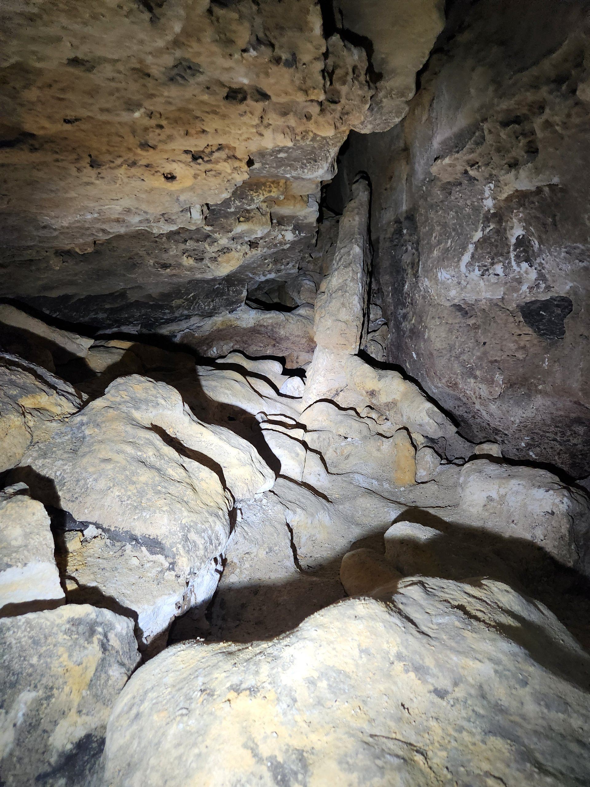
- 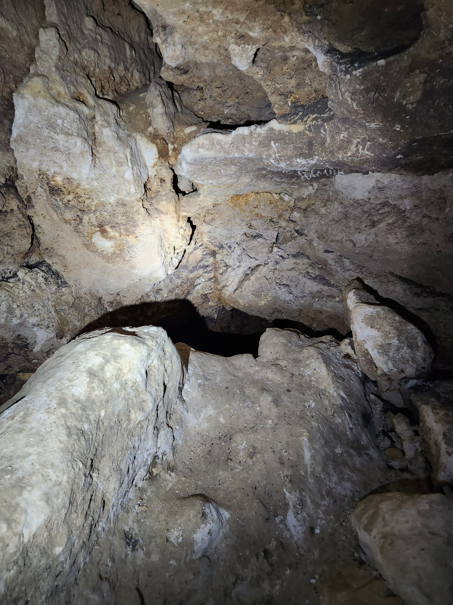
- 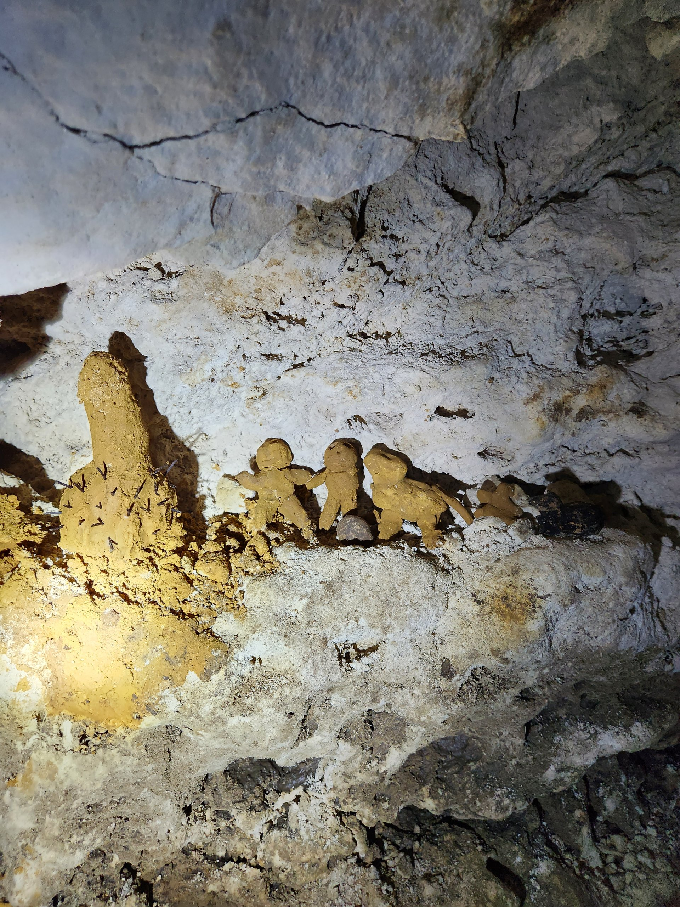
- 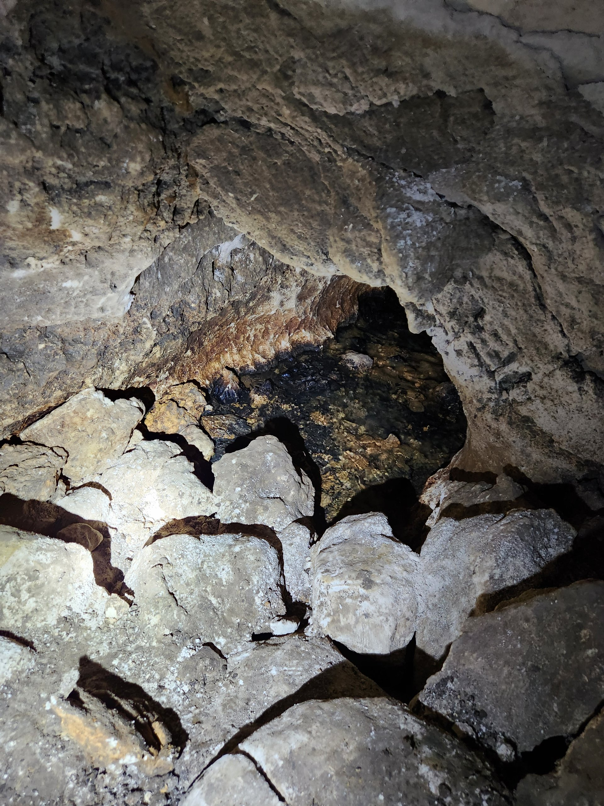
- 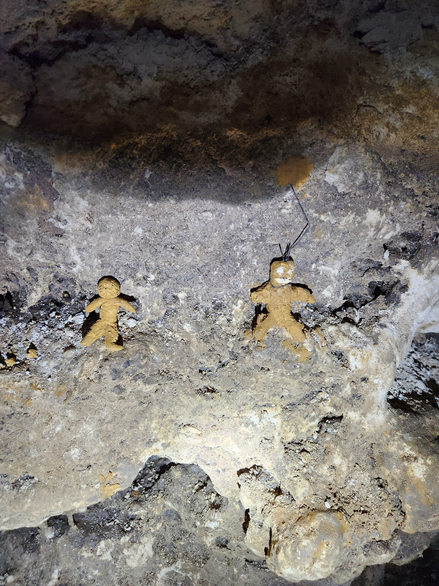
- 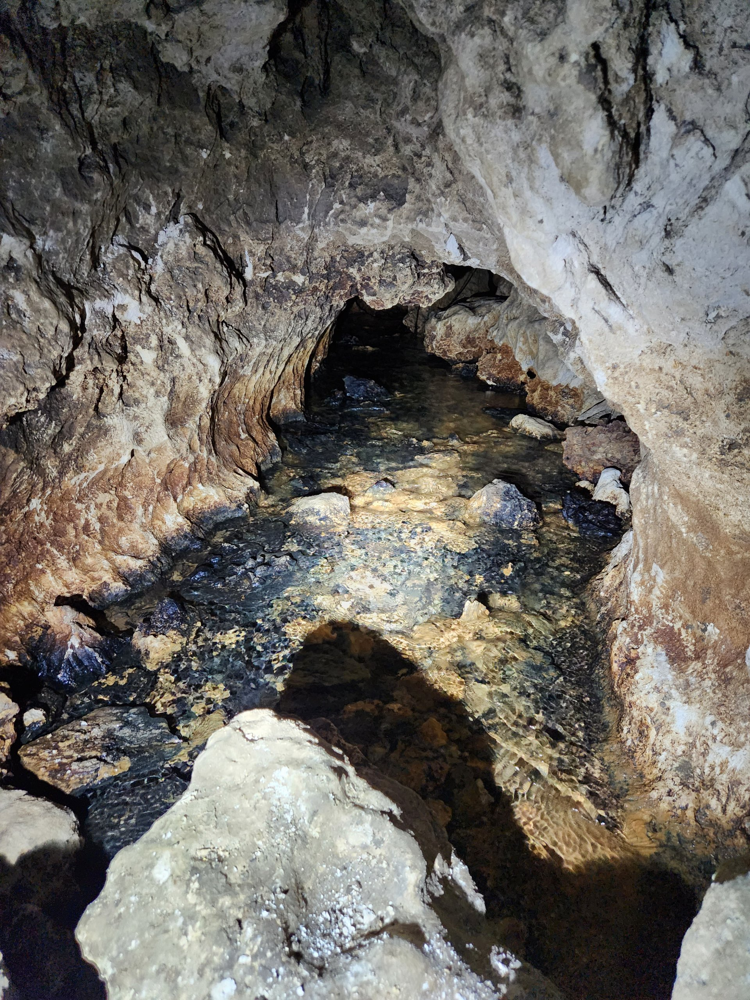
- 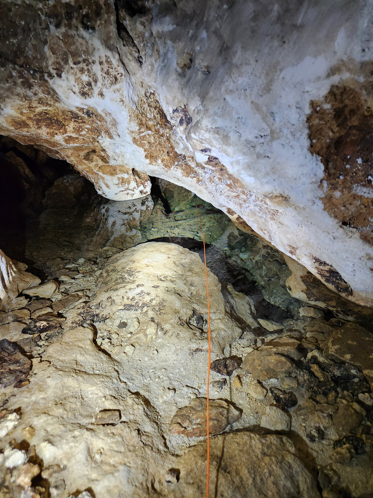
- 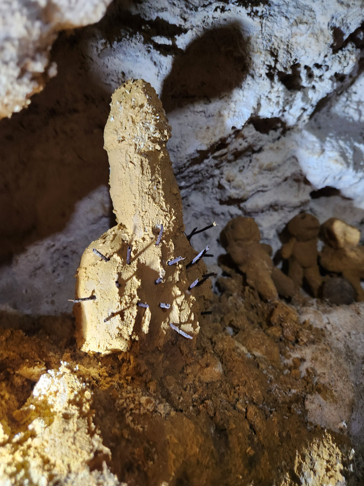
- 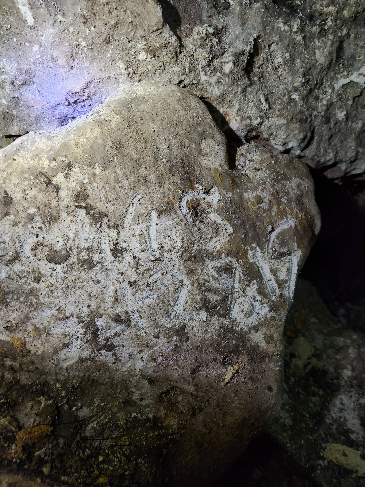
- 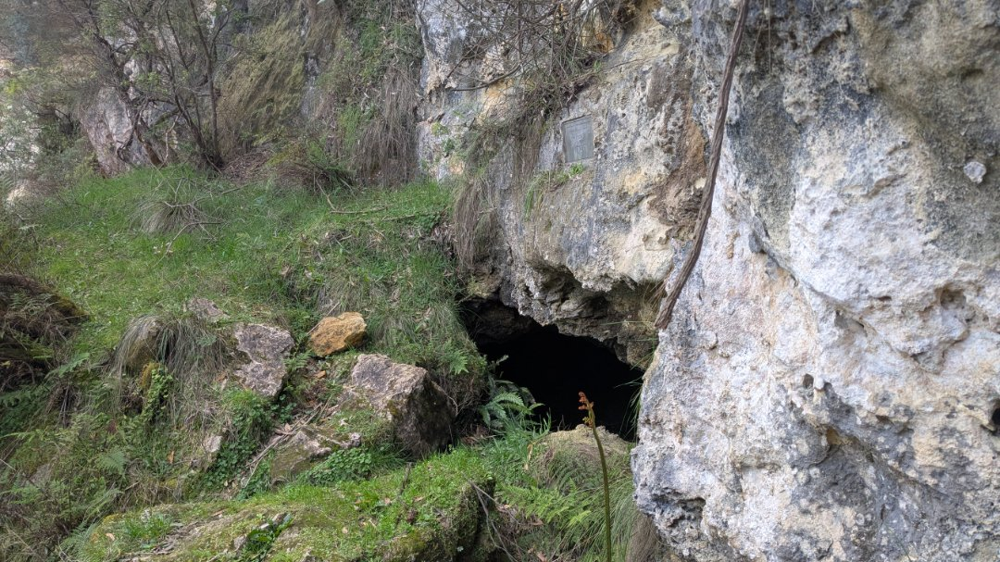
- 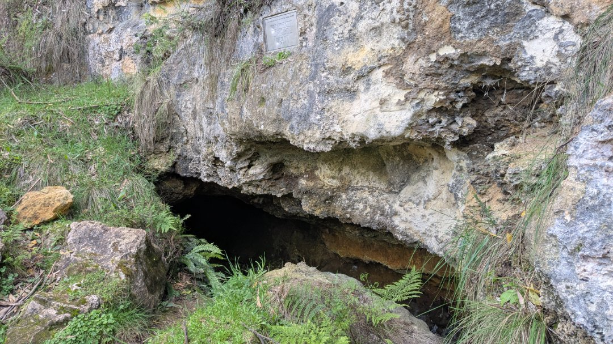

# Details

## Identification

- **Feature type:** Cave
- **Source:** G-14

## Cave and exploration data

- **Cave rating:** Advanced
- **Vertical access:** No
- **Exploration potential:** Medium
- **Tourism potential:** Low
- **Goes to water:** Yes

## Diving data

- **Water type:** Fresh
- **Tidal:** No
- **Difficulty:** VeryHard
- **Entry difficulty:** VeryHard

## Access and warnings

Permit required

## Amenities

- **hasShowers:** No
- **hasToilets:** Yes
- **hasPhone:** Yes
- **family:** Good
- **parking:** Good
