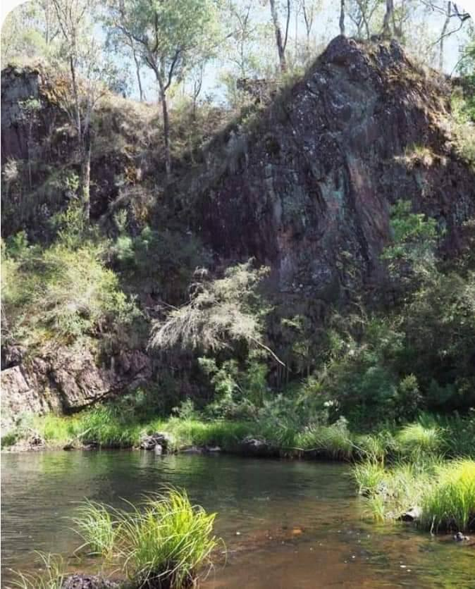
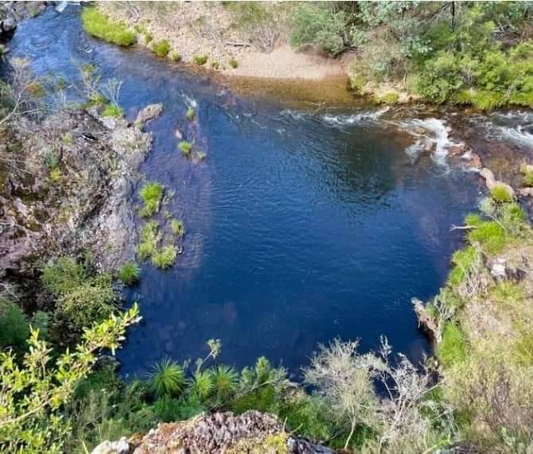
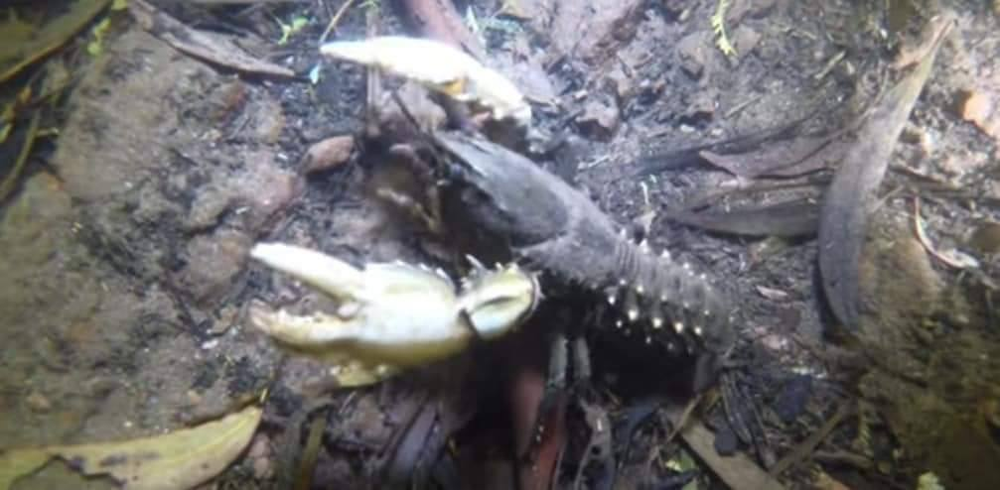
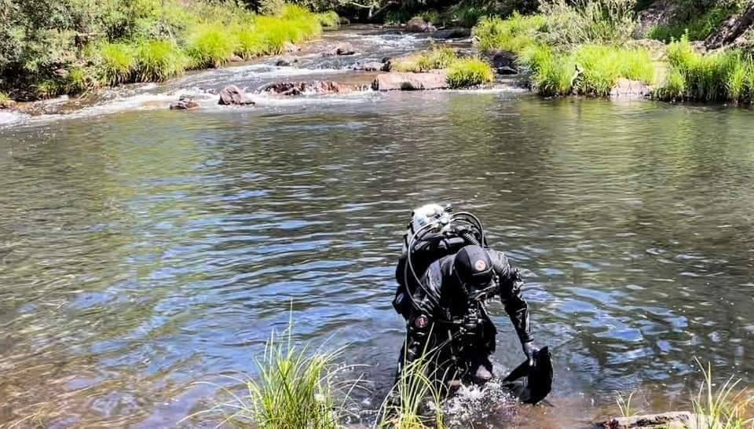

# Details

## Identification

- **Feature type:** Sinkhole
- **System name:** [Jamieson River]()
- **Source:** Facebook

## Cave and exploration data

- **Vertical access:** No
- **Tourism potential:** Low
- **Goes to water:** Yes

## Diving data

- **Maximum depth:** 4 m
- **Water type:** Fresh
- **Tidal:** No

## Amenities

- **hasShowers:** No
- **hasToilets:** No

# References

- **Facebook - Friends of Deep Creeks (Vic):** https://www.facebook.com/FriendsOfDeepCreek/posts/pfbid02qNps8DCM4RTgiiWHkohx8rLUaUu2kDcvV5hZosrVekdb1tATrk4pLALbgHUow9RXl

## Images
- 
- 
- 
- 
