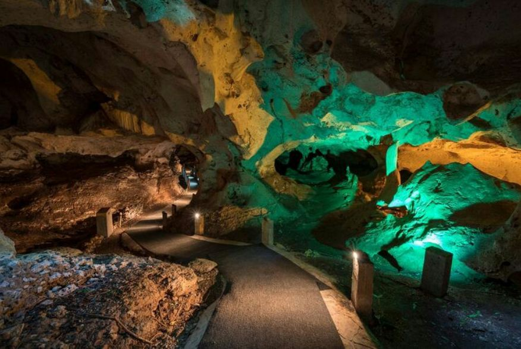
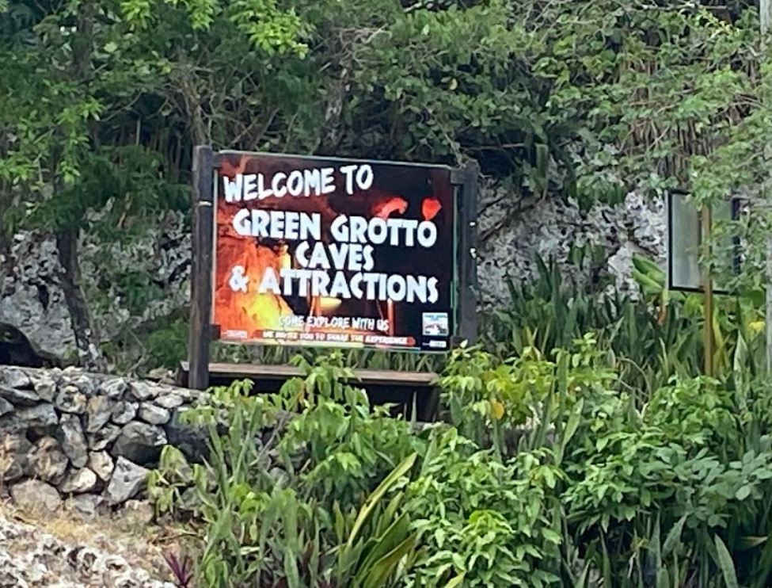

# Details

## Identification

- **Feature type:** Cave

## Cave and exploration data

- **Vertical access:** No
- **Goes to water:** Yes

# References

## Images
- 
- 

- [Jamaica]()

# Notes

- [Satellite of Green Grotto Caves](https://www.facebook.com/photo?fbid=1305137437284710&set=pcb.10160839007363639)
