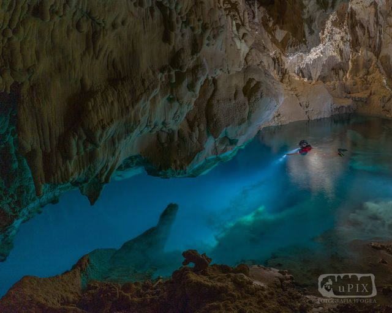
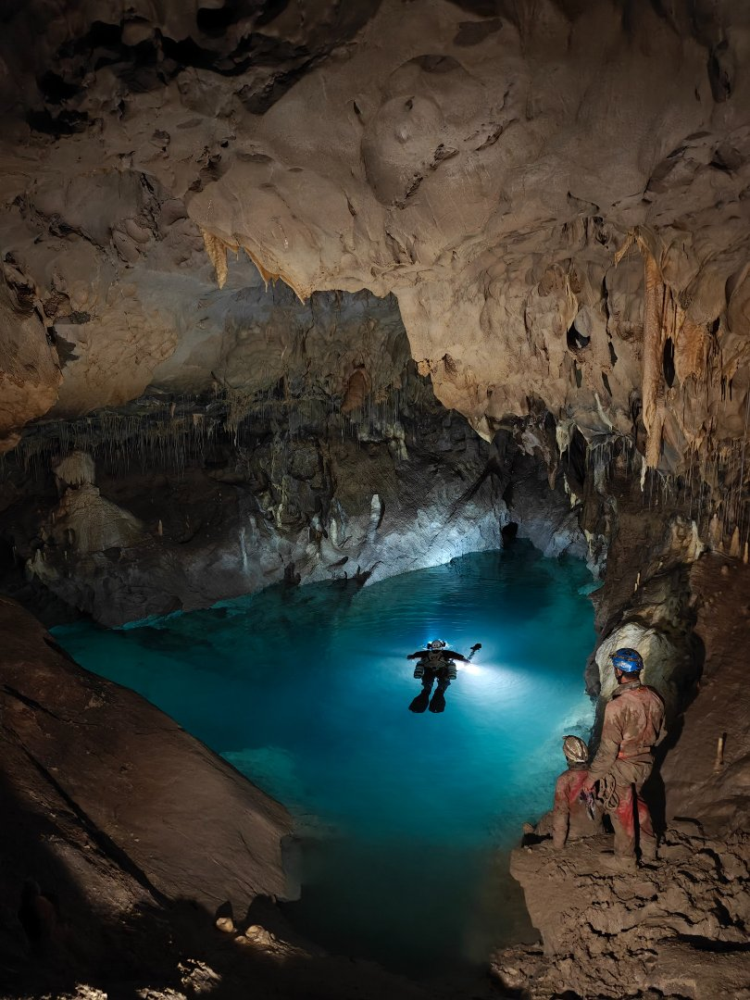
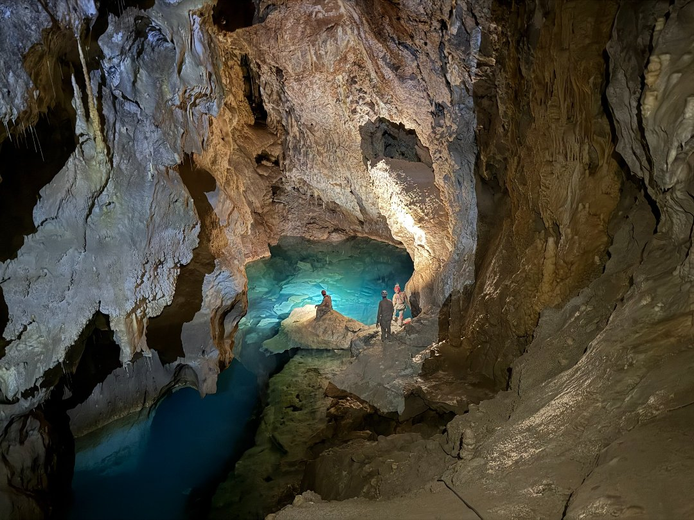
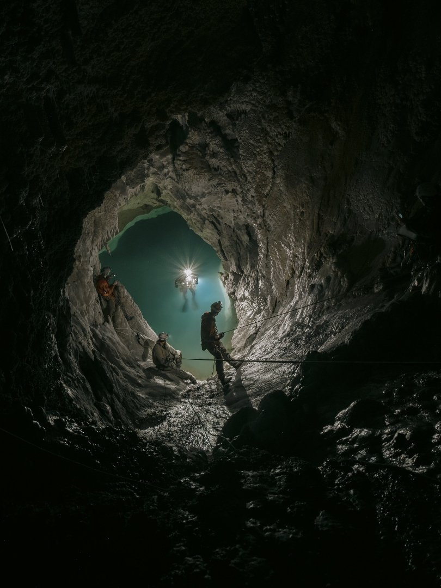
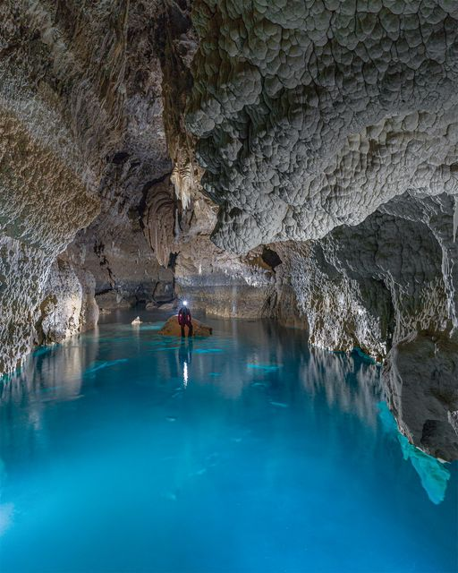
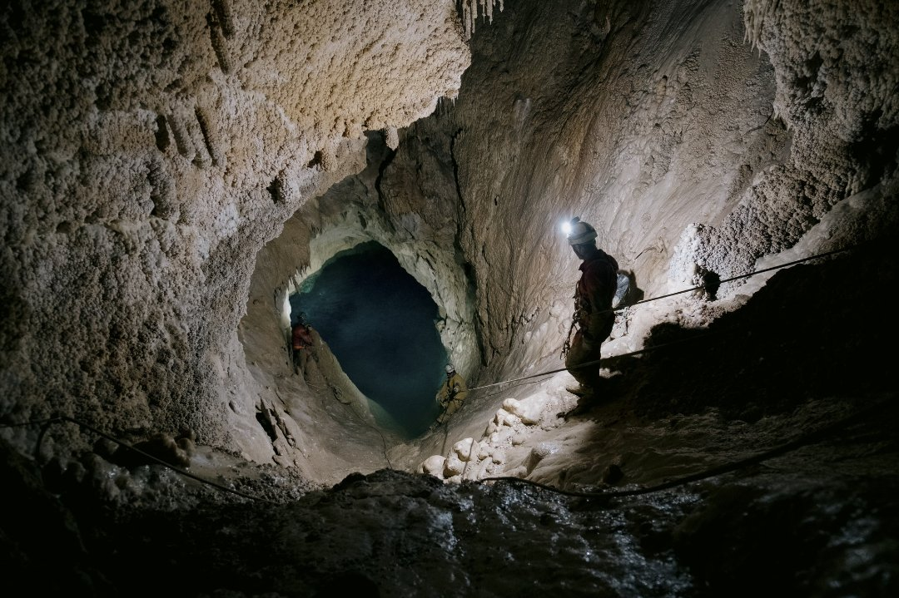

# Details

## Identification

- **Feature type:** Cave
- **System name:** Vento-Fiume
- **Source:** https://www.facebook.com/groups/caversgroup/permalink/10160143393673639/

## Cave and exploration data

- **Goes to water:** Yes

## Diving data

- **Water type:** Salt
- **Tidal:** Yes

# References

- **Facebook:** https://www.facebook.com/groups/caversgroup/permalink/10160143393673639/
https://www.facebook.com/groups/795192310689730/permalink/2350149415194004/

## Images
- 
- 
- 
- 
- 
- 
