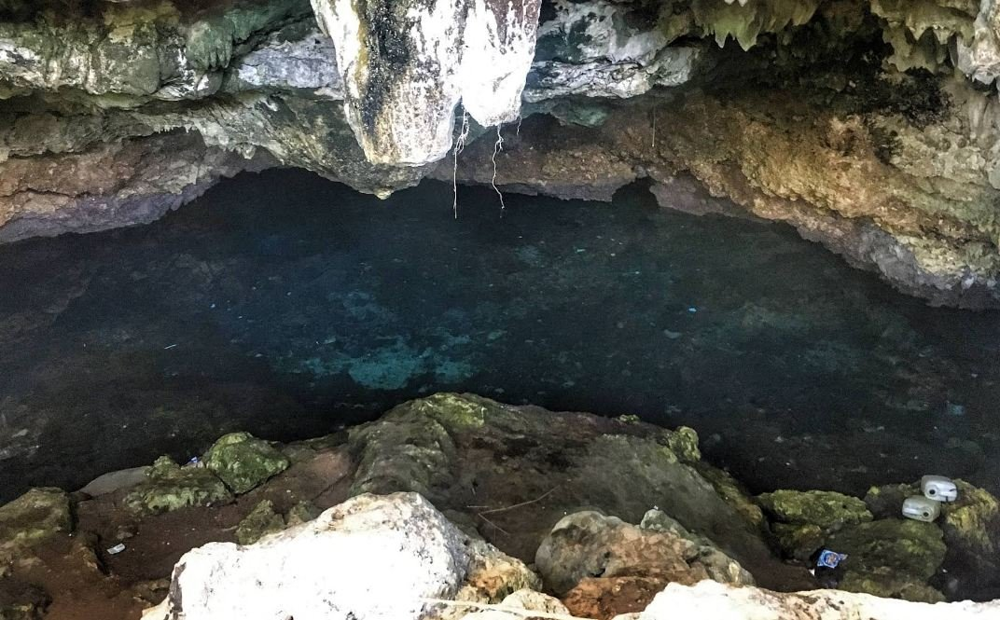
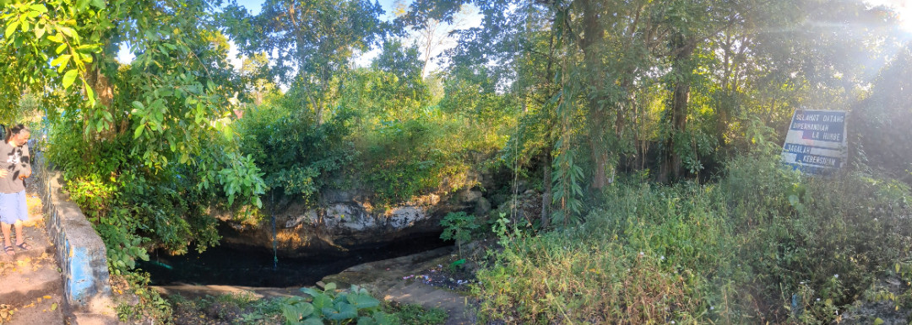
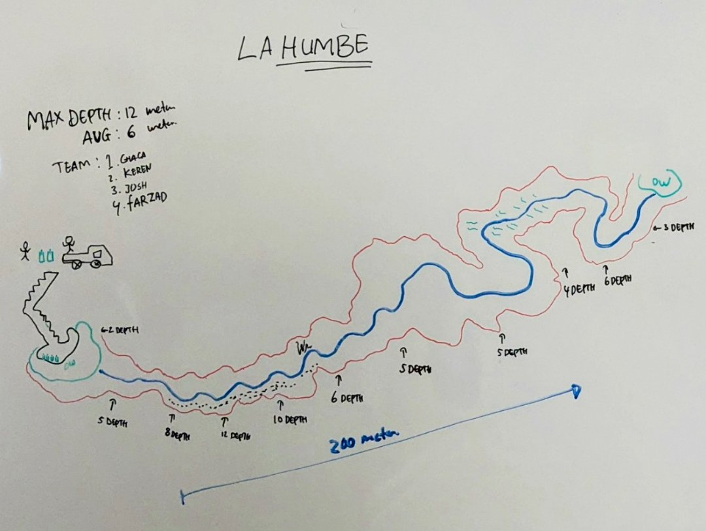

# References

## Images
- 
- 
- 
- [d84108a1-b66e-4954-ac71-49717e77f8bd](https://www.youtube.com/watch?v=AFCt3rVyWgo)

# Details

## Identification

- **Feature type:** Cave

## Cave and exploration data

- **Cave rating:** Cave
- **Highest cave rating:** Advanced
- **Vertical access:** No
- **Exploration potential:** Medium
- **Tourism potential:** Medium
- **Disabled access potential:** Low
- **Goes to water:** Yes

## Diving data

- **Maximum depth:** 14 m
- **Water type:** Fresh
- **Tidal:** No
- **Temperature:** 26–26 °C
- **Difficulty:** Intermediate
- **Entry difficulty:** Easy
- **Entry type:** Shore

## Amenities

- **hasShowers:** No
- **hasToilets:** No
- **hasPhone:** Yes
- **food:** Ok
- **family:** Good
- **parking:** Good
