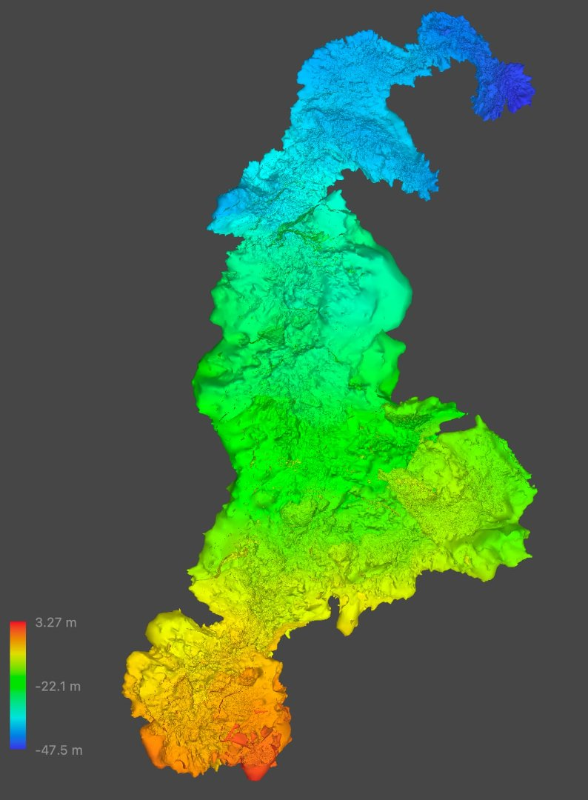
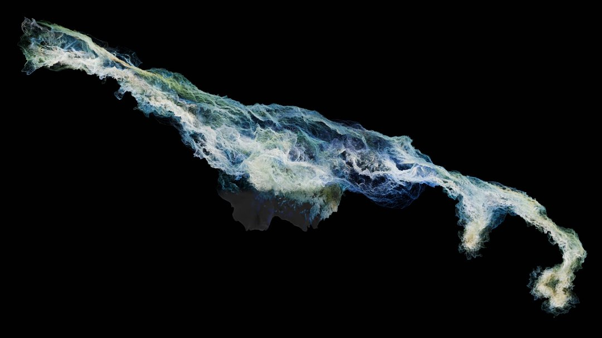
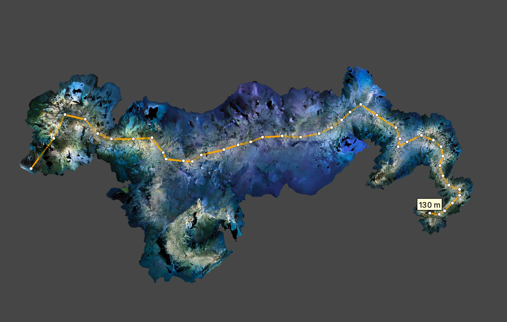
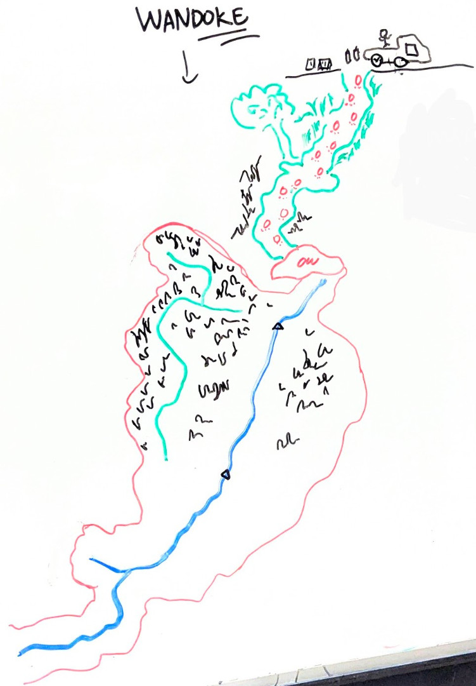

# About

## About

Max depth 49m

# References

## Images
- 
- 
- 
- 

## Images
- [1c81926f-1d9a-4930-a8b5-e691b28210ed](https://www.youtube.com/watch?v=EqhqfPo_J80)

# Details

## Identification

- **Feature type:** Cave

## Cave and exploration data

- **Cave rating:** Cave
- **Highest cave rating:** Advanced
- **Vertical access:** No
- **Exploration potential:** Medium
- **Tourism potential:** Low
- **Goes to water:** Yes
- **Surveyed length:** 130 m

## Diving data

- **Maximum depth:** 48 m
- **Water type:** Salt
- **Tidal:** No
- **Temperature:** 24–25 °C
- **Difficulty:** Intermediate
- **Entry difficulty:** Intermediate
- **Entry type:** Shore

## Amenities

- **hasShowers:** No
- **hasToilets:** No
- **hasPhone:** Yes
- **parking:** Terrible
